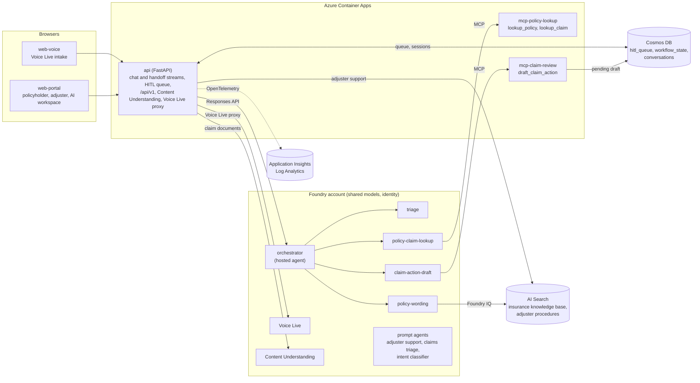

# Northwind Insurance Copilot

An end-to-end, production-shaped demo of **Azure AI Foundry** on a fictional
personal-auto insurer (Washington and Colorado). A policyholder reports a loss by
voice or chat, a claims-concierge orchestrator coordinates four hosted specialist
agents, and **a person approves or rejects the drafted claim action**. All
policyholders, policies, claims and policy wording are synthetic.

> **Agents only draft.** No agent or tool can approve or deny a claim, decide
> coverage, execute a settlement, issue a payment or change an external system.
> Drafts (`request_evidence`, `assign_adjuster`, `customer_update`,
> `escalate_review`, `settlement_recommendation`) wait in a human-review queue, and
> a reviewer's approval applies to the draft only; nothing is executed afterwards.

## The four departments

One shared Foundry AI Services account hosts one project per department: model
deployments, identity and observability are shared; agents, connections and
evaluators are per project. The manifest is
[`data/northwind/company.yaml`](./data/northwind/company.yaml); the Foundry project
names in it are the live deployment's names. See
[`docs/departments.md`](./docs/departments.md).

| Department (slug) | Pillar | What it does | Portal tab |
| --- | --- | --- | --- |
| **Claims Concierge** (`claims-concierge`, flagship) | Multi-agent + human in the loop | Triage, policy and claim lookup, cited policy wording and a pending claim-action draft for human approval | Claims / Policies, Claims Concierge chat, Reviewed drafts, Approvals |
| **Adjuster Support** (`adjuster-support`) | Grounded retrieval (RAG) | Extractive, cited answers about adjuster claims-handling procedures; never a coverage or claim decision | Adjuster support |
| **Claims Document Intelligence** (`claims-documents`) | Content Understanding | Typed fields with confidence and source spans from FNOL reports, repair estimates, invoices and damage evidence (PDF, JPEG or PNG, up to 10 MiB); every extraction needs human review | Document Intelligence |
| **Policyholder Contact Center** (`contact-center`) | Voice Live | Intake with an editable summary and an explicit confirmation before the handoff to Claims Concierge (microphone intake runs in `web-voice`) | Policyholder Contact Center |

Foundry capabilities on display: **Voice Live** through a keyless WebSocket proxy,
**Content Understanding**, **Foundry Agent Service** hosted agents built with the
**Microsoft Agent Framework**, **Foundry IQ** knowledge bases on **Azure AI Search**
plus MCP tools, **Foundry Observability** with Application Insights, **evaluators, the
AI Red Team agent and the Prompt Optimizer** running in CI, and an opt-in **AI Gateway**
for models and MCP. The pitch is in [`docs/differentiators.md`](./docs/differentiators.md).

## Architecture at a glance



- **Front doors.** `web-portal` (public insurer site, policyholder and adjuster
  accounts, staff AI workspace) and `web-voice` (Voice Live intake) call the API.
  Chat and handoff stream newline-delimited JSON (`POST /insurance/chat`,
  `POST /handoff`).
- **Agents.** The API calls the hosted `northwind-insurance-orchestrator` through the
  Foundry Responses API. The orchestrator delegates to four hosted specialists, which
  use MCP tools and the Foundry IQ knowledge base. Every MCP call shows up in Foundry
  Observability as a first-class tool call.
- **Human in the loop.** `draft_claim_action` writes a `pending` item
  (`execution_status: not_executed`) to the Cosmos `hitl_queue` container. The
  Approvals tab lists it (`GET /hitl`) and posts the decision (`POST /hitl/decide`,
  `approve` or `reject`); Reviewed drafts reads `GET /hitl/resolved`.
- **Readiness gate.** Agent inference (`/insurance/chat`, `/handoff`, `/voice/session`,
  `POST /harness/runs`) returns an explicit 503 until `NORTHWIND_INSURANCE_AGENTS_READY=true`
  with a consistent orchestrator and project configuration; `GET /health` reports
  `insurance_agent_runtime_ready`. Records, drafts, the business API, Content
  Understanding and adjuster support do not depend on the agent fleet.
- **Optional gateways (off by default).** With `NORTHWIND_GATEWAY_URL` set, `API_URI` and
  the MCP URLs point at the `insurance` stack of API Management (`apim-northwind`);
  see [`docs/api-management.md`](./docs/api-management.md). The AI Gateway
  (`ai-gateway-northwind`) can front model inference and MCP tool servers; see
  [`docs/ai-gateway.md`](./docs/ai-gateway.md).
- **Telemetry.** OpenTelemetry spans go to Application Insights, stamped with
  `department` and `foundry_project`. `GET /traces/{sid}` feeds the portal's trace panel
  and cost HUD from the Log Analytics workspace.

## The five apps

`azure.yaml` declares five azd services. Each deploys into a Container App with a fixed
name (`resourceName`) in `AZURE_APPS_RESOURCE_GROUP`; `scripts/release-app.py` carries
the same service-to-app map for the release workflow.

| azd service | Source | Container App | What it is |
| --- | --- | --- | --- |
| `api` | `apps/api` | `ca-insurance-api` | FastAPI on port 8000: chat and handoff streams, human-review queue, department manifest, Content Understanding, adjuster support, Voice Live proxy, `/api/v1` business API, Copilot SDK harness, trace panel. The 59 HTTP operations are listed in the [generated route table](./infra/live/apim/specs/northwind-api.operations.md) |
| `mcp-policy-lookup` | `apps/mcp-policy-lookup` | `ca-insurance-lookup` | FastMCP server with the read-only tools `lookup_policy` and `lookup_claim` over the synthetic fixtures, returning versioned wording citations |
| `mcp-claim-review` | `apps/mcp-claim-review` | `ca-insurance-review` | FastMCP server with `draft_claim_action`, which queues a validated, pending-only draft in Cosmos DB |
| `web-portal` | `apps/web-portal` | `ca-insurance-portal` | React/Vite: public insurer site, signed-in account, staff AI workspace |
| `web-voice` | `apps/web-voice` | `ca-insurance-voice` | React/Vite: Voice Live intake with a confirmed handoff |

All five are defined with external ingress. The MCP servers do not authenticate callers by
default (a demo trade-off); with the opt-in `NORTHWIND_GATEWAY_AUTH_REQUIRED=true` the API
and both MCP servers accept only calls relayed by API Management.

## Agents

**Hosted agents** share one runtime, `agents/hosted` (Microsoft Agent Framework on the
Foundry Responses host), with the entrypoint `agents/orchestrator/main.py`; `AGENT_ROLE`
selects the role. The prompts in `agents/insurance/*.yaml` are the source of truth and
change only through a pull request.

| Role (`AGENT_ROLE`) | Foundry agent | Prompt | Tools and data |
| --- | --- | --- | --- |
| `orchestrator` | `northwind-insurance-orchestrator` | `agents/insurance/orchestrator.yaml` | Coordinates the four specialists as function tools and surfaces failures instead of inventing results |
| `triage` | `northwind-insurance-triage` | `agents/insurance/triage.yaml` | None; returns identifiers, intent, sentiment and urgency as JSON |
| `policy-claim-lookup` | `northwind-insurance-policy-claim-lookup` | `agents/insurance/policy_claim_lookup.yaml` | MCP `lookup_policy`, `lookup_claim` (`MCP_POLICY_LOOKUP_URL`) |
| `policy-wording` | `northwind-insurance-policy-wording` | `agents/insurance/policy_wording.yaml` | Foundry IQ knowledge base `northwind-insurance-kb` (index `northwind-insurance-knowledge`): cited, versioned, jurisdiction-aware wording |
| `claim-action-draft` | `northwind-insurance-claim-action-draft` | `agents/insurance/claim_action_draft.yaml` | MCP `draft_claim_action` (`MCP_CLAIM_REVIEW_URL`) |

**Prompt agents** come from the per-department prompts under
`data/northwind/departments/*/prompts/`. `scripts/create-prompt-agents.py` creates them in
their department projects on the `FOUNDRY_PROMPT_AGENT_DEPLOYMENT` model:

| Prompt agent | Department | Role |
| --- | --- | --- |
| `northwind-insurance-adjuster-support` | `adjuster-support` | Selects exact excerpts from retrieved adjuster procedures (`nw-insurance-adjuster-support`); the API applies the same prompt in its grounded-support route and validates each quote against the source before showing a cited answer |
| `northwind-claims-triage` | `claims-documents` | Reviews extracted claim-document facts and recommends a draft-only next step |
| `northwind-intent-classifier` | `contact-center` | Classifies a policyholder utterance (first notice of loss, claim status, escalation, ...) |

## Portal, business API and evidence

`web-portal` opens on a public insurer-branded site (home, coverage information, claims
help). After Microsoft Entra sign-in (MSAL authorization-code flow, tokens kept in
memory) the **server-assigned role** for the selected run decides what the account
shows: **policyholders** see their policies and claims and can report a loss;
**adjusters** work the claim queue (notes, tasks, assignment, case transitions, document
review); **presenters** are read-only. Adjusters and presenters also get an **AI
workspace** with the department workspaces from the table above. This experience is the
default build; `VITE_INSURANCE_BUSINESS_ENABLED=false` builds the department workspaces
on their own, without sign-in. The Agent Harness has no web UI.

The business API (`apps/api/app/business`, routes under `/api/v1`, off until
`NORTHWIND_BUSINESS_API_ENABLED=true`) is the only part of the API that verifies the
delegated Entra token (v2 RS256: signature, issuer, tenant, audience, expiry, scope
`access_as_user` and a permitted SPA client). Roles and customer access come from
persisted run mappings, never from browser personas, token role labels or
`X-MS-CLIENT-PRINCIPAL-*` headers; `X-Demo-Run` selects a run but grants nothing. Loss
reports need an `Idempotency-Key`, case commands carry `expected_version`, responses
carry ETags and correlation IDs, and errors have the shape
`{"error":{"code","message","correlation_id"}}`. A run is one ETag-protected aggregate
in the `workflow_state` container (at most 100 claims, 200 timeline events per claim and
1.5 MB). Date and jurisdiction mismatches are recorded review flags, not automatic
denials. The AI workspace routes (`/insurance/chat`, `/hitl`, `/voice/*`, `/claims/*`,
`/adjuster-support/*`, `/harness/*`) are **not** protected by that token: the portal sends
it, but the API does not verify it there. This is a synthetic demo, not a production
tenant-isolation solution.

Enable sign-in only after the identity design and participants are approved. The API
expects the v2 token's GUID audience (`INSURANCE_AUTH_AUDIENCE`); the browser requests
the full scope URI (`VITE_INSURANCE_AUTH_SCOPE`, for example
`api://<API-GUID>/access_as_user`). Both are application registration IDs, not the app's
managed identity.

```powershell
# Preview the Entra API and SPA registrations (offline; --apply with --journal <external .json> reconciles them)
python scripts\configure-insurance-identity.py --preview `
  --tenant-id "<tenant-uuid>" --deployment-id "<stable-uuid>" `
  --redirect-uri "https://ca-insurance-portal.<container-apps-domain>/" `
  --run-id northwind-demo --actors-json C:\secure\actors.json

# Preview, then (with --apply) create an isolated run in Cosmos DB; create-only, never overwrites
python scripts\seed-insurance-run.py --run-id northwind-demo --actors-json C:\secure\actors.json
```

The `--actors-json` file maps canonical `tenant-UUID:object-UUID` keys to
`{"role":"policyholder","policyholder_id":"PH-1001"}`, `{"role":"adjuster"}` or
`{"role":"presenter"}`; keep it outside source control. Vite settings are build-time
values: changing container variables does not alter a built frontend.

**Evidence (opt-in, off by default).** Claim documents (PDF, JPEG or PNG up to 10 MiB,
from a synthetic allowlist or an explicitly enabled upload path; at most 8 per run and 4
per claim) are stored as immutable private Blob objects; jobs and per-field reviews live
in the run aggregate. Content Understanding output is an untrusted suggestion: an
adjuster accepts, corrects or clears each field, and confirmation changes no claim
workflow or financial state. Processing runs in a separate bounded worker, never as an API
background task (`python -m app.business.evidence_worker --run-id <run> --once`, from
`apps\api`); it needs `NORTHWIND_CU_ENABLED` and an explicit run allowlist. The flags are
in [Configuration](#configuration-reference).

## Copilot SDK harness

An opt-in harness (`COPILOT_HARNESS_ENABLED=true`) runs the GitHub Copilot SDK
(`github-copilot-sdk==1.0.14`, runtime downloaded into the API image) inside the API
with four registered tools: `triage`, `policy_claim_lookup`, `policy_lookup` and
`claim_action_draft`. Shell and filesystem tools are rejected. Inference comes from
Foundry (or the AI Gateway when configured) with a managed-identity bearer token, so no
GitHub subscription or extra model key is needed. A draft stays **pending human
approval**; runs and events are kept for seven days in Cosmos DB. The API is
`/harness/status`, `POST /harness/runs` and `GET /harness/runs/{run_id}`. The harness is
scored by `data/golden/harness.jsonl` and red-teamed with `--agent copilot-sdk`; see
[`evals/README.md`](./evals/README.md#copilot-sdk-harness). Locally, use a clean virtual
environment (not one that holds the Agent Framework packages, which can pin an
incompatible SDK), install `apps\api\requirements.txt`, run
`python -m copilot download-runtime` and set `COPILOT_HARNESS_ENABLED=true`.

## Run locally

Nothing runs Foundry locally: the API uses your Azure sign-in (or the keys that
`scripts\fetch-keys.ps1` writes to a git-ignored `.env`) against the same Foundry,
Search, Cosmos DB and Storage as the deployment. Agent inference stays unavailable until
the readiness settings point at deployed agents.

```powershell
python -m venv .venv; .\.venv\Scripts\Activate.ps1
pip install -r apps\api\requirements.txt
.\scripts\dev-api.ps1                            # http://127.0.0.1:8001 (scripts/dev-api.sh from bash)

cd apps\web-portal; npm install
$env:VITE_API_BASE_URL = "http://127.0.0.1:8001"
$env:VITE_INSURANCE_BUSINESS_ENABLED = "false"   # department workspace without Entra sign-in
npm run dev                                       # http://localhost:5173
```

`apps\web-voice` runs the same way on port 5174. `docker compose up --build` starts the
API (:8000) and both SPAs (:5173, :5174); it needs a repo-root `.env` because the
containers do not inherit your Azure CLI login. Cosmos DB has public access disabled in
the Bicep, so from a laptop the Cosmos-backed routes (approvals, sessions, harness runs,
voice tickets, `/api/v1`) answer 503 unless `COSMOS_ENDPOINT` points at an account you can
reach; to exercise them, point `VITE_API_BASE_URL` at a deployed API. Details, the checks
CI runs and gotchas: [`docs/local-dev.md`](./docs/local-dev.md).

## Deploy

### What `azd` does

`azure.yaml` (`name: northwind-copilot`) sets `docker.remoteBuild: true` for all five
services and these hooks:

| Hook | Runs |
| --- | --- |
| `preprovision`, `predeploy` | `python ./scripts/validate-reuse.py`: validates the azd environment (see reuse mode); no Azure calls, no writes |
| `prepackage` (`api`) | stages `data/northwind` into the API build context, then runs `scripts/bundle-insurance-assets.py --service api` and `scripts/bundle-harness-assets.py` |
| `prepackage` (`mcp-*`) | `scripts/bundle-insurance-assets.py --service <service>` |
| `prepackage` (`web-*`) | defaults `VITE_API_BASE_URL` to `API_URI`, then `npm install` and `npm run build` |

There is no hook after provisioning: provisioning never seeds data, creates agents or
changes network access. Those steps are explicit scripts, dry run first.

### Fresh environment

```powershell
pip install -r data\seed\requirements.txt
python data\seed\generate.py --domain insurance   # synthetic PDFs that the API image bundles (git-ignored output)
azd auth login
azd up                                            # NORTHWIND_REUSE_EXISTING_RESOURCES unset or false
```

The generator step is a prerequisite because `scripts/bundle-insurance-assets.py --service api`
(the API `prepackage` hook) reads four of those PDFs; CI and the app release workflow
generate them the same way.

`azd up` provisions `infra/main.bicep` at subscription scope into a resource group
`rg-<env>` (observability, a user-assigned identity, the container registry, a VNet,
Storage, AI Search, Cosmos DB with a private endpoint, the Foundry account with its four
projects and model deployments, the Container Apps environment and the five apps), then
builds and deploys the five services. Resource names derive from a fixed token
(`zurlo-northwind`), so globally unique names such as the registry, the Storage account
and the Foundry custom domain must be free.

It does **not** publish knowledge, create agents or configure identity. Run these
explicitly after dot-sourcing `. .\scripts\load-azd-env.ps1` (loads the azd values into the
session):

```powershell
python scripts\publish-insurance-knowledge.py --connect-project   # 13 synthetic documents; dry run, add --apply to write
python scripts\publish-adjuster-support.py                         # 4 adjuster procedures; dry run, add --apply
python scripts\create-department-indexes.py                        # nw-claims and nw-contact-center indexes
python scripts\create-knowledge-base.py
python scripts\connect-knowledge-base.py
python scripts\create-prompt-agents.py --dry-run                   # then without --dry-run
python scripts\configure-insurance-cu.py                           # preview; --apply registers analyzer northwindInsuranceClaimsV1
```

Then deploy the five hosted agents (see [Hosted agents](#hosted-agents)) and, only after
verifying every specialist, set `NORTHWIND_INSURANCE_AGENTS_READY=true` and
`FOUNDRY_INSURANCE_ORCHESTRATOR_AGENT_ID` to enable agent inference. Several scripts (the
publish, Content Understanding, release, OIDC, gateway and API Management scripts) carry
the live subscription, tenant and resource names as constants at the top of each file;
adapt them before targeting another subscription.

### Existing deployment: reuse mode

The live deployment is split across resource groups and is released in place.
`NORTHWIND_REUSE_EXISTING_RESOURCES=true` turns `azd provision` into a **reference-only**
adoption: every resource module in `infra/main.bicep` is skipped, and
`infra/modules/existing-resources.bicep` only reads the existing resources and emits the
outputs below. It creates or changes no resource, role assignment, model deployment,
connection, network setting, app setting or image, and reports the account's effective
default project (`FOUNDRY_DEFAULT_PROJECT`) without changing it. Never run the default
greenfield path against the live deployment. Group selectors only choose where to look;
they never move a resource.

`scripts/validate-reuse.py` fails the hook when:

- `NORTHWIND_REUSE_EXISTING_RESOURCES` or `NORTHWIND_INSURANCE_AGENTS_READY` is not
  exactly `true` or `false`;
- readiness is `true` while `HOSTED_AGENTS_ENABLED` is not `true`, or without a
  `FOUNDRY_INSURANCE_ORCHESTRATOR_AGENT_ID` that starts with `northwind-insurance-`, or
  without a project endpoint for the selected project;
- `NORTHWIND_GATEWAY_URL` is not a bare `https://<name>.azure-api.net` origin, or
  `NORTHWIND_GATEWAY_STACK` is not `insurance`;
- in reuse mode, a required value below is missing or blank, the two project endpoints
  differ, `AZURE_AI_PROJECT_ID` does not match the subscription, Foundry group, account
  and `INSURANCE_PROJECT_NAME`, or `FOUNDRY_PROJECT_ENDPOINTS` lacks one of the four
  department endpoints;
- `AI_GATEWAY_REQUIRED` is enabled without an `AGENT_MODEL_GATEWAY_ENDPOINT` ending in
  `/openai/v1/` and gateway model aliases in `AGENT_GATEWAY_MANAGER_MODEL` and
  `AGENT_GATEWAY_SPECIALIST_MODEL`, or `AI_GATEWAY_MCP_REQUIRED` is enabled without a
  valid `AGENT_MCP_GATEWAY`.

```powershell
azd env set NORTHWIND_REUSE_EXISTING_RESOURCES true   # and the keys below
azd provision                                         # validates, then only reads the existing resources
```

| Key | Value or rule |
| --- | --- |
| `NORTHWIND_REUSE_EXISTING_RESOURCES` | `true` (exact lowercase string) |
| `AZURE_SUBSCRIPTION_ID` | The subscription GUID of the live deployment |
| `AZURE_RESOURCE_GROUP` | Must equal `AZURE_FOUNDRY_RESOURCE_GROUP`: the group of the Foundry project that hosts the agents, never the apps group |
| `AZURE_APPS_RESOURCE_GROUP` | `rg-northwind-apps`: Container Apps, registry, identity, Application Insights |
| `AZURE_DATA_RESOURCE_GROUP` | `rg-northwind-data`: Storage, Search, Cosmos DB |
| `AZURE_NETWORKING_RESOURCE_GROUP` | `rg-northwind-networking`: VNet and private endpoints |
| `AZURE_AI_RESOURCE_GROUP`, `AZURE_FOUNDRY_RESOURCE_GROUP` | `rg-northwind-ai`: Foundry account and AI Gateway |
| `AZURE_OBSERVABILITY_RESOURCE_GROUP` | `rg-northwind-apps` |
| `AZURE_LOG_ANALYTICS_RESOURCE_GROUP`, `AZURE_CONTAINER_APPS_ENVIRONMENT_RESOURCE_GROUP`, `AZURE_VNET_RESOURCE_GROUP` | Optional; default to the apps, apps and networking groups |
| `AZURE_COSMOS_PRIVATE_ENDPOINT_NAME` | Optional; default `pe-zz-cosmos-northwind` (in the networking group) |
| `AZURE_LEGACY_RESOURCE_GROUP` | Omit or leave empty; a deprecated label, never a resource selector |
| `INSURANCE_PROJECT_NAME` | `nw-insurance-claims` (the live project) or the original `northwind-orders`; the default is `nw-insurance-claims` (`INSURANCE_PROJECT_NAMES` in `scripts/validate-reuse.py`) |
| `AZURE_AI_PROJECT_ID` | `/subscriptions/<id>/resourceGroups/<foundry group>/providers/Microsoft.CognitiveServices/accounts/aisvc-zurlo-northwind/projects/<INSURANCE_PROJECT_NAME>` |
| `HOSTED_AGENTS_ENABLED` | Exactly `true` or `false` |
| Preserved azd outputs | Present and non-blank: `FOUNDRY_ENDPOINT`, `FOUNDRY_PROJECT_ENDPOINT`, `AZURE_AI_PROJECT_ENDPOINT`, `FOUNDRY_PROJECT_ENDPOINTS`, `AGENT_OPENAI_ENDPOINT`, `AZURE_OPENAI_ENDPOINT`, `AGENT_KB_CONNECTION_NAME`, `FOUNDRY_KB_CONNECTION_NAME`, `FOUNDRY_PLANNER_DEPLOYMENT`, `FOUNDRY_WORKER_DEPLOYMENT`, `FOUNDRY_PROMPT_AGENT_DEPLOYMENT`, `FOUNDRY_EMBEDDING_DEPLOYMENT`, `AZURE_AI_MODEL_DEPLOYMENT_NAME`, `COSMOS_DATABASE`, `STORAGE_CU_CONTAINER`, `STORAGE_SEED_CONTAINER` |

The `rg-northwind-*` names are the live placement as recorded in `infra/live/`,
`scripts/release-app.py` and the OIDC setup; they are inputs you must keep aligned with the
actual cloud placement, not evidence of it.

`NORTHWIND_EXISTING_RESOURCE_IDS` reports the live resource IDs read from the existing
resources, including each app's actual environment attachment and the environment and
private-endpoint subnets. `azure.yaml` routes each service to its Container App by
explicit `resourceGroup` and `resourceName`, so `azd deploy <service>` targets only that
app (for `api`, generate the PDFs first, as above).

### Scoped GitHub Actions delivery

Live releases run through three scoped workflows behind `CI`. They only run in
`ZacharyZurloMSFT/foundry-frontier`, for current `main` after successful CI, and never use
client secrets (federated OIDC: one identity and one `main`-only GitHub environment per
lane):

| Workflow | Trigger and boundary |
| --- | --- |
| `CI` (`.github/workflows/ci.yml`) | Pull requests, `main`, manual. Application and deployment contracts, TypeScript, web tests and builds, Bicep compilation. No Azure login, no paid inference |
| `Scoped App Release` (`.github/workflows/deploy-apps.yml`) | After successful trusted CI on `main`, or a manual dispatch (`service`, `expected_sha`); needs `NORTHWIND_DEPLOY_ENABLED`. `scripts/release-app.py plan` selects the changed services, images are built on the runner and pushed to the registry, and `release-app.py release` swaps only the digest-pinned image and build metadata on the existing Container App, preserving every setting, secret reference and capability flag. Rollback records are uploaded as artifacts |
| `Scoped Infrastructure` (`.github/workflows/deploy-infra.yml`) | Trusted CI plans; apply is manual with the reviewed full SHA and a successful same-source plan run. Manages only `infra/live/storage-networking.bicep` (Blob private endpoint, private DNS zone, group and VNet link); needs `NORTHWIND_INFRA_ENABLED` |
| `Scoped API Management` (`.github/workflows/deploy-apim.yml`) | Same plan/apply gating, needs `NORTHWIND_APIM_ENABLED`. Manages the allow-listed objects of `infra/live/apim-apis.bicep` (the `insurance` stack of `apim-northwind`), then smoke-tests the public gateway. See [API Management](./docs/api-management.md) |

Rollouts and applies share one non-cancelling concurrency group. These lanes do **not**
deploy hosted agents, prompt agents, Search content or identity registrations.
`python scripts\configure-github-oidc.py` previews the one-time setup (identities,
scoped role definitions and bindings, environments and repository variables); `--apply`
creates them after explicit approval (the repository is public, so `--apply` additionally
needs the explicit `--allow-public-repository` opt-in; see
[`docs/api-management.md`](./docs/api-management.md), *Repository visibility*),
`--only apim` touches just the API Management lane,
and a full setup refuses to run while repository Actions are enabled. The variables are
`AZURE_TENANT_ID`, `AZURE_SUBSCRIPTION_ID`, `AZURE_APPS_RESOURCE_GROUP`, `ACR_NAME`, the
three enable flags above and the client IDs `AZURE_APPS_CLIENT_ID`,
`AZURE_INFRA_PLAN_CLIENT_ID`, `AZURE_INFRA_APPLY_CLIENT_ID`, `AZURE_APIM_PLAN_CLIENT_ID`
and `AZURE_APIM_APPLY_CLIENT_ID`. `NORTHWIND_GATEWAY_URL` (frontends then call
`<gateway>/insurance`) and the `VITE_INSURANCE_*` variables are optional inputs to the
app release.

### Hosted agents

```powershell
python scripts\deploy-hosted-agents.py --role claim-action-draft `
  --project-endpoint <foundry-project-endpoint> --project-arm-id <project-arm-id> `
  --tenant <tenant-id> --subscription <subscription-id> `
  --requirements agents\hosted\requirements.txt --config <per-role-config.json> `
  --output <receipt.json>                 # dry run; add --apply to deploy
```

Roles: `orchestrator`, `triage`, `policy-claim-lookup`, `policy-wording`,
`claim-action-draft`. The `--config` file holds a `common` section and one section per role
of non-secret environment variables, and must set `AGENT_MODEL_DEPLOYMENT`. The script
packages the allowlisted sources (`scripts/hosted_agent_package.py`), deploys a Python 3.13
hosted version with a remote build, writes a crash-safe receipt
(`scripts/agent_deploy_journal.py`) and refuses to declare fleet readiness itself. The
target must be one of the two flagship project names the code accepts
(`INSURANCE_PROJECTS`); `--grant-runtime-roles` is an explicit opt-in to RBAC writes. Use an
isolated environment for `agents/hosted/requirements.txt`.

## CI, evaluation, red team and observability

Every change is scored on synthetic data. The four tiers are summarised below and
specified in [`evals/README.md`](./evals/README.md); how they fit together is in
[`docs/genaiops.md`](./docs/genaiops.md).

| Tier | Workflow | What it checks |
| --- | --- | --- |
| 1 | `.github/workflows/smoke-eval.yml` (pull requests) | 14 cases on the free GitHub Models endpoint (`python evals/smoke_eval.py`): triage extraction, wording grounding, claim-action drafting, refusals, prompt injection |
| 2 | `.github/workflows/evals-on-pr.yml` (pull requests touching the API, agents, evals or golden data) | The 50-row golden set through `POST /insurance/chat` (`python evals/run_evals.py`) with built-in and custom evaluators |
| 3 | `.github/workflows/red-team.yml` (weekly, and on pushes to `main` that touch agents, prompts or the harness) | Foundry AI Red Team against `northwind-insurance-orchestrator` and the harness HTTP target (`pipelines/red-team/run_redteam.py`) |
| 4 | `.github/workflows/continuous-eval.yml`, `.github/workflows/drift-detector.yml` (nightly) | Re-scores about 5% of the last 24 hours of conversation traces; opens an `eval-regression` issue on drift |

Beside them: `.github/workflows/optimizer.yml` (nightly Prompt Optimizer; a pull request
when a prompt beats the baseline by the minimum lift), `.github/workflows/prompt-registry.yml`
(publishes the prompts to the Foundry Prompt Store tagged with the git SHA on merge;
`scripts/publish-prompts.py` only prints what it would upload when the Prompt Store SDK
surface is unavailable), `.github/workflows/codeql.yml`, `.github/workflows/bicep-policy.yml`
(PSRule for Azure on pull requests touching `infra/`) and Dependabot. Apart from the smoke
tier, which only needs the workflow's `GITHUB_TOKEN`, these workflows read repository
secrets (Azure federated-login IDs, `STAGING_API_URI`, Foundry endpoints) and, for the
red team, optimizer and prompt registry, a `staging` environment; they are configured in
GitHub, not by the setup scripts in this repository, and are separate from the scoped
delivery lanes.
No evaluation may be weakened or bypassed. `evals/baseline.json` changes only with reviewer
approval and is empty today, so regression gates report `unavailable` rather than pass.
`pipelines/insurance-learning` prepares evaluation-only datasets (no training). Checks to
run before a pull request are listed in
[`.github/copilot-instructions.md`](./.github/copilot-instructions.md).

**Observability.** `GET /build` reports the build stamp (git SHA, environment, deploy
time). `GET /traces/{sid}` queries the Log Analytics workspace
(`APPINSIGHTS_WORKSPACE_ID` or `LOG_ANALYTICS_WORKSPACE_ID`, `azure-monitor-query`) and
returns real spans or an explicit `unavailable`, never a stand-in. The API identity needs
read access to that workspace, an operator-granted role: this repository's Bicep grants the
monitoring-reader roles only to the Foundry project identity. Failed, incomplete or empty
hosted responses are errors, not successful turns, and the reported token and cost figures
are not an Azure billing total.

## Configuration reference

**azd inputs** (`azd env set`; read by `infra/main.bicepparam` and `scripts/validate-reuse.py`).
The full feature-switch table is in
[`docs/architecture.md`](./docs/architecture.md#runtime-readiness-and-feature-switches).

| Variable | Default | Meaning |
| --- | --- | --- |
| `AZURE_ENV_NAME`, `AZURE_LOCATION`, `AZURE_AI_LOCATION` | required, `canadacentral`, `eastus2` | Environment name; compute and network region; Foundry and Cosmos DB region |
| `AZURE_PRINCIPAL_ID` | empty | User granted data-plane roles for local development |
| `NORTHWIND_REUSE_EXISTING_RESOURCES` | `false` | `true` selects reference-only adoption |
| `INSURANCE_PROJECT_NAME` | `nw-insurance-claims` | Flagship Foundry project that hosts the hosted agents (the original `northwind-orders` is still accepted) |
| `HOSTED_AGENTS_ENABLED` | `true` | Use the hosted insurance agents |
| `NORTHWIND_INSURANCE_AGENTS_READY` | `false` | Operator-confirmed readiness; enables agent inference |
| `FOUNDRY_INSURANCE_ORCHESTRATOR_AGENT_ID` | empty | Deployed orchestrator; must start with `northwind-insurance-` when readiness is `true` |
| `COPILOT_HARNESS_ENABLED` | `false` | Copilot SDK harness |
| `NORTHWIND_BUSINESS_API_ENABLED` | `false` | Protected `/api/v1` routes |
| `INSURANCE_AUTH_TENANT_ID`, `INSURANCE_AUTH_AUDIENCE`, `INSURANCE_AUTH_REQUIRED_SCOPE`, `INSURANCE_AUTH_CLIENT_IDS` | empty, empty, `access_as_user`, empty | Entra tenant GUID, API application GUID, delegated scope name, comma-separated SPA client GUIDs |
| `NORTHWIND_GATEWAY_URL`, `NORTHWIND_GATEWAY_STACK` | empty, `insurance` | Opt-in API Management origin (`https://<name>.azure-api.net`, no path); the stack must be `insurance` |
| `AZURE_*_RESOURCE_GROUP` selectors | empty | Reuse mode only (above) |

**azd outputs** (`infra/main.bicep`): `API_URI`, `WEB_PORTAL_URI`, `WEB_VOICE_URI`,
`MCP_POLICY_LOOKUP_URL`, `MCP_CLAIM_REVIEW_URL` (gateway URLs when `NORTHWIND_GATEWAY_URL`
is set); `FOUNDRY_ENDPOINT`, `FOUNDRY_PROJECT_ENDPOINT`, `AZURE_AI_PROJECT_ENDPOINT`,
`AZURE_AI_PROJECT_ID`, `FOUNDRY_PROJECT_ENDPOINTS` (JSON: department slug to project
endpoint), `FOUNDRY_DEFAULT_PROJECT`, `AGENT_OPENAI_ENDPOINT`, `AZURE_OPENAI_ENDPOINT`,
`AGENT_KB_CONNECTION_NAME`, `FOUNDRY_KB_CONNECTION_NAME`, `FOUNDRY_PLANNER_DEPLOYMENT`,
`FOUNDRY_WORKER_DEPLOYMENT`, `FOUNDRY_PROMPT_AGENT_DEPLOYMENT`,
`FOUNDRY_EMBEDDING_DEPLOYMENT`, `AZURE_AI_MODEL_DEPLOYMENT_NAME`,
`FOUNDRY_PROJECT_PRINCIPAL_ID`; `AZURE_SEARCH_ENDPOINT`, `COSMOS_ENDPOINT`,
`COSMOS_DATABASE`, `STORAGE_ACCOUNT`, `STORAGE_CU_CONTAINER`, `STORAGE_SEED_CONTAINER`,
`AZURE_CONTAINER_REGISTRY_ENDPOINT`, `AZURE_CONTAINER_REGISTRY_NAME`, `AZURE_CLIENT_ID`,
`AZURE_MANAGED_IDENTITY_ID`, `AZURE_MANAGED_IDENTITY_PRINCIPAL_ID`,
`APPLICATIONINSIGHTS_CONNECTION_STRING`, `AZURE_LOG_ANALYTICS_RESOURCE_ID`,
`AZURE_TENANT_ID`, the `AZURE_*_RESOURCE_GROUP` values, `NORTHWIND_GATEWAY_URL`,
`NORTHWIND_GATEWAY_STACK` and `NORTHWIND_EXISTING_RESOURCE_IDS`.

**API runtime settings** (Container App environment, or `.env` locally;
`apps/api/app/settings.py`):

| Group | Settings (defaults in parentheses) |
| --- | --- |
| Foundry | `FOUNDRY_ENDPOINT`, `FOUNDRY_PROJECT_ENDPOINT`, `FOUNDRY_PROJECT_ENDPOINTS`, `INSURANCE_PROJECT_NAME`, `HOSTED_AGENTS_ENABLED`, `NORTHWIND_INSURANCE_AGENTS_READY`, `FOUNDRY_INSURANCE_ORCHESTRATOR_AGENT_ID`, `FOUNDRY_PLANNER_DEPLOYMENT` (`gpt-5.4`), `FOUNDRY_WORKER_DEPLOYMENT` (`gpt-5.4-mini`) |
| Data | `COSMOS_ENDPOINT`, `COSMOS_DATABASE` (`northwind`), `AZURE_SEARCH_ENDPOINT`, `STORAGE_ACCOUNT`; optional keys (`FOUNDRY_API_KEY`, `COSMOS_KEY`, `STORAGE_KEY`, `AZURE_SEARCH_KEY`) from `scripts\fetch-keys.ps1`, otherwise managed identity |
| Capability switches (all default `false`; Bicep sets only `COPILOT_HARNESS_ENABLED`) | `ADJUSTER_SUPPORT_ENABLED` (index `ADJUSTER_SUPPORT_INDEX`, default `nw-insurance-adjuster-support`), `NORTHWIND_CU_ENABLED` (`NORTHWIND_CU_ENDPOINT`, `NORTHWIND_CU_ANALYZER_ID`, `NORTHWIND_CU_COMPLETION_MODEL`: `gpt-4.1` or `gpt-4o`, upload limit 10 MiB), `VOICE_LIVE_ENABLED`, `VOICE_LIVE_READY` (`VOICE_LIVE_MODEL`, `VOICE_LIVE_ALLOWED_ORIGINS`), `COPILOT_HARNESS_ENABLED`. Keep them off until the real dependency and transport are verified |
| Evidence (all `false` or empty) | `NORTHWIND_EVIDENCE_ENABLED`, `NORTHWIND_EVIDENCE_UPLOADS_ENABLED`, `NORTHWIND_EVIDENCE_EXTRACTION_ENABLED`, `NORTHWIND_EVIDENCE_WORKER_ENABLED`, `NORTHWIND_EVIDENCE_WORKER_RUN_IDS` (explicit allowlist), `NORTHWIND_EVIDENCE_WORKER_LEASE_SECONDS` (60), `NORTHWIND_EVIDENCE_WORKER_BATCH_SIZE` (5), `NORTHWIND_EVIDENCE_WORKER_MAX_ATTEMPTS` (3) |
| Gateways | `AI_GATEWAY_REQUIRED`, `AI_GATEWAY_MODEL_ENDPOINT`, `AI_GATEWAY_SCOPE`, `AI_GATEWAY_MODEL_PROVIDER`, `AI_GATEWAY_MODEL_ALIASES`; `MCP_CLAIM_REVIEW_URL` and `MCP_GATEWAY_SUBSCRIPTION_KEY` (harness MCP); `NORTHWIND_GATEWAY_AUTH_REQUIRED`, `NORTHWIND_GATEWAY_TENANT_ID`, `NORTHWIND_GATEWAY_AUDIENCE`, `NORTHWIND_GATEWAY_ALLOWED_OIDS` (guard on the API and MCP apps) |
| Observability | `APPLICATIONINSIGHTS_CONNECTION_STRING`, `APPINSIGHTS_WORKSPACE_ID` (or `LOG_ANALYTICS_WORKSPACE_ID`), `GIT_SHA`, `BUILD_ENV`, `DEPLOYED_AT`, `GITHUB_REPOSITORY` |

**Hosted-agent settings** (`agents/hosted/config.py`): `AGENT_ROLE`, `AGENT_MODEL_DEPLOYMENT`,
`AGENT_OPENAI_ENDPOINT`, `AGENT_MODEL_GATEWAY_ENDPOINT`, `AGENT_MODEL_GATEWAY_MODEL`,
`AGENT_MODEL_GATEWAY_DEPLOYMENT`, `AGENT_MODEL_GATEWAY_SCOPE`, `AGENT_MCP_GATEWAY`,
`AGENT_KB_CONNECTION_NAME`, `MCP_POLICY_LOOKUP_URL`, `MCP_CLAIM_REVIEW_URL`,
`MCP_GATEWAY_CONNECTION`, `AI_GATEWAY_REQUIRED`, `AI_GATEWAY_MCP_REQUIRED`. They are
passed as non-secret per-role environment; `FOUNDRY_*` names are platform-reserved.

**Web build-time (Vite):** `VITE_API_BASE_URL` (default `http://localhost:8000`),
`VITE_INSURANCE_BUSINESS_ENABLED` (on unless `false`), `VITE_INSURANCE_AUTH_TENANT_ID`,
`VITE_INSURANCE_AUTH_CLIENT_ID`, `VITE_INSURANCE_AUTH_SCOPE`, `VITE_INSURANCE_RUN_ID`.
The release lane (`deploy-apps.yml`) supplies the sign-in defaults; an `azd deploy web-portal`
build only defaults `VITE_API_BASE_URL`, so set the others in the azd environment first.

**Compatibility.** Configuration written before the insurance-only cleanup keeps working:
the code still reads the previous names of the project, agent-runtime, gateway and MCP
URL or connection settings, hosted role ids, department slugs (also inside
`FOUNDRY_PROJECT_ENDPOINTS`), the workflow-binding header and two deprecated HITL route
aliases. The canonical name always wins and an alias is never written. The maps live in
`DEPRECATED_ALIASES` (`scripts/validate-reuse.py`), `SETTING_ALIASES` and `ROLE_ALIASES`
(`agents/hosted/config.py`), `apps/api/app/settings.py` and `LEGACY_DEPARTMENT_SLUGS`
(`apps/api/app/company.py`). `NORTHWIND_GATEWAY_STACK` must be `insurance`: an azd
environment still set to the previous stack fails preprovision.

## Regions and network posture

Greenfield defaults (`infra/main.bicep`): `AZURE_LOCATION=canadacentral` hosts the VNet,
Container Apps, Storage, AI Search, the registry and observability;
`AZURE_AI_LOCATION=eastus2` hosts the Foundry account (models, Voice Live, Agent Service,
projects) and the Cosmos DB account. Cosmos DB has public network access disabled behind a
private endpoint in the compute VNet. Foundry, Search, Storage, the registry and the
Container Apps ingress are publicly reachable behind their own access controls
(`infra/live/storage-networking.bicep` defines a Blob private endpoint for the live Storage
account, managed by the scoped infrastructure workflow). Do not describe this as an
entirely private-network solution.

## Repository layout

```
azure.yaml               azd services and hooks
docker-compose.yml       local API and both SPAs
apps/
  api/                   FastAPI (app/business, app/harness, voice, insurance, adjuster_support, ...)
  mcp-policy-lookup/     MCP: lookup_policy, lookup_claim
  mcp-claim-review/      MCP: draft_claim_action
  web-portal/            React/Vite portal
  web-voice/             React/Vite Voice Live intake
agents/
  insurance/             prompt source of truth: orchestrator, triage, policy_claim_lookup,
                         policy_wording, claim_action_draft
  hosted/                hosted-agent runtime (Agent Framework, Responses host)
  orchestrator/          main.py: entrypoint shared by every hosted role
  copilot-harness/       Copilot SDK harness instructions
data/
  northwind/             company.yaml, insurance-fixtures.json, departments/<slug>/
  seed/                  synthetic corpus generator (generate.py)
  golden/                dataset.jsonl (50 rows), harness.jsonl (17 rows)
evals/                   four-tier evaluation, baseline.json (README.md)
pipelines/
  insurance-learning/    evaluation-only dataset preparation
  optimizer/             Prompt Optimizer
  red-team/              AI Red Team runner
infra/
  main.bicep, main.bicepparam, modules/   azd infrastructure (main.json is compiled from main.bicep)
  live/                  scoped boundaries of the live deployment: storage-networking.bicep,
                         apim-apis.bicep, ai-gateway.json, apim/ (specs and policies)
scripts/                 operator and CI scripts: release-app, validate-reuse, deploy-hosted-agents,
                         publish-*, create-*, configure-*, apim-*, ai-gateway-*, ...
docs/                    architecture, departments, gateways, GenAIOps, demo script, runbooks
  brain/                 second brain: glossary, gotchas and decision records for contributors and coding agents
.github/workflows/       ci, deploy-apps, deploy-infra, deploy-apim, bicep-policy, codeql,
                         smoke-eval, evals-on-pr, continuous-eval, drift-detector, optimizer,
                         prompt-registry, red-team
```

## Documentation

- [Architecture](./docs/architecture.md): components, data flow, networking and identity
- [One company, four departments](./docs/departments.md): the manifest and Foundry projects
- [API Management gateway](./docs/api-management.md): the `insurance` stack of `apim-northwind`
- [AI Gateway routing](./docs/ai-gateway.md): models and MCP, with the rollout runbook
- [GenAIOps through GitHub](./docs/genaiops.md): CI, evals, red team, prompts and observability
- [Evaluation](./evals/README.md): the four tiers, golden sets and baselines
- [Demo script](./docs/demo-script.md): the 10-minute story arc
- [Why Foundry](./docs/differentiators.md): the pitch this demo defends
- [Local development](./docs/local-dev.md)
- [Data manifest](./data/northwind/README.md)
- [Second brain](./docs/brain/README.md): glossary, gotchas and decision records

## Legacy `northwind` stack

The earlier `northwind` stack (its Container Apps, API Management APIs, AI Gateway tool
servers, Foundry agents and Search indexes) is **not managed by this repository**:
nothing here deploys, releases or tests it. The operator runbook for retiring it is
[`docs/legacy-decommission.md`](./docs/legacy-decommission.md); it records that it has not
been executed and that every name must be re-verified read-only before anything is deleted.

## Non-goals

This demo intentionally omits Front Door, WAF, Azure Policy definitions, PSTN or ACS
telephony, model training and production multi-tenant isolation. The goal is a focused,
forkable pattern a Solution Engineer can adapt to a real customer, not a turnkey product.
