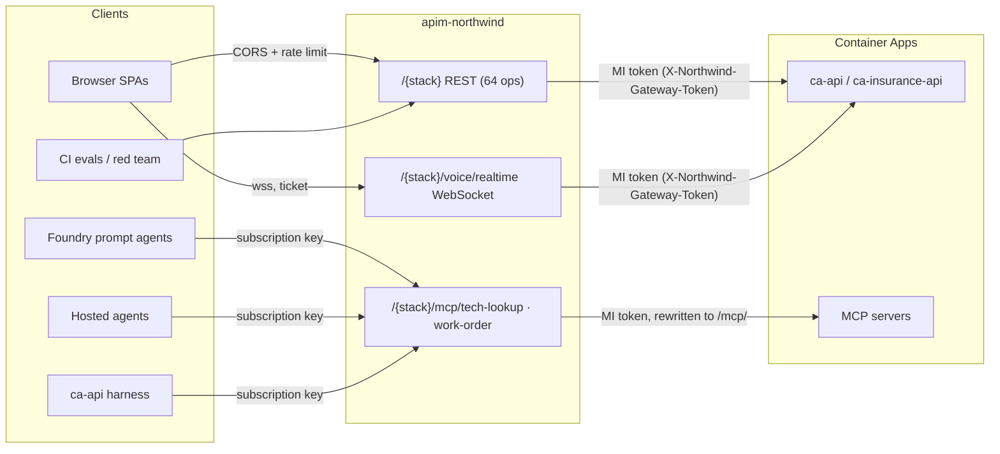

# API Management gateway (`apim-northwind`)

Every HTTP API that lives in `rg-northwind-apps` is published through the existing
Azure API Management instance **`apim-northwind`** (Standard v2, Central US,
`https://apim-northwind.azure-api.net`). The gateway is **opt-in and off by default**:
the repository ships the definition, the guarded release pipeline and the cut-over
tooling, but nothing changes in Azure until an operator runs the steps in
[Rollout runbook](#rollout-runbook).

> **Status (2026-10-22).**
> - **Applied:** `apim-northwind` now publishes all 8 APIs (both stacks), 4 products, the 2
>   agents subscriptions, the logger and per-API diagnostics (51 objects). The first apply ran
>   through the guarded `scripts/apim-release.py` from a clean LF checkout of `main` (same
>   allow-list, plan-hash equality and SHA confirmation as the pipeline) because the pipeline's
>   OIDC setup is blocked, see [Known blocker](#known-blocker-repository-visibility).
> - Also done: merged in #59 and #60; the five repo-managed apps run the new images (guard
>   deployed, **off**); the gateway identity exists (APIM system-assigned managed identity and
>   the secretless `northwind-gateway` Entra application, whose client ID is the template
>   default for `gatewayAudience`).
> - **Verified live:** every public smoke check and the keyed MCP checks (`initialize` and
>   `tools/list` on all four MCP APIs); 36/36 read-only calls identical direct vs through the
>   gateway; matching error responses; bodies up to 30 MiB; NDJSON streaming is not buffered
>   (`/chat`: first line at 0.6 s, last at 13 s through APIM); the real policy fragment obtains
>   the managed-identity token and the real guard accepts it (live Microsoft signing keys) while
>   rejecting a wrong principal or audience; Foundry authenticates to the gateway, both as a
>   prompt-agent MCP tool through a project connection and through the hosted-agent code path.
> - **Not done (consumers still call the apps directly, so nothing is locked down):** SPA, harness
>   and Foundry agent cut-over, and the guard. See the runbook and
>   [what is not verified](#not-verified-live-yet).

## What exists in `rg-northwind-apps`

Ten Container Apps sit in one shared Container Apps environment. Two stacks run the
**same code** and are published side by side:

| Container App | Stack | What it is | Published as |
| --- | --- | --- | --- |
| `ca-api` | `northwind` | FastAPI orchestrator: 64 HTTP operations + the Voice Live WebSocket | `northwind-api`, `northwind-voice` |
| `ca-mcp-tech-lookup` | `northwind` | FastMCP server (`lookup_order`) | `northwind-mcp-tech-lookup` |
| `ca-mcp-work-order` | `northwind` | FastMCP server (`propose_resolution`, HITL queue) | `northwind-mcp-work-order` |
| `ca-insurance-api` | `insurance` | Same API image, insurance deployment | `insurance-api`, `insurance-voice` |
| `ca-insurance-lookup` | `insurance` | FastMCP policy/claim lookup | `insurance-mcp-tech-lookup` |
| `ca-insurance-review` | `insurance` | FastMCP claim-action draft | `insurance-mcp-work-order` |
| `ca-web-tech`, `ca-web-voice` | `northwind` | nginx SPAs (consumers of the API) | not published; their origins are CORS-allowed |
| `ca-insurance-portal`, `ca-insurance-voice` | `insurance` | nginx SPAs (consumers) | not published; their origins are CORS-allowed |

The `northwind` stack is the repository-managed deployment. The `insurance` stack was
created out of band (manual image deploys); it is included because it is an API in the
resource group. Both are listed in `infra/live/apim-apis.bicep` (`stacks` parameter).

Deliberately **not** published: the two SPAs per stack (they are clients, not APIs),
Foundry hosted-agent endpoints (served by Foundry), the model gateway
`ai-gateway-northwind` (separate instance in `rg-northwind-ai`), and data planes
(Cosmos, Search, Storage).

### The REST API surface (64 operations, 62 paths)

Generated from the application itself by `scripts/export-openapi.py`; the full table is
[`infra/live/apim/specs/northwind-api.operations.md`](../infra/live/apim/specs/northwind-api.operations.md).

| Group | Operations | Notes |
| --- | --- | --- |
| `insurance-business` | 24 | `/api/v1/*`, Entra delegated token (scope `access_as_user`) |
| `core` | 22 | chat, session, handoff, company/departments, bake-off, HITL and work orders, safety, traces, health, model gateway status, voice session ticket |
| `insurance-content-understanding` | 6 | claims document analysis |
| `synthetic-insurance` | 5 | fixtures and records |
| `adjuster-support`, `Agent Harness` | 3 + 3 | |
| `voice` | 1 | `GET /voice/status` (the WebSocket itself is published as its own API) |

Several operations stream newline-delimited JSON (`/chat`, `/handoff`, bake-off,
adjuster support, harness runs). The REST policy therefore never buffers responses.

## Architecture



Public URLs, per stack `S` in `{northwind, insurance}`:

| Purpose | URL |
| --- | --- |
| REST | `https://apim-northwind.azure-api.net/S/...` |
| Voice Live | `wss://apim-northwind.azure-api.net/S/voice/realtime` |
| MCP (tech lookup) | `https://apim-northwind.azure-api.net/S/mcp/tech-lookup` |
| MCP (work order) | `https://apim-northwind.azure-api.net/S/mcp/work-order` |

The gateway rewrites the MCP URLs to the backend's `/mcp/` endpoint, so clients never
append `/mcp`. The stack name is the immutable first path segment, which is also what
lets one APIM instance front two identical APIs.

## Security model

| Hop | Control |
| --- | --- |
| Browser to REST | No subscription key. APIM is the single CORS authority (only the stack's SPA origins plus local dev), rate limit per client IP (default 600/min), Application Insights diagnostics. Optional `validate-jwt` for `/api/v1/*` when `businessAuth` is set. |
| Browser to Voice Live | No policy can be applied at WebSocket API scope; the `onHandshake` operation carries only the gateway token. Origin and the one-time connect ticket stay enforced by the backend (verified: identical 101/403 behavior as direct). |
| Agents and harness to MCP | Product `S-agents` requires a subscription key (`Ocp-Apim-Subscription-Key`). Rate limit per subscription (default 300/min). The key is stripped before the request is forwarded. |
| APIM to Container App | APIM's system-assigned managed identity requests an Entra app-only token for the `northwind-gateway` application and sends it as `X-Northwind-Gateway-Token`. The caller's own `Authorization` header is preserved. |
| Direct to Container App | **Open until the lock-down step.** With `NORTHWIND_GATEWAY_AUTH_REQUIRED=true` the in-app guard (`apps/api/app/gateway_guard.py`) rejects every request without a valid gateway token (401; 503 if mis-configured; WebSocket close 1008). `/health` and `/healthz` stay exempt. |

Why an in-app guard instead of an IP restriction: Standard v2 has no dedicated outbound
IP, so Container Apps ingress rules cannot identify the gateway. The guard validates an
RS256 Entra token (issuer, tenant, audience, expiry, **no `scp`** i.e. app-only) and
allows only the configured object IDs (APIM's managed identity). Forced signing-key
refreshes are rate limited so unauthenticated callers cannot amplify outbound traffic.

Subscription keys are generated by APIM and never appear in the repository, Bicep
outputs or pipeline logs. The pipeline's apply identity cannot call `listSecrets`.

## Findings that shaped the design (verified live on scratch APIs)

- Standard v2 supports WebSocket APIs; Consumption does not. No dedicated IP on v2 tiers.
- Overlapping path prefixes route correctly (longest wins); OpenAPI 3.1 imports as is
  (all 64 operations). OpenAPI 3.1 is import-only.
- The native `type: mcp` API is a preview, APIM-hosted tool server with a different ARM
  contract than documented. The gateway instead uses **GA plain HTTP passthrough** APIs
  with `rewrite-uri` to `/mcp/`; initialize, `tools/list` and `tools/call` work and
  subscription-key enforcement returned 401/401/200 as intended.
- The APIM `cors` policy is the only CORS authority: one `Access-Control-Allow-Origin`
  for an allowed origin, none for a foreign one. `allowed-headers` cannot mix `*` with
  other names, so the list is explicit.
- WebSocket policies are accepted only on the system-created `onHandshake` operation.
- Subscription keys are stable across re-deployments of the template.
- `validate-jwt` fetches the tenant's OpenID configuration when the policy is saved, so a
  wrong tenant in `businessAuth` fails the deployment (fail closed).
- Policy comments must not contain placeholders; attribute values holding quotes use
  single-quoted attributes so the XML stays strict.

## Repository map

| Path | Purpose |
| --- | --- |
| `infra/live/apim-apis.bicep` | Incremental definition: APIs, operations, policies, products, subscriptions, logger, diagnostics. Existing resources are references only; no modules. |
| `infra/live/apim/policies/*.xml` | `rest-api`, `voice-api`, `mcp-api` and the gateway-token / JWT fragments |
| `infra/live/apim/specs/` | Committed OpenAPI export and generated operations table |
| `scripts/export-openapi.py` | Regenerates the export from the FastAPI app (`--check` is the strict drift check) |
| `scripts/apim-release.py` | Plan/apply guard: allow-list of resource IDs, exact parameter set, plan-hash equality |
| `.github/workflows/deploy-apim.yml` | `Scoped API Management`: plan, gated apply, public smoke |
| `scripts/configure-github-oidc.py --only apim` | Scoped OIDC identities, custom roles and variables for the pipeline |
| `scripts/configure-gateway-identity.py` | APIM managed identity and the `northwind-gateway` Entra app |
| `scripts/configure-gateway-apps.py` | Guarded per-app configuration: guard variables, MCP URLs, gateway key secret, rollback records |
| `scripts/apim-smoke.py` | Read-only checks through the gateway; `--expect-lockdown` proves direct access is blocked |
| `apps/api/app/gateway_guard.py` | The in-app guard (copied into both MCP apps by `scripts/bundle-insurance-assets.py`) |
| `infra/main.bicep` | `NORTHWIND_GATEWAY_URL` / `NORTHWIND_GATEWAY_STACK` make `API_URI` and `MCP_*_URL` gateway URLs |

## Changing the API

1. Change the FastAPI app, then run `python scripts/export-openapi.py` and commit the
   spec and operations table. CI (`test_export_openapi.py`) fails if the gateway-visible
   surface differs; `python scripts/export-openapi.py --check` is the strict comparison.
2. Merge to `main` after CI. The pipeline plans automatically; apply is manual
   ([Rollout runbook](#rollout-runbook), step 4).
3. Adding a **stack** or a **resource type** is a deliberate boundary change: update
   `infra/live/apim-apis.bicep`, the allow-list and role in `scripts/apim-release.py` and
   `scripts/configure-github-oidc.py`, and the tests together. Tests derive the expected
   resource types from the compiled template, so a mismatch fails CI.

## Rollout runbook

Everything below is an operator action; none of it runs automatically. Each script
previews by default and only changes things with `--apply`. Order matters.

1. **Merge to `main`.** CI compiles the template and runs all gateway tests. The app
   release workflow ships images that contain the guard (default off). The
   `ca-insurance-*` apps are deployed manually: build them from the same commit before
   step 8, or the guard step will refuse to confirm.
2. **Create the pipeline identities** (needs GitHub admin and Azure RBAC rights):
   ```powershell
   python scripts/configure-github-oidc.py --only apim            # preview
   python scripts/configure-github-oidc.py --only apim --apply
   ```
   This creates `id-gh-northwind-apim-plan` / `-apply`, two custom roles scoped to the
   resource group, environments `northwind-apim-plan` / `northwind-apim-apply` pinned to
   `main`, and the variables including `NORTHWIND_APIM_ENABLED`. Add required reviewers
   to `northwind-apim-apply` in the repository settings. Run it as the repository owner
   (`ZacharyZurloMSFT`): it needs admin on the repository, and the Enterprise Managed
   User account has read-only access. It currently refuses to run, see
   [Known blocker](#known-blocker-repository-visibility).
3. **Create the gateway token identity** (done for this environment on 2026-10-22; re-running
   previews no actions and prints the values):
   ```powershell
   python scripts/configure-gateway-identity.py                    # preview
   python scripts/configure-gateway-identity.py --apply
   ```
   The `gateway_audience` it prints is the default of `gatewayAudience` in
   `infra/live/apim-apis.bicep` (the release guard accepts only empty, a GUID or
   `api://<GUID>`). Keep `apim_principal_id` for step 8. Without a `gatewayAudience` the
   gateway forwards without a token and the guard cannot be enabled.
4. **Plan and apply the API Management definition.** In GitHub Actions run
   `Scoped API Management`: the plan runs after CI on `main`, or dispatch it with
   `operation=plan` and the full `main` SHA. Review the summary (first run: 51 creations,
   nothing else). To apply, dispatch `operation=apply` with `expected_sha`, the successful
   `plan_run_id` and `confirm_apply` set to the same SHA; approve the environment. Apply
   re-plans and refuses if source, template or plan hash changed, then verifies the 8
   APIs and runs the public smoke test.
5. **Smoke test from your machine:**
   ```powershell
   python scripts/apim-smoke.py --gateway-url https://apim-northwind.azure-api.net --public-checks
   ```
6. **Collect the agents key** per stack (the pipeline cannot read it) and hold it in an
   environment variable, never in a file:
   ```powershell
   $env:NORTHWIND_MCP_KEY_INSURANCE = az rest --method post --body "{}" --query primaryKey -o tsv `
     --url "https://management.azure.com/subscriptions/137c905b-7734-479e-acc5-ab8222462936/resourceGroups/rg-northwind-apps/providers/Microsoft.ApiManagement/service/apim-northwind/subscriptions/insurance-agents/listSecrets?api-version=2024-05-01"
   python scripts/apim-smoke.py --gateway-url https://apim-northwind.azure-api.net --stack insurance
   ```
   Create the Foundry project connections (category `RemoteTool`, auth `CustomKeys`, key
   `Ocp-Apim-Subscription-Key`, the stack's agents key) through ARM, the same way
   `scripts/connect-knowledge-base.py` does. **Foundry sends a tool's calls to the *target* of
   the connection it references**, so:
   - **prompt agents** need one connection per MCP endpoint, each with the exact MCP URL as its
     target (for example `https://apim-northwind.azure-api.net/insurance/mcp/tech-lookup`).
     A connection that targets the gateway base URL makes Foundry call the base URL and get a
     404 (reproduced live);
   - **hosted agents** read the credentials themselves and send the header to their own MCP
     URL, so a single connection whose target is the gateway base URL or an exact MCP URL is
     enough. Foundry returns custom key names lower-cased; the code matches case-insensitively.
   Delete any scratch agents and connections after testing; connection names are account-wide.
7. **Cut over the consumers** (each is independently reversible):
   - Foundry agents: `azd env set NORTHWIND_GATEWAY_URL https://apim-northwind.azure-api.net`,
     `NORTHWIND_GATEWAY_STACK` (`northwind` or `insurance`), `MCP_GATEWAY_CONNECTION` (hosted
     agents) and `MCP_GATEWAY_CONNECTION_TECH_LOOKUP` / `MCP_GATEWAY_CONNECTION_WORK_ORDER`
     (prompt agents, one exact-target connection per endpoint); the next reuse-mode provision
     publishes gateway URLs as `API_URI` / `MCP_*_URL` without changing resources, and
     `scripts/create-prompt-agents.py` re-creates MCP tools against the gateway through those
     connections (it warns when a gateway tool has none). The live insurance agents are five
     *hosted* agents whose `MCP_*_URL` environment points at the insurance MCP apps, so moving
     them means redeploying those agent versions
     (`scripts/deploy-orders-hosted.py --business-domain insurance`).
   - `ca-api` harness:
     `python scripts/configure-gateway-apps.py --app ca-insurance-api --mcp-gateway-base https://apim-northwind.azure-api.net/insurance`
     (reads the key from `NORTHWIND_MCP_KEY`; add `--apply` after reviewing the preview).
   - SPAs: set the repository variable `NORTHWIND_GATEWAY_URL` and re-run the app release
     (`VITE_API_BASE_URL` becomes `<gateway>/northwind`); build the insurance SPAs with
     `VITE_API_BASE_URL=https://apim-northwind.azure-api.net/insurance`. The voice client
     appends `/voice/realtime` to that base path.
   - CI consumers: point the `STAGING_API_URI` secret at `<gateway>/northwind`.
8. **Lock direct access** once consumers are verified through the gateway:
   ```powershell
   python scripts/configure-gateway-apps.py --stack insurance --guard enable `
     --gateway-audience <northwind-gateway appId> --allowed-oid <APIM principalId>      # preview
   # repeat with --apply, then:
   python scripts/apim-smoke.py --gateway-url https://apim-northwind.azure-api.net --stack insurance --expect-lockdown
   ```
   The script checks revision health, probes the health endpoint, and confirms the guard
   really answers 401 (an image without the guard would silently ignore the variables).
   Each change writes a rollback record (non-secret values only) under `release/`.

### Known blocker: repository visibility

`configure-github-oidc.py` refuses to run (`Expected the private approved main-branch
repository.`) because GitHub reports `ZacharyZurloMSFT/foundry-frontier` as **public**, while
the script and the README assume a private repository. The check is a deliberate trust
control and was not bypassed, and the repository's visibility was not changed. Decide one of:

- make the repository private again (then run step 2 unchanged); or
- accept OIDC trust on a public repository and relax that one check in a reviewed change.
  Mitigations already in place: the subject claim uses immutable repository and owner IDs,
  the environments are pinned to `main`, and fork pull requests cannot obtain these tokens.
  What changes is that workflow logs, plan artifacts and step summaries become world-readable.

Interim path used on 2026-10-22 (no Azure trust is created, so the check's intent is not
affected): compile and apply the same boundary locally with the same guarded script, from a
clean LF checkout of the merged commit so the template matches what CI would compile:

```powershell
git -c core.autocrlf=false worktree add --detach $env:TEMP\apim-src <main sha>
bicep build $env:TEMP\apim-src\infra\live\apim-apis.bicep --outfile $env:TEMP\apim-src\apim-apis.json   # v0.46.1
python $env:TEMP\apim-src\scripts\apim-release.py --compiled-template $env:TEMP\apim-src\apim-apis.json `
  --source-sha <main sha> --output plan.json                                   # review, then:
$env:NORTHWIND_APIM_CONFIRM = '<main sha>'
python $env:TEMP\apim-src\scripts\apim-release.py --compiled-template $env:TEMP\apim-src\apim-apis.json `
  --source-sha <main sha> --approved-plan plan.json --output result.json --apply
```

Later plans from the pipeline will show these objects as existing.

### Rollback

- Fastest: `python scripts/configure-gateway-apps.py --stack insurance --guard disable --apply`.
- Exact: `python scripts/configure-gateway-apps.py --revert-from release/gateway-rollback-<app>-<revision>.json --apply`.
- Consumers: unset `NORTHWIND_GATEWAY_URL` (azd and the repository variable) and redeploy;
  the direct Container App URLs are the default again.
- The API Management objects are inert without consumers and can stay in place.

### Operations

- **Key rotation:** regenerate the secondary key (`.../subscriptions/<stack>-agents/regenerateSecondaryKey`),
  update the Foundry connection and re-run `configure-gateway-apps.py` for the harness
  secret, restart the hosted agents, then rotate the primary.
- **Telemetry:** every API has an `applicationinsights` diagnostic (logger
  `northwind-appinsights`, W3C correlation, no bodies logged) into `appi-zurlo-northwind`.
- **Limits:** defaults are `webRateLimitPerMinute=600` per IP and
  `agentsRateLimitPerMinute=300` per subscription; both are template parameters.

## Not verified live yet

Verified live on 2026-10-22: see Status. Still not exercised:

- the guard enabled on a live Container App under real gateway traffic (the token and the
  guard code are verified together; flipping the switch on a running app is the remaining
  step, and the Container Apps must be able to reach `login.microsoftonline.com` for the
  signing keys);
- a browser session through the gateway (the SPA calls are covered by CORS, header, body and
  WebSocket checks, not by driving the UI);
- the hosted agents and the harness actually redeployed or re-pointed at the gateway URLs (the
  authentication mechanism is verified, the redeploy is not);
- the first real apply under the scoped pipeline role.

The `ca-insurance-*` apps run images built manually before the guard existed; release them from
`main` before enabling the guard on the insurance stack (the script refuses to confirm
otherwise). Everything else is covered by unit tests and by the live checks above.
