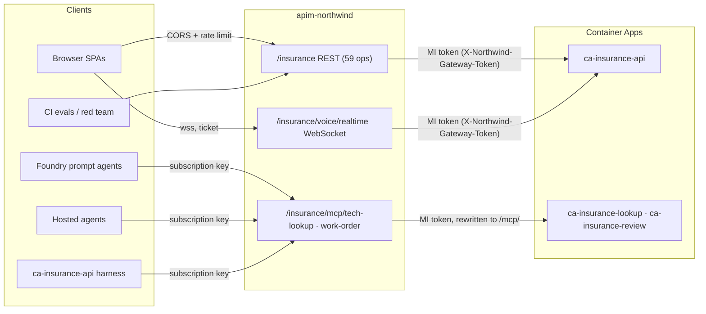

# API Management gateway (`apim-northwind`)

The HTTP APIs of the insurance stack in `rg-northwind-apps` (`ca-insurance-*`) are published
through the existing Azure API Management instance **`apim-northwind`** (Standard v2, Central
US, `https://apim-northwind.azure-api.net`). The gateway is **opt-in and off by default**:
the repository ships the definition, the guarded release pipeline and the cut-over
tooling, but nothing changes in Azure until an operator runs the steps in
[Rollout runbook](#rollout-runbook).

> **Repository scope.** The repository now manages, releases and tests only the `insurance`
> stack. The earlier `northwind` stack (`ca-api`, `ca-mcp-tech-lookup`, `ca-mcp-work-order`,
> `ca-web-tech`, `ca-web-voice`; APIM APIs `northwind-*`) is no longer declared in
> `infra/live/apim-apis.bicep` or touched by any script; [`legacy-decommission.md`](./legacy-decommission.md)
> is the operator runbook for retiring it. Entries marked *legacy stack* below are the
> 2026-10-22 records of that stack, kept for history.

> **Status (2026-10-23).**
> - **Applied:** `apim-northwind` publishes all 8 APIs (both stacks), 4 products, the 2 agents
>   subscriptions, the logger and per-API diagnostics. The first two applies ran locally through
>   the guarded `scripts/apim-release.py` (the pipeline's OIDC identities did not exist yet).
>   The identities now exist (see [Repository visibility](#repository-visibility)):
>   `deploy-apim.yml` plans after every CI success on `main`, and a pipeline apply under the
>   scoped role has succeeded (run 39854582597: `applied=True`, 8 APIs verified, public smoke
>   passed). The repository's template now declares only the insurance stack (4 APIs, 2
>   products, 1 agents subscription) and its OpenAPI export has 59 operations, so the live
>   `insurance-api` (imported from the earlier 64-operation export) differs from the repository
>   until an apply imports the new one; the `northwind-*` APIs are no longer in the template and
>   are left untouched.
> - **Identity:** the APIM system-assigned managed identity and the secretless
>   `northwind-gateway` Entra application exist; the application's client ID is the template
>   default for `gatewayAudience`. All six API/MCP apps (the three `ca-insurance-*` API and MCP
>   apps and the three legacy northwind backends, retired from the repo) run images that
>   contain the guard.
> - **Cut over:** the four SPAs (`ca-insurance-portal`, `ca-insurance-voice` and the legacy
>   `ca-web-tech`, `ca-web-voice`; legacy stack, retired from the repo) are built against
>   `https://apim-northwind.azure-api.net/<stack>` (`insurance`, or the legacy `northwind`)
>   through the repository variable `NORTHWIND_GATEWAY_URL`; the release workflow builds the
>   insurance SPAs that way when the variable is set (runbook step 7). The harness settings of
>   `ca-insurance-api` and of the legacy `ca-api` point at the gateway MCP URLs with the agents
>   key held as a Container App secret. The two hosted insurance agents that call MCP servers
>   (`northwind-insurance-policy-claim-lookup` and `northwind-insurance-claim-action-draft`,
>   version 2) reach them through the gateway with the Foundry project connection
>   `nw-insurance-claims-apim-mcp`.
> - **Locked down:** `ca-insurance-api`, `ca-insurance-lookup` and `ca-insurance-review`, and
>   the legacy northwind backends `ca-api`, `ca-mcp-tech-lookup` and `ca-mcp-work-order` (legacy
>   stack, retired from the repo); the four SPAs are public by design. Direct calls get 401
>   (`gateway_required` on the API), calls through the gateway succeed, and `/health` /
>   `/healthz` stay open for probes. The guard setting survived normal app releases (new
>   revision, same variables).
> - **Verified live:** every public smoke check and the keyed MCP checks on both stacks;
>   `apim-smoke.py --expect-lockdown` passes in full on the legacy `northwind` stack (24 passes,
>   1 skip because Voice Live is not ready on that stack; the script's `--stack` now accepts
>   only `insurance`, or `all`) and on `insurance` (25 of 25, including the WebSocket
>   upgrade through the gateway and the rejected direct WebSocket, MCP call and spoofed token);
>   36/36 read-only calls identical direct vs through the gateway (before the northwind
>   lock-down); matching error responses; bodies up to 30 MiB; NDJSON streaming is not buffered
>   (the since-removed `/chat`: first line at 0.6 s, last at 13 s through APIM; the opt-in
>   `apim-smoke.py --stream-check` now streams `POST /insurance/chat`); inside the running
>   container the guard accepts the gateway's managed-identity token (live Microsoft signing
>   keys) and rejects direct calls, a spoofed token header, a wrong principal and a wrong
>   audience; Foundry authenticates to the gateway as a prompt-agent MCP tool through a
>   project connection and from the hosted agents. After the insurance lock-down, a full
>   orchestrated chat turn
>   through the gateway (the since-removed `/chat`; now `POST /insurance/chat`) ran the hosted
>   triage and policy/claim lookup agents (the lookup agent calls the locked MCP app through
>   the gateway), and a claim-action draft saved through the gateway into the locked
>   claim-review app (`ca-insurance-review`; the test record was deleted again). A synthetic
>   Agent Harness run through the gateway passed too: claim and policy lookups from the bundled
>   records, one draft through the hosted version 2 agent, the gateway and the locked
>   claim-review app, and a final answer; the draft was deleted again.
> - **AI Gateway tool servers:** re-pointed on 2026-10-23. `northwind-insurance-lookup` and
>   `northwind-insurance-review` on `ai-gateway-northwind` now call the insurance MCP routes of
>   this gateway with the `insurance-agents` key (`apim-northwind` -> locked app); a lookup call
>   through them returned the synthetic records ([ai-gateway.md](./ai-gateway.md#findings-to-act-on),
>   finding 8).
> - **Not done:** the three hosted agents that do not call MCP
>   servers, and landing the insurance-resource-cleanup work. See
>   [Remaining steps](#remaining-steps) and [what is not verified](#not-verified-live-yet).

## What exists in `rg-northwind-apps`

Ten Container Apps sit in one shared Container Apps environment (recorded 2026-10-22). Only
the five `ca-insurance-*` apps are managed by the repository: `azure.yaml` declares them as azd
services, `.github/workflows/deploy-apps.yml` releases them through `scripts/release-app.py`,
and `infra/live/apim-apis.bicep` (`stacks` parameter) lists only the `insurance` stack. The
five legacy `northwind` apps are no longer managed or released from the repository;
[`legacy-decommission.md`](./legacy-decommission.md) is the runbook for retiring them.

| Container App | azd service | What it is | Published as |
| --- | --- | --- | --- |
| `ca-insurance-api` | `api` | FastAPI orchestrator: 59 HTTP operations in the current export + the Voice Live WebSocket | `insurance-api`, `insurance-voice` |
| `ca-insurance-lookup` | `mcp-policy-lookup` | FastMCP policy/claim lookup (`lookup_policy`, `lookup_claim`) | `insurance-mcp-tech-lookup` |
| `ca-insurance-review` | `mcp-claim-review` | FastMCP claim-action draft (`draft_claim_action`, writes the HITL queue) | `insurance-mcp-work-order` |
| `ca-insurance-portal`, `ca-insurance-voice` | `web-portal`, `web-voice` | nginx SPAs (consumers of the API) | not published; their origins are CORS-allowed |
| `ca-api`, `ca-mcp-tech-lookup`, `ca-mcp-work-order`, `ca-web-tech`, `ca-web-voice` | none (legacy stack, retired from the repo) | The earlier `northwind` stack: API, two MCP servers, two SPAs | `northwind-api`, `northwind-voice`, `northwind-mcp-tech-lookup`, `northwind-mcp-work-order` (on the instance on 2026-10-22; no longer in the template) |

`insurance-mcp-tech-lookup` and `insurance-mcp-work-order` (and the gateway paths
`/insurance/mcp/tech-lookup` and `/insurance/mcp/work-order`) are live identifiers, not
renamed; they front `ca-insurance-lookup` and `ca-insurance-review`.

The `ca-insurance-*` apps were created out of band (manual image deploys) and are now the
repository-managed deployment.

The MCP code was shared between the two stacks until the insurance-only cleanup: the legacy
`ca-mcp-tech-lookup` and `ca-mcp-work-order` (retired from the repo) run in the insurance
domain and serve every tool; `ca-insurance-lookup` and `ca-insurance-review` additionally set
`NORTHWIND_MCP_INSURANCE_ONLY=true`, so the insurance project exposes only `lookup_policy`,
`lookup_claim` and `draft_claim_action`, and the earlier non-insurance tools are neither
registered nor callable there. Images built from this repository now contain only the three
insurance tools, which makes that switch a no-op; it still matters for the images the live
apps run (CI images from `main` `436da65`, see
[Insurance stack cut-over](#insurance-stack-cut-over-2026-10-23)).

Deliberately **not** published: the two SPAs (they are clients, not APIs), Foundry
hosted-agent endpoints (served by Foundry), the model gateway `ai-gateway-northwind`
(separate instance in `rg-northwind-ai`), and data planes (Cosmos, Search, Storage).

### The REST API surface (59 operations, 57 paths)

Generated from the application itself by `scripts/export-openapi.py`; the full table is
[`infra/live/apim/specs/northwind-api.operations.md`](../infra/live/apim/specs/northwind-api.operations.md).

| Group | Operations | Notes |
| --- | --- | --- |
| `insurance-business` | 24 | `/api/v1/*`, Entra delegated token (scope `access_as_user`) |
| `core` | 17 | session, handoff, company/departments, HITL (`/hitl*`, plus two deprecated aliases), traces, build, health, model gateway status, voice session ticket |
| `insurance-content-understanding` | 6 | claims document analysis |
| `synthetic-insurance` | 5 | `/insurance/*`: fixtures, records, claim-action draft and `POST /insurance/chat` |
| `adjuster-support`, `Agent Harness` | 3 + 3 | |
| `voice` | 1 | `GET /voice/status` (the WebSocket itself is published as its own API) |

Several operations stream newline-delimited JSON (`/insurance/chat`, `/handoff`, adjuster
support, harness runs). The REST policy therefore never buffers responses.

The chat surface is `POST /insurance/chat` only. The live APIs were imported from the earlier
64-operation export (first applied on 2026-10-22); the routes that changed since are listed under
[Renames and compatibility](#renames-and-compatibility).

## Architecture



Today the MCP clients are the hosted agents and the harness; the three current prompt agents
declare no MCP tool.

Public URLs for the repository-managed `insurance` stack (the legacy `northwind` stack used
the same shapes under its own prefix):

| Purpose | URL |
| --- | --- |
| REST | `https://apim-northwind.azure-api.net/insurance/...` |
| Voice Live | `wss://apim-northwind.azure-api.net/insurance/voice/realtime` |
| MCP (policy/claim lookup) | `https://apim-northwind.azure-api.net/insurance/mcp/tech-lookup` |
| MCP (claim review) | `https://apim-northwind.azure-api.net/insurance/mcp/work-order` |

The gateway rewrites the MCP URLs to the backend's `/mcp/` endpoint, so clients never
append `/mcp`. The stack name is the immutable first path segment, which is also what
let one APIM instance front two identical stacks side by side.

## Security model

| Hop | Control |
| --- | --- |
| Browser to REST | No subscription key. APIM is the single CORS authority (only the stack's SPA origins plus local dev), rate limit per client IP (default 600/min), Application Insights diagnostics. Optional `validate-jwt` for `/api/v1/*` when `businessAuth` is set. |
| Browser to Voice Live | No policy can be applied at WebSocket API scope; the `onHandshake` operation carries only the gateway token. Origin and the one-time connect ticket stay enforced by the backend (verified: identical 101/403 behavior as direct). |
| Agents and harness to MCP | Product `insurance-agents` requires a subscription key (`Ocp-Apim-Subscription-Key`). Rate limit per subscription (default 300/min). The key is stripped before the request is forwarded. |
| APIM to Container App | APIM's system-assigned managed identity requests an Entra app-only token for the `northwind-gateway` application and sends it as `X-Northwind-Gateway-Token`. The caller's own `Authorization` header is preserved. |
| Direct to Container App | **Locked on the insurance apps (`ca-insurance-api`, `ca-insurance-lookup`, `ca-insurance-review`; runbook step 8) and on the legacy northwind apps (`ca-api`, `ca-mcp-tech-lookup`, `ca-mcp-work-order`; retired from the repo).** With `NORTHWIND_GATEWAY_AUTH_REQUIRED=true` the in-app guard (`apps/api/app/gateway_guard.py`) rejects every request without a valid gateway token (401; 503 if mis-configured; WebSocket close 1008). `/health` and `/healthz` stay exempt. |

Why an in-app guard instead of an IP restriction: Standard v2 has no dedicated outbound
IP, so Container Apps ingress rules cannot identify the gateway. The guard validates an
RS256 Entra token (issuer, tenant, audience, expiry, **no `scp`** i.e. app-only) and
allows only the configured object IDs (APIM's managed identity). Forced signing-key
refreshes are rate limited so unauthenticated callers cannot amplify outbound traffic.

Subscription keys are generated by APIM and never appear in the repository, Bicep
outputs or pipeline logs. The pipeline's apply identity cannot call `listSecrets`.

## Findings that shaped the design (verified live on scratch APIs)

- Standard v2 supports WebSocket APIs; Consumption does not. No dedicated IP on v2 tiers.
- Overlapping path prefixes route correctly (longest wins); OpenAPI 3.1 imports as is
  (the whole document: 64 operations at the 2026-10-22 import, 59 in the current export).
  OpenAPI 3.1 is import-only.
- The native `type: mcp` API is a preview, APIM-hosted tool server with a different ARM
  contract than documented. The gateway instead uses **GA plain HTTP passthrough** APIs
  with `rewrite-uri` to `/mcp/`; initialize, `tools/list` and `tools/call` work and
  subscription-key enforcement returned 401/401/200 as intended.
- The APIM `cors` policy is the only CORS authority: one `Access-Control-Allow-Origin`
  for an allowed origin, none for a foreign one. `allowed-headers` cannot mix `*` with
  other names, so the list is explicit.
- WebSocket policies are accepted only on the system-created `onHandshake` operation.
- Subscription keys are stable across re-deployments of the template.
- `validate-jwt` fetches the tenant's OpenID configuration when the policy is saved, so a
  wrong tenant in `businessAuth` fails the deployment (fail closed).
- Policy comments must not contain placeholders; attribute values holding quotes use
  single-quoted attributes so the XML stays strict.
- OpenAPI import puts a *required* query parameter into the operation's URL template, so a
  call that omits it (for example `DELETE /hitl/{id}`, `POST /claims/upload` or
  `POST /api/v1/claims/{id}/documents` without the parameter) gets an APIM 404 instead of the
  backend's 422. Valid calls behave exactly as they do direct. (The finding was first
  recorded on the pre-rename path of `DELETE /hitl/{id}`, see
  [Renames and compatibility](#renames-and-compatibility); the required parameter is
  `workflow_id` on both.)

## Repository map

| Path | Purpose |
| --- | --- |
| `infra/live/apim-apis.bicep` | Incremental definition: APIs, operations, policies, products, subscriptions, logger, diagnostics. Existing resources are references only; no modules. Its `stacks` parameter lists only the `insurance` stack. |
| `infra/live/apim/policies/*.xml` | `rest-api`, `voice-api`, `mcp-api` and the gateway-token / JWT fragments |
| `infra/live/apim/specs/` | Committed OpenAPI export and generated operations table |
| `scripts/export-openapi.py` | Regenerates the export from the FastAPI app (`--check` is the strict drift check) |
| `scripts/apim-release.py` | Plan/apply guard: allow-list of resource IDs (`STACKS = ("insurance",)`), exact parameter set, plan-hash equality |
| `.github/workflows/deploy-apim.yml` | `Scoped API Management`: plan, gated apply, public smoke |
| `.github/workflows/deploy-apps.yml`, `scripts/release-app.py` | `Scoped App Release`: releases the five `ca-insurance-*` apps (azd services `api`, `mcp-policy-lookup`, `mcp-claim-review`, `web-portal`, `web-voice`) and builds the SPAs against `<gateway>/insurance` when `NORTHWIND_GATEWAY_URL` is set |
| `scripts/configure-github-oidc.py --only apim` | Scoped OIDC identities, custom roles and variables for the pipeline |
| `scripts/configure-gateway-identity.py` | APIM managed identity and the `northwind-gateway` Entra app |
| `scripts/configure-gateway-apps.py` | Guarded per-app configuration of `ca-insurance-api`, `ca-insurance-lookup` and `ca-insurance-review`: guard variables, MCP URLs, gateway key secret, rollback records |
| `scripts/apim-smoke.py` | Read-only checks through the gateway (stack `insurance`); `--expect-lockdown` proves direct access is blocked |
| `apps/api/app/gateway_guard.py` | The in-app guard (copied into both MCP apps by `scripts/bundle-insurance-assets.py`) |
| `infra/main.bicep` | `NORTHWIND_GATEWAY_URL` / `NORTHWIND_GATEWAY_STACK` (must be `insurance`) make `API_URI` and `MCP_*_URL` gateway URLs |
| `scripts/validate-reuse.py` | azd preprovision and predeploy hook; rejects a `NORTHWIND_GATEWAY_STACK` other than `insurance` and a `NORTHWIND_GATEWAY_URL` that is not a bare `https://<name>.azure-api.net` origin |

### Renames and compatibility

The insurance-only conversion removed and renamed these names; where a deprecated name is
still read, the canonical one wins.

| Before | Now |
| --- | --- |
| `/chat`, `/qa`, `/agent/{slug}/chat`, the model-comparison routes, `/safety/*` | removed from the export (chat is `POST /insurance/chat`); the gateway stops exposing them when the next apply imports the 59-operation export |
| `GET /work-orders`, `DELETE /work-orders/{id}` | `GET /hitl/resolved`, `DELETE /hitl/{id}`; the old paths are still served and published as deprecated aliases |
| `MCP_TECH_LOOKUP_URL`, `MCP_WORK_ORDER_URL` | `MCP_POLICY_LOOKUP_URL`, `MCP_CLAIM_REVIEW_URL`; the old names are still read while the canonical one is unset |
| `MCP_GATEWAY_CONNECTION_TECH_LOOKUP`, `MCP_GATEWAY_CONNECTION_WORK_ORDER` | `MCP_GATEWAY_CONNECTION_POLICY_LOOKUP`, `MCP_GATEWAY_CONNECTION_CLAIM_REVIEW`; the old names are still read while the canonical one is unset |
| `NORTHWIND_GATEWAY_STACK` set to `northwind` | must be `insurance`; an azd environment that still says `northwind` fails preprovision (`scripts/validate-reuse.py`) |

`scripts/configure-gateway-apps.py` writes only the canonical `MCP_*_URL` names; it reads the
deprecated ones only to restore an older rollback record. The gateway API ids and paths
(`insurance-mcp-tech-lookup`, `insurance-mcp-work-order`, `/insurance/mcp/tech-lookup`,
`/insurance/mcp/work-order`) are live identifiers and keep their names.

## Changing the API

1. Change the FastAPI app, then run `python scripts/export-openapi.py` and commit the
   spec and operations table. CI (`test_export_openapi.py`) fails if the gateway-visible
   surface differs; `python scripts/export-openapi.py --check` is the strict comparison.
2. Merge to `main` after CI. The pipeline plans automatically; apply is manual
   ([Rollout runbook](#rollout-runbook), step 4).
3. Adding a **stack** or a **resource type** is a deliberate boundary change: update
   `infra/live/apim-apis.bicep`, the allow-list and role in `scripts/apim-release.py` and
   `scripts/configure-github-oidc.py`, and the tests together (`scripts/apim-smoke.py` and
   `scripts/configure-gateway-apps.py` carry the same single-stack list). Tests derive the
   expected resource types from the compiled template, so a mismatch fails CI.

## Rollout runbook

Everything below is an operator action; none of it runs automatically. Each script
previews by default and only changes things with `--apply`. Order matters.

1. **Merge to `main`.** CI compiles the template and runs all gateway tests. The app
   release workflow (`Scoped App Release`, `deploy-apps.yml`) releases the five `ca-insurance-*`
   apps through `scripts/release-app.py`; their images contain the guard (default off). An app
   whose image predates the guard makes the guard step (8) refuse to confirm, so release it
   first. On the live environment `ca-insurance-api`, `ca-insurance-lookup` and
   `ca-insurance-review` were released by hand before the workflow covered them, see
   [Insurance stack cut-over](#insurance-stack-cut-over-2026-10-23).
2. **Create the pipeline identities** (needs GitHub admin and Azure RBAC rights):
   ```powershell
   python scripts/configure-github-oidc.py --only apim --allow-public-repository            # preview
   python scripts/configure-github-oidc.py --only apim --allow-public-repository --apply
   ```
   This creates `id-gh-northwind-apim-plan` / `-apply`, two custom roles scoped to the
   resource group, environments `northwind-apim-plan` / `northwind-apim-apply` pinned to
   `main`, and the variables including `NORTHWIND_APIM_ENABLED`. Add required reviewers
   to `northwind-apim-apply` in the repository settings, and do it **after** the script: it
   rewrites each environment's branch policy and a later run would not preserve reviewers.
   Run it as the repository owner (`ZacharyZurloMSFT`): it needs admin on the repository, and
   the Enterprise Managed User account has read-only access. The repository is public, so the
   script refuses without `--allow-public-repository`, see
   [Repository visibility](#repository-visibility).
3. **Create the gateway token identity** (done for this environment on 2026-10-22; re-running
   previews no actions and prints the values):
   ```powershell
   python scripts/configure-gateway-identity.py                    # preview
   python scripts/configure-gateway-identity.py --apply
   ```
   The `gateway_audience` it prints is the default of `gatewayAudience` in
   `infra/live/apim-apis.bicep` (the release guard accepts only empty, a GUID or
   `api://<GUID>`). Keep `apim_principal_id` for step 8. Without a `gatewayAudience` the
   gateway forwards without a token and the guard cannot be enabled.
4. **Plan and apply the API Management definition.** In GitHub Actions run
   `Scoped API Management`: the plan runs after CI on `main`, or dispatch it with
   `operation=plan` and the full `main` SHA. Review the summary (the first run, on 2026-10-22
   when the template still declared both stacks: 51 creations, nothing else; on an instance
   with none of these objects the insurance-only template plans 26, see
   `scripts/tests/test_apim_release.py`). To apply, dispatch `operation=apply` with
   `expected_sha`, the successful `plan_run_id` and `confirm_apply` set to the same SHA;
   approve the environment. Apply re-plans and refuses if source, template or plan hash
   changed, then verifies the 4 APIs (`insurance-api`, `insurance-voice`,
   `insurance-mcp-tech-lookup`, `insurance-mcp-work-order`) and runs the public smoke test.
5. **Smoke test from your machine:**
   ```powershell
   python scripts/apim-smoke.py --gateway-url https://apim-northwind.azure-api.net --public-checks
   ```
6. **Collect the agents key** (stack `insurance`; the pipeline cannot read it) and hold it in
   an environment variable, never in a file:
   ```powershell
   $env:NORTHWIND_MCP_KEY_INSURANCE = az rest --method post --body "{}" --query primaryKey -o tsv `
     --url "https://management.azure.com/subscriptions/137c905b-7734-479e-acc5-ab8222462936/resourceGroups/rg-northwind-apps/providers/Microsoft.ApiManagement/service/apim-northwind/subscriptions/insurance-agents/listSecrets?api-version=2024-05-01"
   python scripts/apim-smoke.py --gateway-url https://apim-northwind.azure-api.net --stack insurance
   ```
   Create the Foundry project connections (category `RemoteTool`, auth `CustomKeys`, key
   `Ocp-Apim-Subscription-Key`, the stack's agents key) through ARM, the same way
   `scripts/connect-knowledge-base.py` does. **Foundry sends a tool's calls to the *target* of
   the connection it references**, so:
   - **prompt agents** need one connection per MCP endpoint, each with the exact MCP URL as its
     target (for example `https://apim-northwind.azure-api.net/insurance/mcp/tech-lookup`).
     A connection that targets the gateway base URL makes Foundry call the base URL and get a
     404 (reproduced live);
   - **hosted agents** read the credentials themselves and send the header to their own MCP
     URL, so a single connection whose target is the gateway base URL or an exact MCP URL is
     enough. Foundry returns custom key names lower-cased; the code matches case-insensitively.
   Delete any scratch agents and connections after testing; connection names are account-wide.
7. **Cut over the consumers** (each is independently reversible):
   - Foundry agents: `azd env set NORTHWIND_GATEWAY_URL https://apim-northwind.azure-api.net`
     (`NORTHWIND_GATEWAY_STACK` must stay `insurance`, its default) and
     `MCP_GATEWAY_CONNECTION_POLICY_LOOKUP` / `MCP_GATEWAY_CONNECTION_CLAIM_REVIEW` (prompt
     agents, one exact-target connection per endpoint); hosted agents read
     `MCP_GATEWAY_CONNECTION` from the `--config` file of `scripts/deploy-hosted-agents.py`.
     The next reuse-mode provision publishes gateway URLs as `API_URI` / `MCP_*_URL` without
     changing resources, and `scripts/create-prompt-agents.py` re-creates MCP tools against the
     gateway through those connections (it warns when a gateway tool has none; none of the
     three current prompt agents declares an MCP tool). The live insurance agents are five
     *hosted* agents whose `MCP_*_URL` environment pointed at the insurance MCP apps; moving the
     two that call MCP servers took new agent versions (done, see
     [Insurance stack cut-over](#insurance-stack-cut-over-2026-10-23); the generic command is
     `scripts/deploy-hosted-agents.py --role <role>`, one role at a time, see the
     [AI Gateway runbook](./ai-gateway.md#runbook) for the command shape).
   - Harness in `ca-insurance-api` (**done** on 2026-10-23; on the legacy stack's `ca-api` it is
     also **done**, but the harness itself was `unavailable` there, so only its configuration
     moved):
     `python scripts/configure-gateway-apps.py --app ca-insurance-api --mcp-gateway-base https://apim-northwind.azure-api.net/insurance`
     (reads the key from `NORTHWIND_MCP_KEY`; add `--apply` after reviewing the preview).
   - SPAs (**done** for the insurance stack on 2026-10-23, and for the legacy stack, retired from
     the repo, whose release built both bundles against `<gateway>/northwind`): set the
     repository variable `NORTHWIND_GATEWAY_URL` (a bare `https://<name>.azure-api.net`
     origin) and re-run the app release for `web-portal` and `web-voice`; `deploy-apps.yml`
     then builds them with `VITE_API_BASE_URL=<gateway>/insurance`, and without the variable
     they keep calling `ca-insurance-api` directly. The voice client appends `/voice/realtime`
     to that base path. A local `azd deploy` of an SPA builds from
     `API_URI`, so keep `NORTHWIND_GATEWAY_URL` in the azd environment (the next provision then
     publishes the gateway URL as `API_URI`) or export `VITE_API_BASE_URL` yourself; otherwise
     the bundle calls the direct URL, which a locked-down app rejects.
   - CI consumers: the eval and red-team workflows (`evals-on-pr.yml`, `continuous-eval.yml`,
     `red-team.yml`) read the `STAGING_API_URI` secret; before step 8 point it at
     `<gateway>/insurance` (the public REST API needs no key). No such secret existed on
     2026-10-22, so no workflow was affected by the lock-down of the legacy stack.
8. **Lock direct access** once consumers are verified through the gateway:
   ```powershell
   python scripts/configure-gateway-apps.py --stack insurance --guard enable `
     --gateway-audience <northwind-gateway appId> --allowed-oid <APIM principalId>      # preview
   # repeat with --apply, then:
   python scripts/apim-smoke.py --gateway-url https://apim-northwind.azure-api.net --stack insurance --expect-lockdown
   ```
   The script checks revision health, probes the health endpoint, and confirms the guard
   really answers 401 (an image without the guard would silently ignore the variables).
   Each change writes a rollback record (non-secret values only) under `release/`.

   **Done for the legacy northwind stack on 2026-10-22** (retired from the repo; the script no
   longer accepts those apps), one app at a time with `--app`, in this order: `ca-api`, then the
   harness settings, then `ca-mcp-tech-lookup` and `ca-mcp-work-order`.
   Through the gateway `GET /company` returned 200, which also proves the container reaches
   Microsoft's signing keys; direct it returned 401, and direct `/health` and `/healthz` stayed
   200. The next `ca-api` release (workflow run 39844489003) kept all four guard variables on its
   new revision. The evidence before locking the MCP apps: no Foundry agent references them (the
   five hosted agents use the insurance MCP apps and the two prompt agents have no MCP tools),
   the northwind harness is `unavailable` and was re-pointed at the gateway first, no workflow
   or script hard-codes them, and the repository calls them legacy. Earlier direct calls in the
   container logs came from many Azure addresses and the telemetry carries no client IP or user
   agent, so their origin (manual or CI testing) could not be established. **Anything external
   that still calls these apps directly now gets 401**; [Rollback](#rollback) says how to
   unlock them.
   **Do not lock an app before everything that calls it has moved**, see
   [Insurance stack cut-over](#insurance-stack-cut-over-2026-10-23) for the order that worked.

   **Done for the insurance stack on 2026-10-23**, consumers first, then images, then the
   guard: the `ca-insurance-api` harness settings, the two hosted agents that call MCP servers,
   the insurance SPAs, then the API (`--app ca-insurance-api`), `ca-insurance-review` and
   `ca-insurance-lookup`. `apim-smoke.py --stack insurance --expect-lockdown` passes 25 of 25.
   The images, the hosted agents and the rollback values are in
   [Insurance stack cut-over](#insurance-stack-cut-over-2026-10-23).

### Repository visibility

`ZacharyZurloMSFT/foundry-frontier` is **public**, while `configure-github-oidc.py` was written for
a private repository and used to refuse (`Expected the private approved main-branch repository.`).
On 2026-10-22 the owner approved accepting OIDC trust on the public repository, so the check is
now an explicit opt-in: without `--allow-public-repository` the script still refuses. The opt-in
relaxes **only** the visibility check. These are unchanged and still enforced:

- the immutable repository and owner IDs and the immutable OIDC subject (`validate_oidc_policy`):
  a renamed, recreated or forked repository cannot obtain these identities;
- the `main` default branch;
- environments pinned to the `main` branch before any Azure trust exists, so only workflows
  running on `main` can use them. Pull requests, including fork pull requests, cannot obtain
  these tokens; dispatching the workflows needs write access;
- apply identities that cannot read secrets (`listSecrets`) and are limited to an allow-list of
  resource types in one resource group.

What changes with a public repository: workflow logs, plan artifacts and step summaries are
world-readable. They carry resource names and plan hashes only; the plan envelope never
contains property values, and no secret is ever passed through the workflows. Making the
repository private again needs no code change: run the script without the flag.

Before the pipeline existed, the same boundary was applied locally with the same guarded script
(on 2026-10-22, twice), from a clean LF checkout of the merged commit so the template matches
what CI would compile. The procedure stays valid as a fallback:

```powershell
git -c core.autocrlf=false worktree add --detach $env:TEMP\apim-src <main sha>
bicep build $env:TEMP\apim-src\infra\live\apim-apis.bicep --outfile $env:TEMP\apim-src\apim-apis.json   # v0.46.1
python $env:TEMP\apim-src\scripts\apim-release.py --compiled-template $env:TEMP\apim-src\apim-apis.json `
  --source-sha <main sha> --output plan.json                                   # review, then:
$env:NORTHWIND_APIM_CONFIRM = '<main sha>'
python $env:TEMP\apim-src\scripts\apim-release.py --compiled-template $env:TEMP\apim-src\apim-apis.json `
  --source-sha <main sha> --approved-plan plan.json --output result.json --apply
```

Later plans from the pipeline see these objects as existing, but expect noise. Every API, policy
and the logger is listed as **Modify** and the product links as **Create** even when nothing
changed: the service normalises defaults (for example `isAgent`, key header names, policy
`format`) and what-if cannot resolve the template's expressions. The second plan (after #61,
for both stacks) showed 25 such entries, 17 Modify and 8 Create, while all product links already
existed. The real change signal is the diff of `infra/live/apim/specs/northwind-api.openapi.json`;
every entry still has to fall inside the allow-list, which `apim-release.py` enforces.

### Rollback

- Fastest: `python scripts/configure-gateway-apps.py --stack insurance --guard disable --apply`
  unlocks the three insurance API and MCP apps (step 8 locked them on 2026-10-23);
  `--app <name>` unlocks one (for example `--app ca-insurance-review`).
- Exact: `python scripts/configure-gateway-apps.py --revert-from release/gateway-rollback-<app>-<revision>.json --apply`
  for a record the script wrote under `release/` for an insurance app; the values a record
  holds are the ones before the change.
- Harness: unlock the MCP apps first, then set `MCP_POLICY_LOOKUP_URL` and
  `MCP_CLAIM_REVIEW_URL` (`MCP_TECH_LOOKUP_URL` and `MCP_WORK_ORDER_URL` on an image that
  predates the rename) on `ca-insurance-api` back to
  `https://ca-insurance-lookup.<container-apps-domain>/mcp/` and
  `https://ca-insurance-review.<container-apps-domain>/mcp/` and remove
  `MCP_GATEWAY_SUBSCRIPTION_KEY` (and its secret `mcp-gateway-key`).
- Insurance stack (full values in [Insurance stack cut-over](#insurance-stack-cut-over-2026-10-23)):
  - unlock one app: `python scripts/configure-gateway-apps.py --app ca-insurance-lookup --guard disable --apply`
    (also `ca-insurance-review`, `ca-insurance-api`);
  - hosted agents: switch the version selector of `northwind-insurance-policy-claim-lookup` and
    `northwind-insurance-claim-action-draft` back to version 1. **Unlock the two MCP apps first**:
    version 1 calls them directly and would get 401;
  - images: `az containerapp update -g rg-northwind-apps -n <app> --image <previous digest>
    --revision-suffix <new suffix>`; the previous digests are listed in the cut-over section.
- Legacy northwind stack (retired from the repo): `configure-gateway-apps.py` no longer
  accepts those apps and `--revert-from` rejects their records. The 2026-10-22 records were
  written outside the repository; the values they hold are the ones before the change: every
  guard variable unset, and on `ca-api` the direct `/mcp/` URLs of the two legacy MCP apps
  without `MCP_GATEWAY_SUBSCRIPTION_KEY`. To restore the legacy harness, unlock the two legacy
  MCP apps first, then set `MCP_TECH_LOOKUP_URL` and `MCP_WORK_ORDER_URL` on `ca-api` back to
  `https://ca-mcp-tech-lookup.<container-apps-domain>/mcp/` and
  `https://ca-mcp-work-order.<container-apps-domain>/mcp/` and remove
  `MCP_GATEWAY_SUBSCRIPTION_KEY` (and its secret `mcp-gateway-key`). To unlock a legacy app
  before it is retired, set `NORTHWIND_GATEWAY_AUTH_REQUIRED=false` on it with
  `az containerapp update --set-env-vars` (what `--guard disable` did), or run
  `scripts/configure-gateway-apps.py` from the commit before the cleanup; otherwise retire the
  apps with [`legacy-decommission.md`](./legacy-decommission.md).
- Consumers: unset `NORTHWIND_GATEWAY_URL` (azd and the repository variable) and redeploy;
  the direct Container App URLs are the default again.
- The API Management objects are inert without consumers and can stay in place.

### Operations

- **Key rotation:** regenerate the secondary key (`.../subscriptions/insurance-agents/regenerateSecondaryKey`),
  update the Foundry connection and re-run `configure-gateway-apps.py` for the harness
  secret, restart the hosted agents, then rotate the primary. For `insurance` the key sits in
  the connection `nw-insurance-claims-apim-mcp` (project `nw-insurance-claims`), in the secret
  `mcp-gateway-key` of `ca-insurance-api` and in the credentials of the AI Gateway tool servers
  `northwind-insurance-lookup` and `-review` (re-run `ai-gateway-release.py plan --refresh-secrets` and
  `apply` with the new key in `INSURANCE_AGENTS_KEY`, see ai-gateway.md finding 8). Hosted agents resolve the connection once at start-up, so a new version (or a
  restart) is what makes them pick up a new key.
- **Telemetry:** every API has an `applicationinsights` diagnostic (logger
  `northwind-appinsights`, W3C correlation, no bodies logged) into `appi-zurlo-northwind`.
- **Limits:** defaults are `webRateLimitPerMinute=600` per IP and
  `agentsRateLimitPerMinute=300` per subscription; both are template parameters.
- **Re-provisioning:** reuse mode (this environment) never touches the Container Apps. A
  full-Bicep provision of a new environment re-declares each app's environment and drops the
  guard variables; re-run step 8 afterwards. `apim-smoke.py --expect-lockdown` shows the gap
  immediately, so run it after any provision or manual change to an app.

## Insurance stack cut-over (2026-10-23)

The insurance apps were created by hand, so their live images are not a commit of `main`, and a
plain CI image is not a drop-in: on 2026-10-22 releasing one made `/health` report
`insurance_agent_runtime_ready: false` and it was rolled back within three minutes. Each gap
below was closed, and each change was canaried on a throwaway copy first and is reversible.

| App | What a plain `main` image lacked | Closed by |
| --- | --- | --- |
| `ca-insurance-api` | `main` hard-coded the original project name (the live project is `nw-insurance-claims`), and the live company and department data carry insurance project names that exist only in the unmerged `insurance-resource-cleanup` work. | #70 (`INSURANCE_PROJECTS` accepts both names) plus a data overlay. |
| `ca-insurance-lookup`, `ca-insurance-review` | The hand-built images predate the guard and expose only the insurance tools, which a plain CI image did not. | #72: `NORTHWIND_MCP_INSURANCE_ONLY=true` makes the CI image expose only the insurance tools. The legacy northwind MCP apps (retired from the repo) run in the insurance domain too and keep every tool, which is why the switch was its own setting rather than derived from the domain flag (since removed). The insurance-only cleanup removed the other tools from the code, so the switch is now a no-op for images built from this repository. |
| Hosted agents | Version 1 of all five was packaged outside the repository and calls the MCP apps directly. | New versions of the two that call MCP servers. |

**API image.** The packaging is what `.github/workflows/deploy-apps.yml` does for the `api`
service (generate the insurance inputs, copy `data/northwind` to `_northwind` inside
`apps/api/app`, `bundle-insurance-assets.py --service api`, `bundle-harness-assets.py`), run
from a clean LF checkout of `main`, plus an eight-line edit of `data/northwind/company.yaml`
that gave the departments the live project names (`hosted_in_project` and the claims-concierge
`foundry_project` became `nw-insurance-claims`; the `foundry_project`s of adjuster-support,
claims-documents and contact-center became `nw-insurance-support`, `nw-insurance-documents`
and `nw-insurance-contact-center`; the adjuster-support `search_index` became
`nw-insurance-adjuster-support`, which the file has carried since the insurance-only cleanup,
so that line is no longer needed). Build from `apps/api` with
`az acr build -r acrzurlonorthwind --platform linux/amd64 .` (no local Docker needed). The overlay
goes away once the `insurance-resource-cleanup` work is in `main`. The canary was a throwaway
Container App cloned from
the live configuration (same environment, identity and variables, one replica, tag
`purpose=apim-canary`); 19 read-only GETs matched the live app apart from additive fields
(`model_route`, `/gateway/status`, the build SHA) and per-request ids.

**MCP apps.** CI images from `main` `436da65` plus `NORTHWIND_MCP_INSURANCE_ONLY=true`, released
by hand (the workflow did not cover these apps then; it does now, see
[Remaining steps](#remaining-steps)):
`az containerapp update -g rg-northwind-apps -n ca-insurance-lookup --image <digest> --set-env-vars NORTHWIND_MCP_INSURANCE_ONLY=true --revision-suffix <suffix>`.
Comparing the old and the new image showed only `app/main.py`, `requirements.txt` (PyJWT for the
guard) and the guard module differing; the domain module and fixtures were identical. The base
layers and installed package versions were not compared; the behaviour was. The canary
was one throwaway app per image, and a differential of `initialize`, `tools/list` (names,
descriptions, schemas), the read-only lookups, a non-insurance tool name being unknown and, on
the claim-review server, a draft the server rejects before any write found **0 differences**
against the old live apps, and again against the live apps after the release. The guard went on
afterwards (`configure-gateway-apps.py --app <app> --guard enable ...`, claim-review first).

**Hosted agents.** `northwind-insurance-policy-claim-lookup` (role `policy-claim-lookup`) and
`northwind-insurance-claim-action-draft` (role `claim-action-draft`) in project
`nw-insurance-claims` now run version 2:

- *Package:* built with `scripts/hosted_agent_package.py` (named `orders_agent_package.py` at the
  time) from `main` (`ad4edfd`, requirements `agents/hosted/requirements.txt`, whose pins match
  version 1). Version 1 was packaged outside the repository from pre-gateway `main` plus two
  edits that only affect the policy-wording role.
- *Environment:* version 1's non-secret environment plus `MCP_GATEWAY_CONNECTION=nw-insurance-claims-apim-mcp`,
  `MCP_TECH_LOOKUP_URL=https://apim-northwind.azure-api.net/insurance/mcp/tech-lookup` and
  `MCP_WORK_ORDER_URL=https://apim-northwind.azure-api.net/insurance/mcp/work-order` (the
  setting names of that time; the code now uses `MCP_POLICY_LOOKUP_URL` and
  `MCP_CLAIM_REVIEW_URL`, and `scripts/deploy-hosted-agents.py` maps the earlier names onto
  them). `AGENT_MCP_GATEWAY` stays unset: for one role the AI Gateway and API Management routes
  are mutually exclusive, and a role that sets both fails at start-up.
- *Connection:* `nw-insurance-claims-apim-mcp` in the project, category `RemoteTool`, auth
  `CustomKeys`, key `Ocp-Apim-Subscription-Key` = the `insurance-agents` key, target
  `https://apim-northwind.azure-api.net/insurance` (for a hosted agent a base URL covers both MCP
  URLs). It was created with an ARM `PUT`, the way `connect-knowledge-base.py` creates its
  connection. Connection names are account-wide.
- *Rollout:* a new version of an agent whose selector is pinned takes no traffic. Both versions
  were proven on throwaway agents first (same package and environment, the same three role
  assignments as the live runtime principals, deleted afterwards; an agent that has been invoked
  needs `force` to delete), then the selector (`update_details`) was switched one agent at a time
  and each was verified with a live call: the response's `agent_reference.version` shows which
  version served it. The runtime principal belongs to the agent, not the version, so no role
  assignment changed.
- *Redeploying:* `scripts/deploy-hosted-agents.py --role <role>` with the same
  environment in its `--config` file. It switches the selector immediately and only accepts the
  standard agent names, so a staged rollout uses the SDK as above. **Any new version of these two
  roles must keep `MCP_GATEWAY_CONNECTION` and the gateway URLs**, otherwise it calls the locked
  apps directly and gets 401.

| App | Now | Previous (rollback) |
| --- | --- | --- |
| `ca-insurance-api` | `api@sha256:1305a295968f6be15c20b896c8aa20bd0748f4596f1118d8de05220962fbabd0` (`main` `ab32e73` plus the overlay), guard on, harness through the gateway | `api@sha256:5c9f01f42941bf58368377def819cd01685b52804e7f3dbb9969e2796ae0d36b` (`insurance-names-20261020`, no guard code, so it unlocks the app) |
| `ca-insurance-lookup` | `mcp-tech-lookup@sha256:117d6e668c1848f5e21e142d92850357d35c8985cd4156de8ddf2ff0c3565f4f` (CI, `main` `436da65`) with `NORTHWIND_MCP_INSURANCE_ONLY=true`, guard on | `mcp-tech-lookup@sha256:ad61483cf7ac00e37cf7a8d6d1548ed89e203494c10943ae69b25cbad94876bf` |
| `ca-insurance-review` | `mcp-work-order@sha256:c4ce9258d22a68d8e4ee70cf309bc7ac391248a35127d39bd480edcae58a4a0f` (same build), same variable, guard on | `mcp-work-order@sha256:a6b8971e44a96c01dc80e631fff4c1aef7a6874cad43b94cafa0b1d0d929081e` |
| Hosted `...policy-claim-lookup`, `...claim-action-draft` | version 2 (package SHA-256 `b3bff914c255f6e87936248c1dc48c5df258f227c8487c9c6bcaa8bd73367a23`) | version 1, by switching the selector |

`mcp-tech-lookup` and `mcp-work-order` are the live image repository names; the workflow pushes
its images to `mcp-policy-lookup` and `mcp-claim-review`, the azd service names.

If this is ever repeated, the order is: consumers first (harness settings, hosted agents), then
the images, then the guard, and the AI Gateway registrations last, because they cannot carry a
credential until someone re-points them.

## Remaining steps

Deliberately not done. The gateway works without them, and each one is independent and
reversible.

| Step | Why it is not done | How to finish |
| --- | --- | --- |
| Land the `insurance-resource-cleanup` work | The live department project names and the policy-wording tweaks of hosted version 1 exist only there. Until then the API image carries the data overlay, and the policy-wording agent cannot be rebuilt from `main` (`main` insists on the connection name `northwind-insurance-kb-mcp`, the live one is `nw-insurance-claims-kb-mcp`). | Rebase and merge the branch (a trial merge on 2026-10-22, before the insurance-only cleanup, conflicted in 16 files), then rebuild the API from `main` without the overlay. |
| The other three hosted agents (`...-triage`, `...-policy-wording`, `...-orchestrator`) | They never call an MCP app, so the lock-down does not touch them; their version-1 environment still lists the direct MCP URLs, unused. | Redeploy from `main` with the same environment when the cleanup work lands. |
| Release the insurance apps from the workflow | `deploy-apps.yml` and `scripts/release-app.py` now cover all five `ca-insurance-*` apps, but the live `ca-insurance-api`, `ca-insurance-lookup` and `ca-insurance-review` were released by hand (see [Insurance stack cut-over](#insurance-stack-cut-over-2026-10-23)). A workflow build of `api` has no data overlay, so releasing it before the cleanup work lands would replace the live department project names with the ones in `data/northwind/company.yaml`. The automatic release after CI on `main` (gated by the `NORTHWIND_DEPLOY_ENABLED` repository variable) selects every service when `scripts/` or the workflows change. | After the cleanup work lands (it removes the overlay), release the three apps through the workflow. A release changes only the image and build metadata, so the guard variables and `NORTHWIND_MCP_INSURANCE_ONLY` carry over, as they did for the legacy apps. |

## Not verified live yet

Verified live on 2026-10-22 and 2026-10-23: see Status. Still not exercised:

- a signed-in browser session: headless Chromium loads both insurance SPAs against the gateway
  without CORS or console errors, but the Entra sign-in and a manual claim flow were not driven;
- the harness's own `MCP_POLICY_LOOKUP_URL`, `MCP_CLAIM_REVIEW_URL` (`MCP_TECH_LOOKUP_URL` and
  `MCP_WORK_ORDER_URL` on the pre-rename images the live apps run) and
  `MCP_GATEWAY_SUBSCRIPTION_KEY` settings on the API apps. With hosted agents enabled
  (`HOSTED_AGENTS_ENABLED`, the insurance stack) the specialists are hosted agents that carry
  their own routing and the lookups read the bundled records, so a harness run (verified, see
  Status) does not use them; they matter only when the specialists are prompt agents, and the
  legacy northwind harness is `unavailable`;
- a rotation of the `insurance-agents` key (see [Operations](#operations));
- the three hosted agents that stay on version 1.

`ca-insurance-api` runs `main` plus the data overlay and the two MCP apps run CI images; all
three were released by hand, not by the workflow (which now covers all five `ca-insurance-*`
apps, see [Remaining steps](#remaining-steps)). Everything else is covered by unit tests and by
the live checks above.
