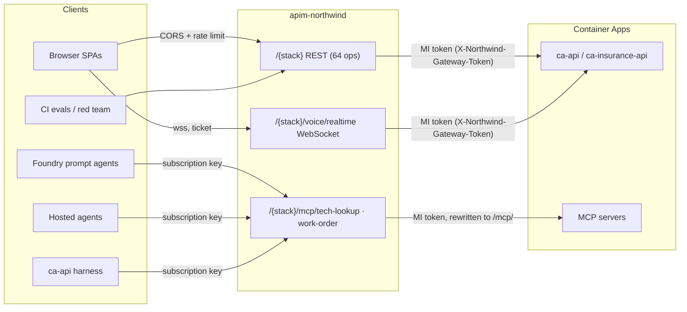

# API Management gateway (`apim-northwind`)

Every HTTP API that lives in `rg-northwind-apps` is published through the existing
Azure API Management instance **`apim-northwind`** (Standard v2, Central US,
`https://apim-northwind.azure-api.net`). The gateway is **opt-in and off by default**:
the repository ships the definition, the guarded release pipeline and the cut-over
tooling, but nothing changes in Azure until an operator runs the steps in
[Rollout runbook](#rollout-runbook).

> **Status (2026-10-23).**
> - **Applied:** `apim-northwind` publishes all 8 APIs (both stacks), 4 products, the 2 agents
>   subscriptions, the logger and per-API diagnostics. The first two applies ran locally through
>   the guarded `scripts/apim-release.py` (the pipeline's OIDC identities did not exist yet).
>   The identities now exist (see [Repository visibility](#repository-visibility)):
>   `deploy-apim.yml` plans after every CI success on `main`, and a pipeline apply under the
>   scoped role has succeeded (run 39854582597: `applied=True`, 8 APIs verified, public smoke
>   passed).
> - **Identity:** the APIM system-assigned managed identity and the secretless
>   `northwind-gateway` Entra application exist; the application's client ID is the template
>   default for `gatewayAudience`. All six API/MCP apps run images that contain the guard.
> - **Cut over, both stacks:** the four SPAs (`ca-web-tech`, `ca-web-voice`,
>   `ca-insurance-portal`, `ca-insurance-voice`) are built against
>   `https://apim-northwind.azure-api.net/<stack>` through the repository variable
>   `NORTHWIND_GATEWAY_URL`. The harness settings of `ca-api` and `ca-insurance-api` point at the
>   gateway MCP URLs with the agents key held as a Container App secret. The two hosted
>   insurance agents that call MCP servers (`northwind-insurance-policy-claim-lookup` and
>   `northwind-insurance-claim-action-draft`, version 2) reach them through the gateway with the
>   Foundry project connection `nw-insurance-claims-apim-mcp`.
> - **Locked down, both stacks:** `ca-api`, `ca-mcp-tech-lookup`, `ca-mcp-work-order`,
>   `ca-insurance-api`, `ca-insurance-lookup` and `ca-insurance-review` (the four SPAs are
>   public by design). Direct calls get 401 (`gateway_required` on the API), calls through the
>   gateway succeed, and `/health` / `/healthz` stay open for probes. The guard setting survived
>   normal app releases (new revision, same variables).
> - **Verified live:** every public smoke check and the keyed MCP checks on both stacks;
>   `apim-smoke.py --expect-lockdown` passes in full on `northwind` (24 passes, 1 skip because
>   Voice Live is not ready on that stack) and on `insurance` (25 of 25, including the WebSocket
>   upgrade through the gateway and the rejected direct WebSocket, MCP call and spoofed token);
>   36/36 read-only calls identical direct vs through the gateway (before the northwind
>   lock-down); matching error responses; bodies up to 30 MiB; NDJSON streaming is not buffered
>   (`/chat`: first line at 0.6 s, last at 13 s through APIM); inside the running container the
>   guard accepts the gateway's managed-identity token (live Microsoft signing keys) and rejects
>   direct calls, a spoofed token header, a wrong principal and a wrong audience; Foundry
>   authenticates to the gateway as a prompt-agent MCP tool through a project connection and
>   from the hosted agents. After the insurance lock-down, a full orchestrated `/chat` turn
>   through the gateway ran the hosted triage and policy/claim lookup agents (the lookup agent
>   calls the locked MCP app through the gateway), and a claim-action draft saved through the
>   gateway into the locked work-order app (the test record was deleted again).
> - **Not done:** the AI Gateway's two direct tool-server registrations for the insurance MCP
>   apps (they now get 401 until re-pointed), the three hosted agents that do not call MCP
>   servers, and landing the insurance-resource-cleanup work. See
>   [Remaining steps](#remaining-steps) and [what is not verified](#not-verified-live-yet).

## What exists in `rg-northwind-apps`

Ten Container Apps sit in one shared Container Apps environment. Two stacks run the
**same code** and are published side by side:

| Container App | Stack | What it is | Published as |
| --- | --- | --- | --- |
| `ca-api` | `northwind` | FastAPI orchestrator: 64 HTTP operations + the Voice Live WebSocket | `northwind-api`, `northwind-voice` |
| `ca-mcp-tech-lookup` | `northwind` | FastMCP server (`lookup_order`) | `northwind-mcp-tech-lookup` |
| `ca-mcp-work-order` | `northwind` | FastMCP server (`propose_resolution`, HITL queue) | `northwind-mcp-work-order` |
| `ca-insurance-api` | `insurance` | Same API image, insurance deployment | `insurance-api`, `insurance-voice` |
| `ca-insurance-lookup` | `insurance` | FastMCP policy/claim lookup | `insurance-mcp-tech-lookup` |
| `ca-insurance-review` | `insurance` | FastMCP claim-action draft | `insurance-mcp-work-order` |
| `ca-web-tech`, `ca-web-voice` | `northwind` | nginx SPAs (consumers of the API) | not published; their origins are CORS-allowed |
| `ca-insurance-portal`, `ca-insurance-voice` | `insurance` | nginx SPAs (consumers) | not published; their origins are CORS-allowed |

The `northwind` stack is the repository-managed deployment. The `insurance` stack was
created out of band (manual image deploys); it is included because it is an API in the
resource group. Both are listed in `infra/live/apim-apis.bicep` (`stacks` parameter).

The MCP images are shared too. `ca-mcp-tech-lookup` and `ca-mcp-work-order` run in the
insurance domain and serve every tool; `ca-insurance-lookup` and `ca-insurance-review`
additionally set `NORTHWIND_MCP_INSURANCE_ONLY=true`, so the insurance project exposes only
`lookup_policy`, `lookup_claim` and `draft_claim_action`, and the retail `lookup_order` and
`propose_resolution` tools are neither registered nor callable there.

Deliberately **not** published: the two SPAs per stack (they are clients, not APIs),
Foundry hosted-agent endpoints (served by Foundry), the model gateway
`ai-gateway-northwind` (separate instance in `rg-northwind-ai`), and data planes
(Cosmos, Search, Storage).

### The REST API surface (64 operations, 62 paths)

Generated from the application itself by `scripts/export-openapi.py`; the full table is
[`infra/live/apim/specs/northwind-api.operations.md`](../infra/live/apim/specs/northwind-api.operations.md).

| Group | Operations | Notes |
| --- | --- | --- |
| `insurance-business` | 24 | `/api/v1/*`, Entra delegated token (scope `access_as_user`) |
| `core` | 22 | chat, session, handoff, company/departments, bake-off, HITL and work orders, safety, traces, health, model gateway status, voice session ticket |
| `insurance-content-understanding` | 6 | claims document analysis |
| `synthetic-insurance` | 5 | fixtures and records |
| `adjuster-support`, `Agent Harness` | 3 + 3 | |
| `voice` | 1 | `GET /voice/status` (the WebSocket itself is published as its own API) |

Several operations stream newline-delimited JSON (`/chat`, `/handoff`, bake-off,
adjuster support, harness runs). The REST policy therefore never buffers responses.

## Architecture



Public URLs, per stack `S` in `{northwind, insurance}`:

| Purpose | URL |
| --- | --- |
| REST | `https://apim-northwind.azure-api.net/S/...` |
| Voice Live | `wss://apim-northwind.azure-api.net/S/voice/realtime` |
| MCP (tech lookup) | `https://apim-northwind.azure-api.net/S/mcp/tech-lookup` |
| MCP (work order) | `https://apim-northwind.azure-api.net/S/mcp/work-order` |

The gateway rewrites the MCP URLs to the backend's `/mcp/` endpoint, so clients never
append `/mcp`. The stack name is the immutable first path segment, which is also what
lets one APIM instance front two identical APIs.

## Security model

| Hop | Control |
| --- | --- |
| Browser to REST | No subscription key. APIM is the single CORS authority (only the stack's SPA origins plus local dev), rate limit per client IP (default 600/min), Application Insights diagnostics. Optional `validate-jwt` for `/api/v1/*` when `businessAuth` is set. |
| Browser to Voice Live | No policy can be applied at WebSocket API scope; the `onHandshake` operation carries only the gateway token. Origin and the one-time connect ticket stay enforced by the backend (verified: identical 101/403 behavior as direct). |
| Agents and harness to MCP | Product `S-agents` requires a subscription key (`Ocp-Apim-Subscription-Key`). Rate limit per subscription (default 300/min). The key is stripped before the request is forwarded. |
| APIM to Container App | APIM's system-assigned managed identity requests an Entra app-only token for the `northwind-gateway` application and sends it as `X-Northwind-Gateway-Token`. The caller's own `Authorization` header is preserved. |
| Direct to Container App | **Locked on both stacks** (`ca-api`, `ca-mcp-tech-lookup`, `ca-mcp-work-order`, `ca-insurance-api`, `ca-insurance-lookup`, `ca-insurance-review`). With `NORTHWIND_GATEWAY_AUTH_REQUIRED=true` the in-app guard (`apps/api/app/gateway_guard.py`) rejects every request without a valid gateway token (401; 503 if mis-configured; WebSocket close 1008). `/health` and `/healthz` stay exempt. |

Why an in-app guard instead of an IP restriction: Standard v2 has no dedicated outbound
IP, so Container Apps ingress rules cannot identify the gateway. The guard validates an
RS256 Entra token (issuer, tenant, audience, expiry, **no `scp`** i.e. app-only) and
allows only the configured object IDs (APIM's managed identity). Forced signing-key
refreshes are rate limited so unauthenticated callers cannot amplify outbound traffic.

Subscription keys are generated by APIM and never appear in the repository, Bicep
outputs or pipeline logs. The pipeline's apply identity cannot call `listSecrets`.

## Findings that shaped the design (verified live on scratch APIs)

- Standard v2 supports WebSocket APIs; Consumption does not. No dedicated IP on v2 tiers.
- Overlapping path prefixes route correctly (longest wins); OpenAPI 3.1 imports as is
  (all 64 operations). OpenAPI 3.1 is import-only.
- The native `type: mcp` API is a preview, APIM-hosted tool server with a different ARM
  contract than documented. The gateway instead uses **GA plain HTTP passthrough** APIs
  with `rewrite-uri` to `/mcp/`; initialize, `tools/list` and `tools/call` work and
  subscription-key enforcement returned 401/401/200 as intended.
- The APIM `cors` policy is the only CORS authority: one `Access-Control-Allow-Origin`
  for an allowed origin, none for a foreign one. `allowed-headers` cannot mix `*` with
  other names, so the list is explicit.
- WebSocket policies are accepted only on the system-created `onHandshake` operation.
- Subscription keys are stable across re-deployments of the template.
- `validate-jwt` fetches the tenant's OpenID configuration when the policy is saved, so a
  wrong tenant in `businessAuth` fails the deployment (fail closed).
- Policy comments must not contain placeholders; attribute values holding quotes use
  single-quoted attributes so the XML stays strict.
- OpenAPI import puts a *required* query parameter into the operation's URL template, so a
  call that omits it (for example `DELETE /work-orders/{id}`, `POST /claims/upload` or
  `POST /api/v1/claims/{id}/documents` without the parameter) gets an APIM 404 instead of the
  backend's 422. Valid calls behave exactly as they do direct.

## Repository map

| Path | Purpose |
| --- | --- |
| `infra/live/apim-apis.bicep` | Incremental definition: APIs, operations, policies, products, subscriptions, logger, diagnostics. Existing resources are references only; no modules. |
| `infra/live/apim/policies/*.xml` | `rest-api`, `voice-api`, `mcp-api` and the gateway-token / JWT fragments |
| `infra/live/apim/specs/` | Committed OpenAPI export and generated operations table |
| `scripts/export-openapi.py` | Regenerates the export from the FastAPI app (`--check` is the strict drift check) |
| `scripts/apim-release.py` | Plan/apply guard: allow-list of resource IDs, exact parameter set, plan-hash equality |
| `.github/workflows/deploy-apim.yml` | `Scoped API Management`: plan, gated apply, public smoke |
| `scripts/configure-github-oidc.py --only apim` | Scoped OIDC identities, custom roles and variables for the pipeline |
| `scripts/configure-gateway-identity.py` | APIM managed identity and the `northwind-gateway` Entra app |
| `scripts/configure-gateway-apps.py` | Guarded per-app configuration: guard variables, MCP URLs, gateway key secret, rollback records |
| `scripts/apim-smoke.py` | Read-only checks through the gateway; `--expect-lockdown` proves direct access is blocked |
| `apps/api/app/gateway_guard.py` | The in-app guard (copied into both MCP apps by `scripts/bundle-insurance-assets.py`) |
| `infra/main.bicep` | `NORTHWIND_GATEWAY_URL` / `NORTHWIND_GATEWAY_STACK` make `API_URI` and `MCP_*_URL` gateway URLs |

## Changing the API

1. Change the FastAPI app, then run `python scripts/export-openapi.py` and commit the
   spec and operations table. CI (`test_export_openapi.py`) fails if the gateway-visible
   surface differs; `python scripts/export-openapi.py --check` is the strict comparison.
2. Merge to `main` after CI. The pipeline plans automatically; apply is manual
   ([Rollout runbook](#rollout-runbook), step 4).
3. Adding a **stack** or a **resource type** is a deliberate boundary change: update
   `infra/live/apim-apis.bicep`, the allow-list and role in `scripts/apim-release.py` and
   `scripts/configure-github-oidc.py`, and the tests together. Tests derive the expected
   resource types from the compiled template, so a mismatch fails CI.

## Rollout runbook

Everything below is an operator action; none of it runs automatically. Each script
previews by default and only changes things with `--apply`. Order matters.

1. **Merge to `main`.** CI compiles the template and runs all gateway tests. The app
   release workflow ships images that contain the guard (default off) to the northwind apps
   and rebuilds the insurance SPAs. `ca-insurance-api`, `ca-insurance-lookup` and
   `ca-insurance-review` are released by hand, see
   [Insurance stack cut-over](#insurance-stack-cut-over-2026-10-23).
2. **Create the pipeline identities** (needs GitHub admin and Azure RBAC rights):
   ```powershell
   python scripts/configure-github-oidc.py --only apim --allow-public-repository            # preview
   python scripts/configure-github-oidc.py --only apim --allow-public-repository --apply
   ```
   This creates `id-gh-northwind-apim-plan` / `-apply`, two custom roles scoped to the
   resource group, environments `northwind-apim-plan` / `northwind-apim-apply` pinned to
   `main`, and the variables including `NORTHWIND_APIM_ENABLED`. Add required reviewers
   to `northwind-apim-apply` in the repository settings, and do it **after** the script: it
   rewrites each environment's branch policy and a later run would not preserve reviewers.
   Run it as the repository owner (`ZacharyZurloMSFT`): it needs admin on the repository, and
   the Enterprise Managed User account has read-only access. The repository is public, so the
   script refuses without `--allow-public-repository`, see
   [Repository visibility](#repository-visibility).
3. **Create the gateway token identity** (done for this environment on 2026-10-22; re-running
   previews no actions and prints the values):
   ```powershell
   python scripts/configure-gateway-identity.py                    # preview
   python scripts/configure-gateway-identity.py --apply
   ```
   The `gateway_audience` it prints is the default of `gatewayAudience` in
   `infra/live/apim-apis.bicep` (the release guard accepts only empty, a GUID or
   `api://<GUID>`). Keep `apim_principal_id` for step 8. Without a `gatewayAudience` the
   gateway forwards without a token and the guard cannot be enabled.
4. **Plan and apply the API Management definition.** In GitHub Actions run
   `Scoped API Management`: the plan runs after CI on `main`, or dispatch it with
   `operation=plan` and the full `main` SHA. Review the summary (first run: 51 creations,
   nothing else). To apply, dispatch `operation=apply` with `expected_sha`, the successful
   `plan_run_id` and `confirm_apply` set to the same SHA; approve the environment. Apply
   re-plans and refuses if source, template or plan hash changed, then verifies the 8
   APIs and runs the public smoke test.
5. **Smoke test from your machine:**
   ```powershell
   python scripts/apim-smoke.py --gateway-url https://apim-northwind.azure-api.net --public-checks
   ```
6. **Collect the agents key** per stack (the pipeline cannot read it) and hold it in an
   environment variable, never in a file:
   ```powershell
   $env:NORTHWIND_MCP_KEY_INSURANCE = az rest --method post --body "{}" --query primaryKey -o tsv `
     --url "https://management.azure.com/subscriptions/137c905b-7734-479e-acc5-ab8222462936/resourceGroups/rg-northwind-apps/providers/Microsoft.ApiManagement/service/apim-northwind/subscriptions/insurance-agents/listSecrets?api-version=2024-05-01"
   python scripts/apim-smoke.py --gateway-url https://apim-northwind.azure-api.net --stack insurance
   ```
   Create the Foundry project connections (category `RemoteTool`, auth `CustomKeys`, key
   `Ocp-Apim-Subscription-Key`, the stack's agents key) through ARM, the same way
   `scripts/connect-knowledge-base.py` does. **Foundry sends a tool's calls to the *target* of
   the connection it references**, so:
   - **prompt agents** need one connection per MCP endpoint, each with the exact MCP URL as its
     target (for example `https://apim-northwind.azure-api.net/insurance/mcp/tech-lookup`).
     A connection that targets the gateway base URL makes Foundry call the base URL and get a
     404 (reproduced live);
   - **hosted agents** read the credentials themselves and send the header to their own MCP
     URL, so a single connection whose target is the gateway base URL or an exact MCP URL is
     enough. Foundry returns custom key names lower-cased; the code matches case-insensitively.
   Delete any scratch agents and connections after testing; connection names are account-wide.
7. **Cut over the consumers** (each is independently reversible):
   - Foundry agents: `azd env set NORTHWIND_GATEWAY_URL https://apim-northwind.azure-api.net`,
     `NORTHWIND_GATEWAY_STACK` (`northwind` or `insurance`), `MCP_GATEWAY_CONNECTION` (hosted
     agents) and `MCP_GATEWAY_CONNECTION_TECH_LOOKUP` / `MCP_GATEWAY_CONNECTION_WORK_ORDER`
     (prompt agents, one exact-target connection per endpoint); the next reuse-mode provision
     publishes gateway URLs as `API_URI` / `MCP_*_URL` without changing resources, and
     `scripts/create-prompt-agents.py` re-creates MCP tools against the gateway through those
     connections (it warns when a gateway tool has none). The live insurance agents are five
     *hosted* agents whose `MCP_*_URL` environment pointed at the insurance MCP apps; moving the
     two that call MCP servers took new agent versions (done, see
     [Insurance stack cut-over](#insurance-stack-cut-over-2026-10-23); the generic command is
     `scripts/deploy-orders-hosted.py --business-domain insurance`).
   - `ca-api` harness (northwind: **done**; the harness itself is `unavailable` on that stack, so
     only its configuration moved; insurance: **done** on 2026-10-23, `ca-insurance-api`):
     `python scripts/configure-gateway-apps.py --app ca-insurance-api --mcp-gateway-base https://apim-northwind.azure-api.net/insurance`
     (reads the key from `NORTHWIND_MCP_KEY`; add `--apply` after reviewing the preview).
   - SPAs (**done** on both stacks, the release builds the bundles against the gateway): set the
     repository variable `NORTHWIND_GATEWAY_URL` and re-run the app release
     (`VITE_API_BASE_URL` becomes `<gateway>/northwind`). The same release also rebuilds the
     insurance portal and voice client (`ca-insurance-portal`, `ca-insurance-voice`) with
     `VITE_API_BASE_URL=<gateway>/insurance`; without the variable they keep calling
     `ca-insurance-api` directly. The voice client appends `/voice/realtime` to that base path.
     A local `azd deploy` of an SPA builds from
     `API_URI`, so keep `NORTHWIND_GATEWAY_URL` in the azd environment (the next provision then
     publishes the gateway URL as `API_URI`) or export `VITE_API_BASE_URL` yourself; otherwise
     the bundle calls the direct URL, which a locked-down app rejects.
   - CI consumers: point the `STAGING_API_URI` secret at `<gateway>/northwind` (the public REST
     API needs no key). No such secret exists today, so no workflow is affected by the lock-down.
8. **Lock direct access** once consumers are verified through the gateway:
   ```powershell
   python scripts/configure-gateway-apps.py --stack insurance --guard enable `
     --gateway-audience <northwind-gateway appId> --allowed-oid <APIM principalId>      # preview
   # repeat with --apply, then:
   python scripts/apim-smoke.py --gateway-url https://apim-northwind.azure-api.net --stack insurance --expect-lockdown
   ```
   The script checks revision health, probes the health endpoint, and confirms the guard
   really answers 401 (an image without the guard would silently ignore the variables).
   Each change writes a rollback record (non-secret values only) under `release/`.

   **Done for the northwind stack on 2026-10-22**, one app at a time with `--app`, in this
   order: `ca-api`, then the harness settings, then `ca-mcp-tech-lookup` and `ca-mcp-work-order`.
   Through the gateway `GET /company` returned 200, which also proves the container reaches
   Microsoft's signing keys; direct it returned 401, and direct `/health` and `/healthz` stayed
   200. The next `ca-api` release (workflow run 39844489003) kept all four guard variables on its
   new revision. The evidence before locking the MCP apps: no Foundry agent references them (the
   five hosted agents use the insurance MCP apps and the two prompt agents have no MCP tools),
   the northwind harness is `unavailable` and was re-pointed at the gateway first, no workflow
   or script hard-codes them, and the repository calls them legacy. Earlier direct calls in the
   container logs came from many Azure addresses and the telemetry carries no client IP or user
   agent, so their origin (manual or CI testing) could not be established. **Anything external
   that still calls these apps directly now gets 401**; [Rollback](#rollback) is one command.
   **Do not lock an app before everything that calls it has moved**, see
   [Remaining steps](#remaining-steps).

   **Done for the insurance stack on 2026-10-23**, consumers first, then images, then the
   guard: the `ca-insurance-api` harness settings, the two hosted agents that call MCP servers,
   the insurance SPAs, then the API (`--app ca-insurance-api`), `ca-insurance-review` and
   `ca-insurance-lookup`. `apim-smoke.py --stack insurance --expect-lockdown` passes 25 of 25.
   The images, the hosted agents and the rollback values are in
   [Insurance stack cut-over](#insurance-stack-cut-over-2026-10-23).

### Repository visibility

`ZacharyZurloMSFT/foundry-frontier` is **public**, while `configure-github-oidc.py` was written for
a private repository and used to refuse (`Expected the private approved main-branch repository.`).
On 2026-10-22 the owner approved accepting OIDC trust on the public repository, so the check is
now an explicit opt-in: without `--allow-public-repository` the script still refuses. The opt-in
relaxes **only** the visibility check. These are unchanged and still enforced:

- the immutable repository and owner IDs and the immutable OIDC subject (`validate_oidc_policy`):
  a renamed, recreated or forked repository cannot obtain these identities;
- the `main` default branch;
- environments pinned to the `main` branch before any Azure trust exists, so only workflows
  running on `main` can use them. Pull requests, including fork pull requests, cannot obtain
  these tokens; dispatching the workflows needs write access;
- apply identities that cannot read secrets (`listSecrets`) and are limited to an allow-list of
  resource types in one resource group.

What changes with a public repository: workflow logs, plan artifacts and step summaries are
world-readable. They carry resource names and plan hashes only; the plan envelope never
contains property values, and no secret is ever passed through the workflows. Making the
repository private again needs no code change: run the script without the flag.

Before the pipeline existed, the same boundary was applied locally with the same guarded script
(on 2026-10-22, twice), from a clean LF checkout of the merged commit so the template matches
what CI would compile. The procedure stays valid as a fallback:

```powershell
git -c core.autocrlf=false worktree add --detach $env:TEMP\apim-src <main sha>
bicep build $env:TEMP\apim-src\infra\live\apim-apis.bicep --outfile $env:TEMP\apim-src\apim-apis.json   # v0.46.1
python $env:TEMP\apim-src\scripts\apim-release.py --compiled-template $env:TEMP\apim-src\apim-apis.json `
  --source-sha <main sha> --output plan.json                                   # review, then:
$env:NORTHWIND_APIM_CONFIRM = '<main sha>'
python $env:TEMP\apim-src\scripts\apim-release.py --compiled-template $env:TEMP\apim-src\apim-apis.json `
  --source-sha <main sha> --approved-plan plan.json --output result.json --apply
```

Later plans from the pipeline see these objects as existing, but expect noise. Every API, policy
and the logger is listed as **Modify** and the product links as **Create** even when nothing
changed: the service normalises defaults (for example `isAgent`, key header names, policy
`format`) and what-if cannot resolve the template's expressions. The second plan (after #61)
showed 25 such entries, 17 Modify and 8 Create, while all product links already existed. The
real change signal is the diff of `infra/live/apim/specs/northwind-api.openapi.json`; every
entry still has to fall inside the allow-list, which `apim-release.py` enforces.

### Rollback

- Fastest: `python scripts/configure-gateway-apps.py --stack northwind --guard disable --apply`
  unlocks the three northwind apps; `--app <name>` unlocks one (for example `--app ca-mcp-work-order`);
  `--stack insurance` covers the insurance stack.
- Exact: `python scripts/configure-gateway-apps.py --revert-from release/gateway-rollback-<app>-<revision>.json --apply`.
  The 2026-10-22 records were written outside the repository; the values they hold are the
  ones before the change: every guard variable unset, and on `ca-api` the harness URLs below
  without `MCP_GATEWAY_SUBSCRIPTION_KEY`.
- Harness (northwind): unlock the MCP apps first, then set `MCP_TECH_LOOKUP_URL` and
  `MCP_WORK_ORDER_URL` on `ca-api` back to
  `https://ca-mcp-tech-lookup.<aca-suffix>/mcp/` and `https://ca-mcp-work-order.<aca-suffix>/mcp/`
  and remove `MCP_GATEWAY_SUBSCRIPTION_KEY` (and its secret `mcp-gateway-key`). The insurance
  harness (`ca-insurance-api`) is the same with `ca-insurance-lookup` / `ca-insurance-review`.
- Insurance stack (full values in [Insurance stack cut-over](#insurance-stack-cut-over-2026-10-23)):
  - unlock one app: `python scripts/configure-gateway-apps.py --app ca-insurance-lookup --guard disable --apply`
    (also `ca-insurance-review`, `ca-insurance-api`);
  - hosted agents: switch the version selector of `northwind-insurance-policy-claim-lookup` and
    `northwind-insurance-claim-action-draft` back to version 1. **Unlock the two MCP apps first**:
    version 1 calls them directly and would get 401;
  - images: `az containerapp update -g rg-northwind-apps -n <app> --image <previous digest>
    --revision-suffix <new suffix>`; the previous digests are listed in the cut-over section.
- Consumers: unset `NORTHWIND_GATEWAY_URL` (azd and the repository variable) and redeploy;
  the direct Container App URLs are the default again.
- The API Management objects are inert without consumers and can stay in place.

### Operations

- **Key rotation:** regenerate the secondary key (`.../subscriptions/<stack>-agents/regenerateSecondaryKey`),
  update the Foundry connection and re-run `configure-gateway-apps.py` for the harness
  secret, restart the hosted agents, then rotate the primary. For `insurance` the key sits in
  the connection `nw-insurance-claims-apim-mcp` (project `nw-insurance-claims`), in the secret
  `mcp-gateway-key` of `ca-insurance-api` and in the AI Gateway tool-server credential once it
  is re-pointed. Hosted agents resolve the connection once at start-up, so a new version (or a
  restart) is what makes them pick up a new key.
- **Telemetry:** every API has an `applicationinsights` diagnostic (logger
  `northwind-appinsights`, W3C correlation, no bodies logged) into `appi-zurlo-northwind`.
- **Limits:** defaults are `webRateLimitPerMinute=600` per IP and
  `agentsRateLimitPerMinute=300` per subscription; both are template parameters.
- **Re-provisioning:** reuse mode (this environment) never touches the Container Apps. A
  full-Bicep provision of a new environment re-declares each app's environment and drops the
  guard variables; re-run step 8 afterwards. `apim-smoke.py --expect-lockdown` shows the gap
  immediately, so run it after any provision or manual change to an app.

## Insurance stack cut-over (2026-10-23)

The insurance apps were created by hand, so their live images are not a commit of `main`, and a
plain CI image is not a drop-in: on 2026-10-22 releasing one made `/health` report
`insurance_agent_runtime_ready: false` and it was rolled back within three minutes. Each gap
below was closed, and each change was canaried on a throwaway copy first and is reversible.

| App | What a plain `main` image lacked | Closed by |
| --- | --- | --- |
| `ca-insurance-api` | `main` hard-coded the project name `northwind-orders` (the live project is `nw-insurance-claims`), and the live company and department data carry insurance project names that exist only in the unmerged `insurance-resource-cleanup` work. | #70 (`INSURANCE_PROJECTS` accepts both names) plus a data overlay. |
| `ca-insurance-lookup`, `ca-insurance-review` | The hand-built images predate the guard and hide the retail tools. | #72: `NORTHWIND_MCP_INSURANCE_ONLY=true` makes the CI image expose only the insurance tools. The northwind MCP apps run in the insurance domain too and keep every tool, which is why the switch is not derived from `NORTHWIND_BUSINESS_DOMAIN`. |
| Hosted agents | Version 1 of all five was packaged outside the repository and calls the MCP apps directly. | New versions of the two that call MCP servers. |

**API image.** The packaging is the `build` step of `.github/workflows/deploy-apps.yml` (generate
the insurance inputs, copy `data/northwind` to `apps/api/app/_northwind`,
`bundle-insurance-assets.py --service api`, `bundle-harness-assets.py`), run from a clean LF
checkout of `main`, plus an eight-line edit of `data/northwind/company.yaml` that gives the
departments the live project names (`hosted_in_project` and the Order Concierge
`foundry_project`: `northwind-orders` -> `nw-insurance-claims`; the HR, claims and contact-center
`foundry_project`s: `nw-employee-help-desk`, `nw-claims-warranty`, `nw-contact-center` ->
`nw-insurance-support`, `nw-insurance-documents`, `nw-insurance-contact-center`; the HR
`search_index`: `nw-hr` -> `nw-insurance-adjuster-support`). Build from `apps/api` with
`az acr build -r acrzurlonorthwind --platform linux/amd64 .` (no local Docker needed). The overlay
goes away once the cleanup work is in `main`. The canary was a throwaway Container App cloned from
the live configuration (same environment, identity and variables, one replica, tag
`purpose=apim-canary`); 19 read-only GETs matched the live app apart from additive fields
(`model_route`, `/gateway/status`, the build SHA) and per-request ids.

**MCP apps.** CI images from `main` `436da65` plus `NORTHWIND_MCP_INSURANCE_ONLY=true`, released
by hand (the workflow skips these apps):
`az containerapp update -g rg-northwind-apps -n ca-insurance-lookup --image <digest> --set-env-vars NORTHWIND_MCP_INSURANCE_ONLY=true --revision-suffix <suffix>`.
Comparing the old and the new image showed only `app/main.py`, `requirements.txt` (PyJWT for the
guard) and the guard module differing; the domain module and fixtures were identical. The base
layers and installed package versions were not compared; the behaviour was. The canary
was one throwaway app per image, and a differential of `initialize`, `tools/list` (names,
descriptions, schemas), the read-only lookups, the retail tool being unknown and, on the
work-order server, a draft the server rejects before any write found **0 differences** against
the old live apps, and again against the live apps after the release. The guard went on afterwards
(`configure-gateway-apps.py --app <app> --guard enable ...`, work-order first).

**Hosted agents.** `northwind-insurance-policy-claim-lookup` (role `orderlookup`) and
`northwind-insurance-claim-action-draft` (role `resolutiondraft`) in project `nw-insurance-claims`
now run version 2:

- *Package:* built with `scripts/orders_agent_package.py` from `main` (`ad4edfd`, requirements
  `agents/hosted/requirements.txt`, whose pins match version 1). Version 1 was packaged outside the repository from
  pre-gateway `main` plus two edits that only affect the policy-wording role.
- *Environment:* version 1's non-secret environment plus `MCP_GATEWAY_CONNECTION=nw-insurance-claims-apim-mcp`,
  `MCP_TECH_LOOKUP_URL=https://apim-northwind.azure-api.net/insurance/mcp/tech-lookup` and
  `MCP_WORK_ORDER_URL=https://apim-northwind.azure-api.net/insurance/mcp/work-order`.
  `ORDERS_MCP_GATEWAY` stays unset: for one role the AI Gateway and API Management routes are
  mutually exclusive, and a role that sets both fails at start-up.
- *Connection:* `nw-insurance-claims-apim-mcp` in the project, category `RemoteTool`, auth
  `CustomKeys`, key `Ocp-Apim-Subscription-Key` = the `insurance-agents` key, target
  `https://apim-northwind.azure-api.net/insurance` (for a hosted agent a base URL covers both MCP
  URLs). It was created with an ARM `PUT`, the way `connect-knowledge-base.py` creates its
  connection. Connection names are account-wide.
- *Rollout:* a new version of an agent whose selector is pinned takes no traffic. Both versions
  were proven on throwaway agents first (same package and environment, the same three role
  assignments as the live runtime principals, deleted afterwards; an agent that has been invoked
  needs `force` to delete), then the selector (`update_details`) was switched one agent at a time
  and each was verified with a live call: the response's `agent_reference.version` shows which
  version served it. The runtime principal belongs to the agent, not the version, so no role
  assignment changed.
- *Redeploying:* `scripts/deploy-orders-hosted.py --business-domain insurance` with the same
  environment in its `--config` file. It switches the selector immediately and only accepts the
  standard agent names, so a staged rollout uses the SDK as above. **Any new version of these two
  roles must keep `MCP_GATEWAY_CONNECTION` and the gateway URLs**, otherwise it calls the locked
  apps directly and gets 401.

| App | Now | Previous (rollback) |
| --- | --- | --- |
| `ca-insurance-api` | `api@sha256:1305a295968f6be15c20b896c8aa20bd0748f4596f1118d8de05220962fbabd0` (`main` `ab32e73` plus the overlay), guard on, harness through the gateway | `api@sha256:5c9f01f42941bf58368377def819cd01685b52804e7f3dbb9969e2796ae0d36b` (`insurance-names-20261020`, no guard code, so it unlocks the app) |
| `ca-insurance-lookup` | `mcp-tech-lookup@sha256:117d6e668c1848f5e21e142d92850357d35c8985cd4156de8ddf2ff0c3565f4f` (CI, `main` `436da65`) with `NORTHWIND_MCP_INSURANCE_ONLY=true`, guard on | `mcp-tech-lookup@sha256:ad61483cf7ac00e37cf7a8d6d1548ed89e203494c10943ae69b25cbad94876bf` |
| `ca-insurance-review` | `mcp-work-order@sha256:c4ce9258d22a68d8e4ee70cf309bc7ac391248a35127d39bd480edcae58a4a0f` (same build), same variable, guard on | `mcp-work-order@sha256:a6b8971e44a96c01dc80e631fff4c1aef7a6874cad43b94cafa0b1d0d929081e` |
| Hosted `...policy-claim-lookup`, `...claim-action-draft` | version 2 (package SHA-256 `b3bff914c255f6e87936248c1dc48c5df258f227c8487c9c6bcaa8bd73367a23`) | version 1, by switching the selector |

If this is ever repeated, the order is: consumers first (harness settings, hosted agents), then
the images, then the guard, and the AI Gateway registrations last, because they cannot carry a
credential until someone re-points them.

## Remaining steps

Deliberately not done. The gateway works without them, and each one is independent and
reversible.

| Step | Why it is not done | How to finish |
| --- | --- | --- |
| Re-point the AI Gateway tool servers `northwind-insurance-lookup` and `northwind-insurance-review` | They register the direct MCP URLs with no credential, so since the lock-down they get 401. They belong to the AI Gateway work ([ai-gateway.md](./ai-gateway.md#findings-to-act-on), finding 8). | Point `northwind-insurance-lookup` at `https://apim-northwind.azure-api.net/insurance/mcp/tech-lookup` with the `Ocp-Apim-Subscription-Key` header (the `insurance-agents` key). `northwind-insurance-review` cannot work through the AI Gateway (it drops `x-orders-workflow`, which the work-order server requires): remove it or leave it failing by design. |
| Land the `insurance-resource-cleanup` work | The live department project names and the policy-wording tweaks of hosted version 1 exist only there. Until then the API image carries the data overlay, and the policy-wording agent cannot be rebuilt from `main` (`main` insists on the connection name `northwind-insurance-kb-mcp`, the live one is `nw-insurance-claims-kb-mcp`). | Rebase and merge the branch (a trial merge on 2026-10-22 conflicted in 16 files), then rebuild the API from `main` without the overlay. |
| The other three hosted agents (`...-triage`, `...-policy-wording`, `...-orchestrator`) | They never call an MCP app, so the lock-down does not touch them; their version-1 environment still lists the direct MCP URLs, unused. | Redeploy from `main` with the same environment when the cleanup work lands. |
| Release the insurance apps from the workflow | `release-app.py` can release `ca-insurance-api` and the two SPAs but not the two MCP apps, and the workflow releases only the SPAs: it deliberately skips `ca-insurance-api`, `ca-insurance-lookup` and `ca-insurance-review`, so a merge that changes their code does not reach them. | After the cleanup work lands, add the two MCP apps to `RELEASE_APPS` (images `mcp-tech-lookup` and `mcp-work-order`) and the three apps to the workflow. A release changes only the image and build metadata, so the guard variables and `NORTHWIND_MCP_INSURANCE_ONLY` carry over, as they did for the northwind apps. |
| Run the harness through the gateway | It is `unavailable` on the northwind stack; on the insurance stack it is `configured` but no run was made. | Run a harness request on `ca-insurance-api` and check the draft reaches the review app through the gateway. |
| Align `configure-github-oidc.py` with the live roles | Its `APPS_NAMES` lists the five northwind apps, while the apps pipeline identity also holds the release role on the five `ca-insurance-*` apps. The script does not manage those assignments, so it no longer describes the live state. | Add the five insurance apps to `APPS_NAMES` together with its tests. |

## Not verified live yet

Verified live on 2026-10-22 and 2026-10-23: see Status. Still not exercised:

- a signed-in browser session: headless Chromium loads both insurance SPAs against the gateway
  without CORS or console errors, but the Entra sign-in and a manual claim flow were not driven;
- a harness run through the gateway (see [Remaining steps](#remaining-steps));
- the AI Gateway tool servers after they are re-pointed;
- a rotation of the `insurance-agents` key (see [Operations](#operations));
- the three hosted agents that stay on version 1.

`ca-insurance-api` runs `main` plus the data overlay and the two MCP apps run CI images, but none
of the three is released by the workflow. Everything else is covered by unit tests and by the live
checks above.
