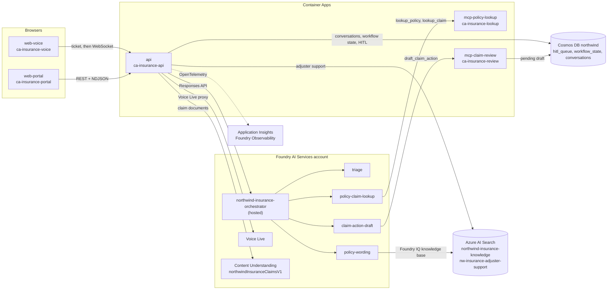
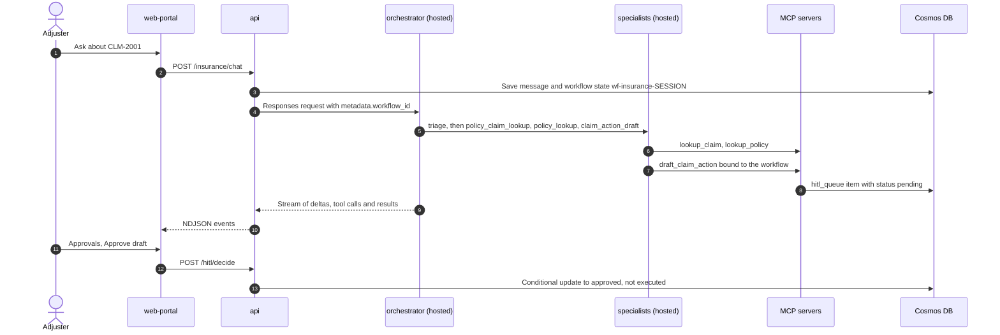

# Architecture

The demo is organized as **one company (Northwind Insurance), four departments and one
shared Azure AI Services account**. Northwind is a fictional property-and-casualty insurer
(Washington and Colorado auto). A policyholder reports a loss by voice or text, a **claims
concierge** orchestrator and four hosted specialist agents look up the records and the
versioned policy wording, and the specialists **draft** a claim action that a **human
approves or rejects**. Agents never approve, deny or pay a claim, and every record is
synthetic.

See [`docs/departments.md`](./departments.md) for the department layout,
[`docs/genaiops.md`](./genaiops.md) for the delivery and evaluation loop and
[`docs/legacy-decommission.md`](./legacy-decommission.md) for retiring the earlier stack,
which this repository no longer manages.

## System at a glance



| azd service | Source | Container App | What it does |
| ----------- | ------ | ------------- | ------------ |
| `api` | `apps/api` | `ca-insurance-api` | FastAPI: claims-concierge chat stream, handoff, human approvals, records and drafts, adjuster support, claim documents, Voice Live proxy, Copilot SDK harness, adjuster-workbench business API |
| `mcp-policy-lookup` | `apps/mcp-policy-lookup` | `ca-insurance-lookup` | MCP server with the read-only tools `lookup_policy` and `lookup_claim` |
| `mcp-claim-review` | `apps/mcp-claim-review` | `ca-insurance-review` | MCP server with `draft_claim_action`, which writes the human-review queue |
| `web-portal` | `apps/web-portal` | `ca-insurance-portal` | React/Vite app served by nginx: policyholder portal, adjuster workbench and the staff AI workspace |
| `web-voice` | `apps/web-voice` | `ca-insurance-voice` | React/Vite Voice Live intake app served by nginx |

The five apps are declared in `azure.yaml` and `infra/modules/containerapps.bicep`; their
ingress is public, and the apps authenticate to Azure with one user-assigned managed
identity. **The hosted agents are not azd services.** They run in Foundry and are deployed
with `scripts/deploy-hosted-agents.py` (see [Hosted agents](#hosted-agents)). The azd hooks
are `preprovision` and `predeploy`, both running `scripts/validate-reuse.py`; there is no
postprovision hook, so the data scripts listed in [`docs/departments.md`](./departments.md)
are run explicitly.

### API surface

`apps/api/app/*.py` is the source of truth. `infra/live/apim/specs/northwind-api.operations.md`
is the generated table of all 59 HTTP operations (regenerate it with
`python scripts/export-openapi.py`; `--check` compares it with the code).

| Group | Routes |
| ----- | ------ |
| Core | `GET /health`, `GET /build`, `GET /gateway/status`, `GET /company`, `GET /departments`, `GET /departments/{slug}`, `POST /session`, `GET /session/{sid}/messages`, `GET /traces/{sid}` |
| Claims concierge | `POST /insurance/chat` (NDJSON stream), `POST /handoff` (NDJSON stream) |
| Records and drafts | `GET /insurance/fixtures`, `GET /insurance/policies/{policy_id}`, `GET /insurance/claims/{claim_id}`, `POST /insurance/actions/draft` |
| Human approval | `GET /hitl`, `POST /hitl/decide`, `GET /hitl/resolved`, `DELETE /hitl/{hitl_id}` |
| Adjuster support | `GET /adjuster-support/status`, `POST /adjuster-support/chat`, `POST /adjuster-support/{slug}/chat` |
| Claim documents | `GET /claims/samples`, `GET /claims/status`, `GET /claims/samples/{filename}/content`, `POST /claims/extract`, `POST /claims/upload`, `DELETE /claims/results/{operation_id}` |
| Voice Live | `POST /voice/session`, `GET /voice/status`, WebSocket `/voice/realtime` |
| Copilot SDK harness | `GET /harness/status`, `POST /harness/runs`, `GET /harness/runs/{run_id}` |
| Adjuster workbench | `/api/v1/*`: `me`, `policies`, `claims`, tasks, notes, assignment, transitions, evidence documents and jobs. Needs an Entra delegated token |

Only `/api/v1/*` authenticates callers. The other routes are a synthetic public demo; the
optional gateway guard ([API gateway](#api-gateway-opt-in)) is what restricts direct
access.

## One claims-concierge turn



1. **Front doors.** `POST /insurance/chat` (`{message, session_id?}`) and `POST /handoff`
   (the contact-center and document-intelligence handoff, which first validates the claim,
   policy, policyholder, loss date and state against the records) both end in
   `run_turn` in `apps/api/app/orchestrator_client.py`.
2. **Gate.** Both return `503` until the insurance runtime is ready
   ([readiness](#runtime-readiness-and-feature-switches)).
3. **Turn.** `run_turn` derives the application-owned workflow id `wf-insurance-<session>`,
   prefixes the message with `[workflow_id: ...]`, saves the user message
   (`conversations`) and the workflow state (`workflow_state`), then calls the hosted
   orchestrator through the project's Responses client with `stream=True`,
   `metadata.workflow_id` and a per-session `previous_response_id` chain. It streams
   NDJSON events: `session`, `assistant_delta`, `reasoning_delta`, `tool_call` (with
   `to_agent` for the four specialists), `tool_args_done`, `tool_result`, `error` and
   `done` (which carries the `workflow_id`).
4. **Delegation.** The orchestrator exposes four function tools. Each calls an
   independently hosted specialist through that specialist's own Responses endpoint
   and returns its answer; the specialists' tool events are relayed into the stream
   before the delegation result.
5. **Draft.** Only `claim-action-draft` can persist anything, and only a pending draft
   (see [Human approval](#human-approval)).

## Runtime readiness and feature switches

`GET /insurance/fixtures` returns the synthetic records plus `agent_runtime_ready`. Chat,
`/handoff` and `POST /voice/session` refuse to run until `insurance_runtime_ready()` in
`apps/api/app/insurance.py` is true:

- `NORTHWIND_INSURANCE_AGENTS_READY=true` and `HOSTED_AGENTS_ENABLED=true`, set by an
  operator after the fleet is deployed and verified, never inferred from packaged files;
- `INSURANCE_PROJECT_NAME` is `nw-insurance-claims` (the live flagship project) or `northwind-orders` (the
  original native project, and the API's fallback when the variable is unset); both are accepted, and which one
  exists in a tenant is an operator fact this repository cannot verify;
- `FOUNDRY_PROJECT_ENDPOINT` is `https://<host>/api/projects/<INSURANCE_PROJECT_NAME>`;
- `FOUNDRY_INSURANCE_ORCHESTRATOR_AGENT_ID` starts with `northwind-insurance-`.

Until then the portal says "Insurance agents are not available yet" and the records,
drafting and approval screens keep working. Every other capability has its own switch,
off by default; none of them is set by `infra/main.bicep` except where noted:

| Capability | Switches | When off |
| ---------- | -------- | -------- |
| Voice Live | the readiness gate, plus `VOICE_LIVE_ENABLED`, `VOICE_LIVE_READY`, `VOICE_LIVE_MODEL` and `VOICE_LIVE_API_VERSION` (and `VOICE_LIVE_ALLOWED_ORIGINS` for origins beyond its defaults) | `503`; text intake in the portal still works |
| Adjuster support | `ADJUSTER_SUPPORT_ENABLED`, a Search endpoint and an authentication mode, a published index | `GET /adjuster-support/status` explains why; chat returns `503` |
| Live Content Understanding | `NORTHWIND_CU_ENABLED`, `NORTHWIND_CU_COMPLETION_DEPLOYMENT`, optionally `NORTHWIND_CU_COMPLETION_MODEL` and `NORTHWIND_CU_ENDPOINT`; the analyzer is registered by `scripts/configure-insurance-cu.py` | `503 cu_disabled`; the sample list still loads, and no authored extraction is substituted |
| Evidence records | `NORTHWIND_EVIDENCE_ENABLED`, `NORTHWIND_EVIDENCE_UPLOADS_ENABLED`, `NORTHWIND_EVIDENCE_EXTRACTION_ENABLED`, `NORTHWIND_EVIDENCE_WORKER_ENABLED`, `NORTHWIND_EVIDENCE_WORKER_RUN_IDS`, `STORAGE_ACCOUNT` | `GET /api/v1/evidence/status` reports disabled |
| Adjuster workbench API | `NORTHWIND_BUSINESS_API_ENABLED` (a Bicep parameter), `INSURANCE_AUTH_TENANT_ID`, `INSURANCE_AUTH_AUDIENCE`, `INSURANCE_AUTH_REQUIRED_SCOPE`, `INSURANCE_AUTH_CLIENT_IDS` | `503 business_api_disabled` |
| Copilot SDK harness | `COPILOT_HARNESS_ENABLED` (a Bicep parameter), `MCP_CLAIM_REVIEW_URL`, `COPILOT_HARNESS_*` | `POST /harness/runs` returns `503` |
| Gateway routing | `AI_GATEWAY_*`, `NORTHWIND_GATEWAY_*` | model calls go straight to Foundry; the API is reached directly |
| In-app trace panel | `APPINSIGHTS_WORKSPACE_ID` (or `LOG_ANALYTICS_WORKSPACE_ID`) | `GET /traces/{sid}` returns `status: unavailable` with a note; no stub trace is substituted |

## Hosted agents

The claims concierge is five independently deployed **Foundry hosted agents**, one runtime
(`agents/hosted`, entrypoint `agents/orchestrator/main.py`) configured by `AGENT_ROLE`.
Prompts are the canonical YAML under `agents/insurance/` (the source of truth; the
deployment configuration never carries prompts).

| Role id | Foundry agent | Manager tool | Prompt | Grounding and tools |
| ------- | ------------- | ------------ | ------ | ------------------- |
| `orchestrator` | `northwind-insurance-orchestrator` | | `orchestrator.yaml` | the four delegation tools below |
| `triage` | `northwind-insurance-triage` | `triage` | `triage.yaml` | none; returns strict JSON (`InsuranceTriageResult`: IDs copied only when supplied, intent, sentiment, urgency P1 to P4) |
| `policy-claim-lookup` | `northwind-insurance-policy-claim-lookup` | `policy_claim_lookup` | `policy_claim_lookup.yaml` | MCP `lookup_policy`, `lookup_claim` on `MCP_POLICY_LOOKUP_URL` |
| `policy-wording` | `northwind-insurance-policy-wording` | `policy_lookup` | `policy_wording.yaml` | Foundry IQ knowledge base `northwind-insurance-kb`, tool `knowledge_base_retrieve` |
| `claim-action-draft` | `northwind-insurance-claim-action-draft` | `claim_action_draft` | `claim_action_draft.yaml` | `draft_claim_action` against `MCP_CLAIM_REVIEW_URL` |

**Runtime guards** (`agents/hosted/runtime.py`, `tools.py`): caller options cannot add
tools or change the model; `store=false` and one tool call at a time; the grounded roles
(`policy-claim-lookup`, `policy-wording`) fail unless a tool returned a successful result;
`claim-action-draft` requires the application-owned `metadata.workflow_id`, the model
supplies only the `draft` argument, and the turn fails unless the MCP service confirmed a
persisted, workflow-bound `pending_approval` with `execution_status: not_executed`.

**Knowledge.** `policy-wording` accepts only the explicit insurance settings
`AZURE_SEARCH_KNOWLEDGE_BASE=northwind-insurance-kb`, `AZURE_SEARCH_INDEX=northwind-insurance-knowledge`
and the project connection `nw-insurance-claims-kb-mcp` (or its original name
`northwind-insurance-kb-mcp`; set with `AGENT_KB_CONNECTION` or
`AGENT_KB_CONNECTION_NAME`); any other knowledge base is rejected at startup. That
knowledge base is published with `scripts/publish-insurance-knowledge.py` (dry run unless
`--apply`) and is configured for minimal, extractive retrieval (no query-planning model),
so retrieval returns the source passages with their citations rather than a model-written
summary. Manifest names describe intended targets, not proof that cloud resources exist or
hold current content.

**Models.** The repository does not pin a model per role. Each role's inference deployment
is `AGENT_MODEL_DEPLOYMENT` in its deployment config (`scripts/deploy-hosted-agents.py`
requires it). `triage` calls account-level Chat Completions at `AGENT_OPENAI_ENDPOINT`
(the account's `.../openai/v1/` URL) with managed-identity tokens; the other roles use the
project's Responses endpoint. `TRIAGE_MODEL_DEPLOYMENT` can override triage only with an
evaluated `northwind-insurance-*` model and `NORTHWIND_INSURANCE_TRIAGE_MODEL_VERIFIED=true`.
Response metadata reports the actual deployment, role and the canonical prompt SHA-256.

**Packaging and deployment.** `scripts/hosted_agent_package.py` builds the allowlisted
source ZIP (`main.py`, the hosted package, the five prompts, `models.py`, the fixtures and
the shared `insurance_domain.py`); the requirements file is passed in
(`agents/hosted/requirements.txt`) and never bundles virtual environments, tests or
secrets. `scripts/deploy-hosted-agents.py --role <role> ...` is a dry run by default;
`--apply` creates a Python 3.13 `remote_build` version that serves the Responses protocol
on port 8088, waits for it to become active and selects it at 100% traffic.
`--grant-runtime-roles` is an explicit opt-in to RBAC writes. Receipts are journaled by
`scripts/agent_deploy_journal.py`. `FOUNDRY_*` variables are platform-reserved and must
not appear in the deployment configuration.

## MCP servers

| Server | Container App | Tools | Behavior |
| ------ | ------------- | ----- | -------- |
| `mcp-policy-lookup` (FastMCP `northwind-insurance-lookup`) | `ca-insurance-lookup` | `lookup_policy(policy_id, policyholder_id?, loss_date?, state?)`, `lookup_claim(claim_id, policy_id?, policyholder_id?)` | Read-only. Checks that policyholder, policy and claim belong together, that the loss date is inside the policy, wording and endorsement periods and that the jurisdiction matches; a mismatch raises an error rather than returning an empty success |
| `mcp-claim-review` (FastMCP `northwind-insurance-review`) | `ca-insurance-review` | `draft_claim_action(workflow_id, draft)` | Validates the draft, requires the `x-workflow-id` request header to equal `workflow_id`, and writes one pending item (`hitl-<workflow_id>`) to Cosmos `hitl_queue`, idempotently. It has no approve, deny or pay tool |

Both serve streamable HTTP at `/mcp` with a `/healthz` probe. The endpoints themselves are
unauthenticated unless `NORTHWIND_GATEWAY_AUTH_REQUIRED=true` turns on the gateway guard.
The shared records module and fixtures (`apps/api/app/insurance_domain.py`,
`data/northwind/insurance-fixtures.json`) are copied into each image by
`scripts/bundle-insurance-assets.py`, and the same module is packaged into the hosted
agents.

The AI Gateway registers the lookup, knowledge and review servers as tool servers
`northwind-insurance-lookup`, `northwind-insurance-knowledge` and
`northwind-insurance-review` (live identifiers, not renamed). Tools are exposed as
`<namespace>_<tool>`.

## Human approval

A claim-action draft is the only thing an agent can persist. Its contract
(`ClaimActionDraft` in `apps/api/app/insurance_domain.py`):

- `claim_id`, `policy_id` and `policyholder_id` must belong together;
- `action_type` is one of `request_evidence`, `assign_adjuster`, `customer_update`,
  `escalate_review` or `settlement_recommendation`. There is no deny, approve, execute
  or payment action;
- `policy_refs` must be unique, applicable wording sections for that claim;
- only a `settlement_recommendation` may carry `amount_usd`: positive, within the
  illustrative policy or cited endorsement limit, with cited wording. It is a
  recommendation, never a payment.

Drafts reach the Cosmos `hitl_queue` container (partition key `/workflowId`) from the
agents (through `mcp-claim-review`) or from the Claims / Policies screen
(`POST /insurance/actions/draft`). `GET /hitl` lists pending items;
`POST /hitl/decide` records `approve` or `reject` with an ETag-conditional update, so a
replay is idempotent and a conflicting decision is refused. The decision writes
`execution_status: not_executed` and `review_scope: draft_only`, and posts a confirmation
into the originating chat session. `GET /hitl/resolved` feeds the Reviewed drafts screen
and `DELETE /hitl/{hitl_id}?workflow_id=...` prunes it. **Approval reviews the draft
only: no coverage decision, claim approval, external message or payment follows.**

## Adjuster support

`POST /adjuster-support/{slug}/chat` is read-only, extractive retrieval:

1. Azure AI Search `search` over the isolated index `nw-insurance-adjuster-support`
   (filtered to the publisher, `business_domain eq 'insurance'`, `synthetic eq true` and
   category `adjuster`);
2. one model call with the department prompt
   (`data/northwind/departments/adjuster-support/prompts/northwind-adjuster-support.yaml`)
   that may only select up to four verbatim excerpts, without tools;
3. the API checks that every quote is a contiguous substring of the named source and
   streams the excerpts with title, version, effective date and source URI. An ungrounded
   excerpt is rejected with an error event and no answer; when no evidence supports the
   question, or it asks for a coverage, approval or payment decision, the fixed "I don't
   have sufficient evidence" answer is returned instead.

The model slug (`gpt-5-4`, `gpt-5-4-mini`, `kimi`) selects the deployment `gpt-5.4`,
`gpt-5.4-mini` or `Kimi-K2.6`; a partner deployment such as Kimi has to exist on the
account (`additionalModelDeployments` in `infra/main.bicep`). History is stored in
`conversations`, isolated per model. The corpus is four versioned fictional procedures
published by `scripts/publish-adjuster-support.py`.

## Claim documents and evidence records

**Document Intelligence** (`/claims/*`) calls Azure Content Understanding live with the
analyzer `northwindInsuranceClaimsV1` (REST `2025-11-01`, base64 input, request-scoped
model deployments, no public blob URL). Inputs are an allowlisted set of synthetic PDFs
(`data/northwind/departments/claims-documents/claims-documents.json`, generated by
`python data/seed/generate.py`) or a raw PDF, JPEG or PNG upload of at most 10 MiB. The
result is returned with confidence, source spans and a SHA-256, flagged `review_required`;
expected extractions are never returned as inference and the API stores no source bytes.
A reviewer can hand the extracted identifiers to the claims concierge through `/handoff`.
FNOL text, estimates, invoices and photos are source facts only: they cannot establish
cause, fault, fraud or coverage.

**Evidence records** (`/api/v1/claims/{claim_id}/documents`, off by default) attach a
document to a claim case: private immutable blobs in the existing `cu-inbox` container, a
run-scoped durable worker (`python -m app.business.evidence_worker`; it is not a deployed
Container App) that extracts fields with the same analyzer, and **field-level human
review** (accept, correct or clear) with an audit trail.

## Voice Live

```text
web-voice  --GET /insurance/fixtures, GET /voice/status-->  api
web-voice  --POST /voice/session (30 s single-use ticket)-->  api   (digest and origin in workflow_state, 60 s TTL)
web-voice  --WebSocket /voice/realtime, first frame {"type":"proxy.connect","ticket":...}-->  api
api        --managed-identity token-->  wss://<account>/voice-live/realtime  (Voice Live)
```

The browser never receives an Azure token or key. The API pins the Foundry host, validates
the origin and the ticket, and relays only audio and transcript events: session
instructions (`INSURANCE_INSTRUCTIONS` in `apps/api/app/voice.py`), voice, server VAD
with barge-in and an empty tool list are server-controlled, so the voice agent cannot look
up records or take actions. Limits are 600 s per call, 32 MiB of input, four active calls
and eight open sockets per API process. Only the **completed** transcript populates the
editable intake form; an operator reviews and confirms the summary, IDs, loss date, state
and asset, and only that confirmation calls `POST /handoff`. Raw audio is not persisted
and partial transcripts never trigger anything.

## Copilot SDK Agent Harness

`/harness/*` is an application-hosted alternative to the hosted orchestrator, not another
Foundry hosted agent. FastAPI owns a lazy GitHub Copilot SDK runtime (pinned
`github-copilot-sdk==1.0.14`, started in `mode="empty"` with an isolated runtime
directory, denied ambient permissions and no configuration discovery) and one isolated
session per `POST /harness/runs` (`{request_id, message}`, idempotent on `request_id`).
These controls do not replace application authentication.

The manager prompt is `agents/copilot-harness/instructions.prompty`. It has exactly four
tools: `triage` (the hosted `northwind-insurance-triage` agent), `policy_claim_lookup` and
`policy_lookup` (in-process reads of the canonical records and wording) and
`claim_action_draft` (the hosted `northwind-insurance-claim-action-draft` agent plus
`MCP_CLAIM_REVIEW_URL`, followed by an independent read of the saved Cosmos item). Model
inference uses the project endpoint, or the AI Gateway when it is configured, with a
managed-identity token callback and `COPILOT_HARNESS_MODEL` (default: the planner
deployment).

Run summaries are `workflow_state` documents and bounded events are `conversations`
documents, both with a seven-day TTL; conditional writes protect idempotency and terminal
states across replicas. The SDK session ends with the request and reading a saved run
never resumes it. Defaults are two concurrent runs per process
(`COPILOT_HARNESS_MAX_CONCURRENT_RUNS`), eight tool calls
(`COPILOT_HARNESS_MAX_TOOL_CALLS`) and a 180 s deadline
(`COPILOT_HARNESS_TIMEOUT_SECONDS`). The harness appends one `AI-conversation` log per
run (`harness=copilot-sdk`) and has no tab in the current web portal; it is exercised by
the API, `evals/run_evals.py --target copilot-sdk` and the red-team HTTP target.

## Adjuster workbench

`/api/v1/*` backs the policyholder portal and the adjuster workbench in `web-portal`.
Callers sign in with Microsoft Entra; the API validates the delegated token and maps the
caller, inside a **demo run** (`X-Demo-Run`, seeded by `scripts/seed-insurance-run.py`), to
one of three server-assigned roles: `policyholder`, `adjuster` or `presenter` (read-only).
Cases follow `reported` to `evidence_requested` to `evidence_received` to `adjuster_review`
to `customer_update_prepared` (with loops back to `evidence_requested`), and every command
carries the case version so a stale write is refused. Adjusters create evidence tasks and
notes (internal or customer-visible), assign cases and move the workflow; none of it sends
a message or decides coverage. Staff roles also see the **AI workspace** (the department
shell), which receives the portal's access token.

## Foundry projects

The four departments are four Foundry projects in one shared AI Services account.
`infra/modules/foundry.bicep` creates the flagship project (`insuranceProjectName` in
`infra/main.bicep`, default `nw-insurance-claims`) and one project per entry of the
`additionalProjects` parameter; the manifest values are in `data/northwind/company.yaml`
(`foundry_project`). Account-scoped roles (Azure AI User, Cognitive Services OpenAI User)
inherit to every project, so the shared identity needs no per-project role plumbing.
The department-to-endpoint map is the JSON app setting `FOUNDRY_PROJECT_ENDPOINTS`, which
`apps/api/app/company.py` uses to resolve the `X-Department` header. Project names match
the live deployment (the manifest derives an endpoint from them when that setting is
absent). The department layout, indexes and how
to add one are in [`docs/departments.md`](./departments.md).

## Data stores

| Store | Used for |
| ----- | -------- |
| Cosmos DB database `northwind` (serverless) | `conversations` (partition `/sessionId`: chat history, harness events, support history), `workflow_state` (`/workflowId`: workflow state, harness runs, voice tickets, adjuster-workbench runs) and `hitl_queue` (`/workflowId`: claim-action drafts and decisions) |
| Azure AI Search | `northwind-insurance-knowledge` (claims-concierge wording and procedures, knowledge source `northwind-insurance-knowledge-ks`, knowledge base `northwind-insurance-kb`), `nw-insurance-adjuster-support`, plus the department indexes built by `scripts/create-department-indexes.py` |
| Blob Storage | `cu-inbox` (evidence blobs) and `seed`, both created by Bicep; `scripts/create-department-indexes.py` uploads department seed files to `dept-seed` |
| Application Insights and Log Analytics | OpenTelemetry from the API and MCP servers, Foundry agent traces |

## Models and gateways

| Model | Where it is used |
| ----- | ---------------- |
| `gpt-5.4` (`FOUNDRY_PLANNER_DEPLOYMENT`) | Planner deployment; default for the Copilot SDK harness and the first adjuster-support choice |
| `gpt-5.4-mini` (`FOUNDRY_WORKER_DEPLOYMENT`) | Worker deployment; second adjuster-support choice |
| `gpt-4o` (`FOUNDRY_PROMPT_AGENT_DEPLOYMENT`) | Prompt agents: Foundry prompt-agent function tools do not yet work on gpt-5.x |
| `text-embedding-3-small` | Embeddings for the department indexes |
| `Kimi-K2.6` | Optional partner deployment offered in adjuster support |
| `VOICE_LIVE_MODEL` | Native Voice Live catalog model (not a text deployment) |
| `NORTHWIND_CU_COMPLETION_MODEL` | `gpt-4.1` or `gpt-4o` for Content Understanding |

The deployments are Bicep parameters in `infra/main.bicep`; which hosted-agent role uses
which deployment is deployment configuration (above).

### Model gateway (opt-in)

With `AGENT_MODEL_GATEWAY_ENDPOINT`, `AGENT_MODEL_GATEWAY_MODEL` and
`AGENT_MODEL_GATEWAY_DEPLOYMENT` (which must equal the selected deployment) all five
hosted roles send inference to the Azure API Management **AI Gateway** tier
(`ai-gateway-northwind`) with an Entra token for `https://azure-api.net/aigateway/.default`
instead of the project endpoint, and the metadata records the alias. The `model` value is
`<provider>/<registration>`, where the registration is the deployment name lowercased with
characters outside `[a-z0-9-]` replaced by `-` (`gpt-5.4` is `aisvc-zurlo-northwind/gpt-5-4`);
bare deployment names return 404. In the API app the same routing applies to adjuster
support and the harness through `AI_GATEWAY_MODEL_ENDPOINT`. `AI_GATEWAY_REQUIRED=true`
turns any direct inference path into a startup error. Agent-to-agent calls, Voice Live
and Content Understanding are not routed.

`AGENT_MCP_GATEWAY` (JSON keyed by role) sends the lookup and knowledge MCP calls through
gateway tool servers, and `AI_GATEWAY_MCP_REQUIRED=true` makes direct MCP an error. The
claim-review MCP is different: its workflow-binding header is application-owned proof and
the AI Gateway does not forward client headers, so that role stays direct or goes through
the API Management instance with `MCP_GATEWAY_CONNECTION`; for one role the two routes are
mutually exclusive. The design, the live inventory and the rollout runbook are in
[`docs/ai-gateway.md`](./ai-gateway.md).

### API gateway (opt-in)

An existing Azure API Management instance, `apim-northwind`, can front the HTTP API, the
Voice Live WebSocket and the two MCP servers of the **`insurance` stack**, the only stack
this repository manages. Browsers reach REST through CORS and rate limits, agents reach MCP
with a subscription key, and APIM reaches the Container Apps with a managed-identity token
(`X-Northwind-Gateway-Token`) that the in-app guard (`apps/api/app/gateway_guard.py`,
`NORTHWIND_GATEWAY_AUTH_REQUIRED=true`) validates once direct access is locked down.
`NORTHWIND_GATEWAY_STACK` must be `insurance`. The definition is
`infra/live/apim-apis.bicep`, applied only by the guarded `Scoped API Management`
workflow; it is off in a fresh deployment. The API inventory, security model and rollout
are in [`docs/api-management.md`](./api-management.md).

## Networking, regions and identity

A fresh `azd up` (`infra/main.bicep`, subscription scope) creates:

| Region | Resources |
| ------ | --------- |
| `location` (default Canada Central) | VNet `10.60.0.0/16` (`container-apps` subnet `10.60.0.0/23`, delegated to `Microsoft.App/environments`; `private-endpoints` subnet `10.60.2.0/24`), Container Apps environment and the five apps, user-assigned managed identity, container registry, Storage, Azure AI Search, Application Insights, Log Analytics and the Cosmos private endpoint with its `privatelink.documents.azure.com` zone |
| `aiLocation` (default East US 2) | The AI Services account with its projects and model deployments (Voice Live and Content Understanding are served by the account) and the Cosmos DB account |

- Cosmos has public network access **disabled** and is reached through the private
  endpoint from the VNet-integrated Container Apps environment. Foundry, Search, Storage
  and the registry have public endpoints (the apps use the managed identity; Search runs in
  API-key mode); there is no Key Vault, Front Door or WAF in the template. A laptop cannot
  reach Cosmos unless you provide a reachable account.
- One user-assigned managed identity (`AZURE_CLIENT_ID`) is attached to all five apps and
  used for Foundry, Cosmos, Storage and Search; role assignments are declared in the Bicep
  modules for it and for the principal that runs `azd up`. Azure AI Search runs in API-key
  mode and the knowledge-base connections use `CustomKeys`; `scripts/fetch-keys.ps1`
  writes keys into a git-ignored `.env` for local development only.
- **Reference-only reuse.** With `NORTHWIND_REUSE_EXISTING_RESOURCES=true`, `main.bicep`
  reads existing resources and republishes their values as azd outputs without creating or
  changing foundational resources, RBAC, models, app settings or networking.
  `scripts/validate-reuse.py` (the azd `preprovision` and `predeploy` hook) validates the
  inputs, including `NORTHWIND_GATEWAY_STACK=insurance`. The resource-group selectors are
  `AZURE_APPS_RESOURCE_GROUP`, `AZURE_DATA_RESOURCE_GROUP`, `AZURE_NETWORKING_RESOURCE_GROUP`,
  `AZURE_AI_RESOURCE_GROUP` and `AZURE_FOUNDRY_RESOURCE_GROUP`; `AZURE_RESOURCE_GROUP`
  stays the Foundry (AI) group. The release and publish scripts of the reference
  deployment target `rg-northwind-apps` (apps), `rg-northwind-ai` (Foundry account and AI
  Gateway), `rg-northwind-data` (Search and Storage) and `rg-northwind-networking`
  (VNet).

## Observability

- **OpenTelemetry to Azure Monitor** from the API and the MCP servers. Every span created
  through `get_tracer` is stamped with the build (`git_sha`, `build_env`, `deployed_at`,
  `repo`), the packaged prompt hashes (`prompt_sha.copilot-harness`,
  `prompt_sha.adjuster-support`), the department and Foundry project from the
  `X-Department` header, and the model route (`gateway.route`).
- Hosted agents report the deployment, role and canonical prompt SHA-256 in their
  Responses metadata, and Foundry exports agent traces to the Application Insights
  component connected to the flagship project (`infra/modules/foundry-observability.bicep`).
  **Foundry Observability** and the App Insights tables correlate with the same session.
- **In-app trace panel.** `GET /traces/{sid}` queries the workspace for the session and
  returns the span tree, per-agent latency and the token counts and costs the spans
  report, plus a sequence diagram of the hand-offs and the build stamp
  (`apps/web-portal/src/components/TracePanel.tsx`). Totals are not an Azure billing total.
- `GET /build` returns the build stamp from the packaged `build.json` that
  `scripts/bundle-harness-assets.py` writes at package time.
- Custom event `AI-conversation` is emitted by Copilot SDK harness runs (department,
  Foundry project, run and workflow IDs, prompt hash; no prompt or answer text).

## Evaluation baselines

`evals/baseline.json` (schema version 2) is keyed by **department slug** so a regression in
one department cannot hide in another. Every department entry is intentionally empty today:
no reviewer-approved measured run exists, so the gates report
`regression_status=unavailable` instead of passing. The four tiers and the rules for
changing the baseline are in [`docs/genaiops.md`](./genaiops.md) and `evals/README.md`.

## What we intentionally omitted

Front Door and WAF, Azure Policy and Defender for Cloud tuning, PSTN telephony, any model
training or fine-tuning (`pipelines/insurance-learning` prepares evaluation data only) and
multi-tenant isolation (the demo is a synthetic, single-tenant, public demonstration).
