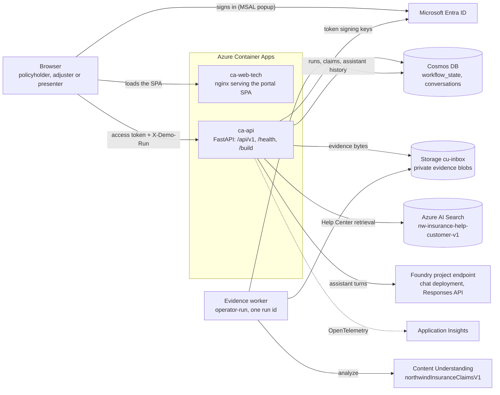
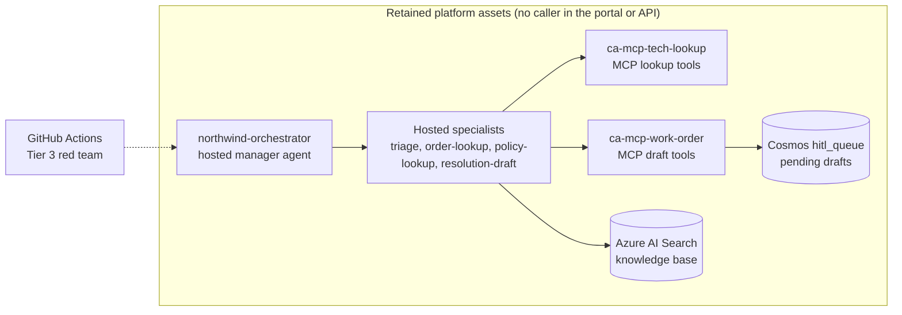
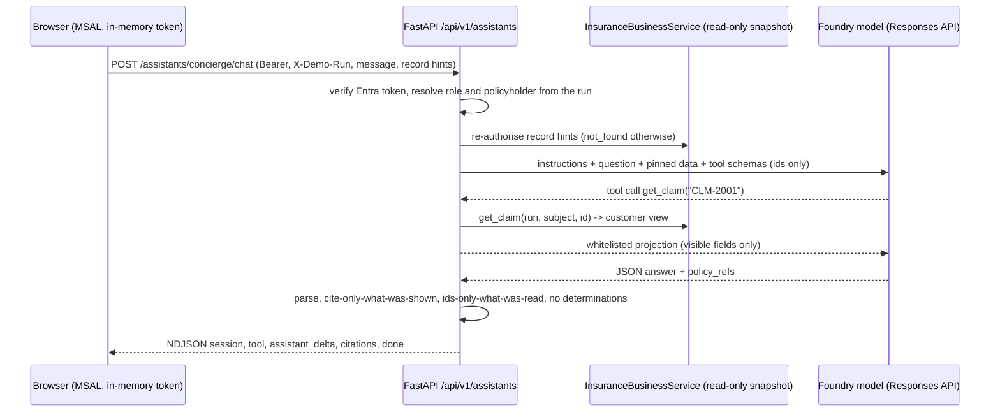
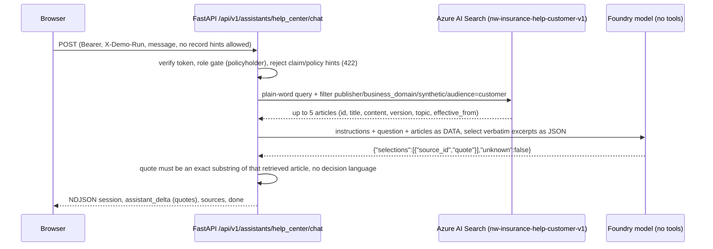

# Architecture

The demo is **one Microsoft Entra-protected insurance portal in front of one
FastAPI service**, with identity-bound AI assistants embedded in the portal
sections they help with. There is no department picker, no separate "AI
workspace" and no voice front door. Everything that predates the portal (the
hosted Foundry agents, the MCP servers, the per-department Foundry projects and
the Content Understanding ingestion pipeline) is kept as a **retained platform
asset that the portal does not call**; see
[Retained platform assets](#retained-platform-assets-not-called-by-the-portal).
All records and policy wordings are synthetic.

## Components

- **Portal** (`apps/web-tech`, Container App `ca-web-tech`) is the only web app.
  Its entry point (`src/main.tsx`) renders `src/business/BusinessPortal.tsx`. The
  public pages (Home, Coverage information, Claims help) need no sign-in.
  **My account** signs in with Microsoft Entra (MSAL popup, authorization code +
  PKCE, tokens kept in memory) and calls only the API's `/api/v1` routes:
  policies, claims and loss reporting for policyholders, the case workbench and
  claim documents/evidence review for adjusters, read-only access for
  presenters, and the embedded assistants. Its settings are build-time `VITE_*`
  values. The production `Dockerfile` only serves a `dist` that azd's
  `prepackage` hook (or `deploy-apps.yml`) already built; `Dockerfile.local`
  builds from source for local Docker.
- **API** (`apps/api`, Container App `ca-api`) is FastAPI and exposes only
  `/health`, `/build` and `/api/v1/*`.
- **Evidence worker** is `python -m app.business.evidence_worker`, started by an
  operator for one explicit run id. It is not an API background task and not a
  Container App.
- The business API, the assistants and each evidence capability are switched on
  separately and are **disabled by default**.

The API's modules (`apps/api/app`):

| Module | Role |
| --- | --- |
| `main.py` | App, CORS, `/health`, `/build`; mounts the business and assistants routers |
| `business/` | Policies, claims and evidence service (`service.py`, `evidence_*.py`), Entra token verification (`auth.py`), the Cosmos run store (`store.py`), routes, and the operator-run evidence worker (`evidence_worker.py`) |
| `assistants/` | Embedded assistants: surface registry (`profiles.py`), per-turn scope (`scope.py`), server-side tools (`tools.py`), output guards and grounding (`guards.py`, `grounding.py`), owner-bound history (`history.py`), the scoped-tools turn (`runtime.py`), the Help Center turn (`extractive.py`) and `routes.py` |
| `settings.py` | All configuration, from environment variables or `.env` |
| `observability.py` | Azure Monitor / OpenTelemetry setup, the build and prompt-SHA stamp behind `/build`, and the department stamp on spans |
| `azure_clients.py`, `repositories.py` | Credentials and the Cosmos client; the `_container` and `_now` helpers |
| `content_understanding.py` | Content Understanding transport used by the evidence pipeline (no router) |
| `foundry_client.py` | Async Foundry project client helpers for the assistants |
| `company.py` | Loads the Northwind manifest; `resolve_department` supplies the telemetry stamp |
| `diagnostics.py` | `log_failure`: allow-listed failure metadata only |
| `insurance_domain.py` | Synthetic fixtures and lookup rules, also bundled into the MCP servers and hosted agents |
| `demo_data.py` | Historical fixtures, read only by `data/seed/generate.py` |

## Request flows

1. **Sign-in and account context.** The SPA reads its build-time `VITE_*`
   settings (tenant, client, scope, run id and API URL); if any is missing or
   invalid, **My account** reports that it is unavailable and no demo account is
   substituted. After a Microsoft popup sign-in, every call to `/api/v1` carries
   the delegated access token in its `Authorization` header and `X-Demo-Run: <run id>`.
   The API verifies the v2 RS256 token (signature against the tenant's Entra
   signing keys, issuer, tenant, audience GUID, expiry, required scope and a
   permitted client app), derives the subject `tenant-UUID:object-UUID` and
   reads the run aggregate from Cosmos. Only the persisted actor mapping assigns a
   role (`policyholder`, `adjuster` or `presenter`) and a policyholder id; the
   token, the header and anything else the browser sends never grant access.
2. **Report a loss and work the case.** A mapped policyholder submits the form
   with `POST /api/v1/claims` and an `Idempotency-Key`. The service re-reads the
   run, checks that the caller owns the policy and the insured vehicle, pins the
   policy and its wording on the claim, and records review flags when the loss
   date falls outside the policy, wording or an endorsement period or the loss
   state differs from the policy state (flags go to a human; they are never a
   denial). It then replaces the run aggregate with an ETag-protected write. The
   same key and input replay the original result; the same key with different
   input conflicts. Adjusters work the case with `expected_version` commands:
   workflow transitions (`reported`, `evidence_requested`, `evidence_received`,
   `adjuster_review`, `customer_update_prepared`), evidence tasks, notes and
   assignment. Policyholders see a customer-filtered view of their own claims and
   presenters are read-only. Nothing here approves coverage, denies a claim,
   sends an external message or makes a payment.
3. **Claim documents and evidence** (each step has its own switch; all are off by
   default). A synthetic sample from an allowlist, or a bounded PDF/JPEG/PNG
   upload of at most 10 MiB, is registered against a claim with a synthetic-data
   acknowledgement and an `Idempotency-Key`. The bytes go to private,
   content-addressed blobs in the `cu-inbox` container, and the run aggregate
   records the document, a queued job, a receipt and an audit event. Processing
   is a separate bounded process: the operator-started worker
   (`python -m app.business.evidence_worker --run-id <run> --once`) leases queued
   jobs, submits the document to Content Understanding (analyzer
   `northwindInsuranceClaimsV1`), polls the saved operation, validates the result
   and stores it as a second blob. It never resubmits after an uncertain
   submission. An adjuster then accepts, corrects or clears each extracted field;
   the extraction stays an untrusted suggestion, and confirming a field does not
   move the claim through its workflow.
4. **Embedded assistant turn.** `POST /api/v1/assistants/{surface}/chat` streams
   NDJSON events for the Claims Concierge or the Help Center; see
   [Identity-bound embedded assistants](#identity-bound-embedded-assistants).

## Data stores

| Store | Contents | Written by |
| --- | --- | --- |
| Cosmos DB `northwind`, container `workflow_state` (`/workflowId`) | One bounded run aggregate per demo run (`insurance-run-<run id>`, at most 1.5 MB): actor mappings, pinned policy snapshots, claims with timelines, idempotency receipts, and evidence documents, jobs and audit. Replaced atomically under an ETag. | The API, the evidence worker, and `scripts/seed-insurance-run.py --apply` (create-only) |
| Cosmos DB `northwind`, container `conversations` (`/sessionId`) | One owner-bound `assistant_exchange` document per answered assistant turn, each with its own `ttl` | The API (assistants) |
| Storage container `cu-inbox` | Private, immutable evidence blobs named `northwind-evidence/<sha256 of run id>/{source,result}/<sha256>` | The API (sources), the evidence worker (results) |
| Azure AI Search index `nw-insurance-help-customer-v1` | The twelve customer Help Center articles | `scripts/publish-customer-help.py --apply` (operator); the API only reads it |

Cosmos is serverless and has public network access disabled; it is reached
through its private endpoint. The template also creates the `hitl_queue` and
`cu_extractions` containers and the `seed` blob container, and the greenfield
bootstrap creates further Search indexes. Those belong to the retained platform
assets below; nothing in the portal path reads or writes them.

## Replacement-stack placement

The authorised 2026-10-14 cutover and legacy retirement are **complete**.
Live placement in subscription
`137c905b-7734-479e-acc5-ab8222462936` is:

- **Apps** (`rg-northwind-apps`): the four stable apps the template defines
  (`ca-api`, `ca-mcp-tech-lookup`, `ca-mcp-work-order`, `ca-web-tech`)
  attached to replacement environment `cae-zurlo-northwind`; retain the
  selected app UAMI, ACR, App Insights and Log Analytics. A `ca-web-voice` app
  deployed by earlier releases is no longer defined, built or released from this
  repository. Bicep deployments are incremental and do not delete it, so an
  operator must delete it.
- **Networking** (`rg-northwind-networking`): replacement
  `vnet-zurlo-northwind`, approved Cosmos PE `pe-zz-cosmos-northwind` and
  `privatelink.documents.azure.com` link `northwind-networking`.
- **AI** (`rg-northwind-ai`): `aisvc-zurlo-northwind`, all five projects and
  `ai-gateway-northwind`. **Data** (`rg-northwind-data`): existing Storage,
  Search and Cosmos remain untouched.

App environment attachment is immutable. Recreate apps on the replacement
environment, then move the recreated resources into Apps under their stable
names; an RG move alone cannot change the attachment. The original PE
`pe-cosmos-zurlo-northwind`, DNS link `cosmos-ng5k6nn2f2ddy`, Dev environment,
VNet, monitoring and unused identity were retired. Dev and Rebuild are
deleted, as are the old service-owned auxiliary groups.
Only the replacement endpoint owns the reconciled Cosmos DNS records.

Reuse defaults select Apps for the environment, Networking for the VNet and
the approved replacement PE. Explicit selectors still support older
transitional deployments; `AZURE_LEGACY_RESOURCE_GROUP` is only an optional
deprecated label and never selects resources. Reference-only provisioning
reports live attachments without moving them or recreating retired resources.
`AZURE_RESOURCE_GROUP` remains the Foundry **AI** group, not Apps.

The replacement ingress suffix is
`gentlemushroom-296b38f8.canadacentral.azurecontainerapps.io`; the old
`bluecliff` suffix retires, with no custom-domain indirection. Update API,
MCP and browser/CORS consumers during cutover. See the
[reuse profile and run URLs](../README.md#replacement-endpoint-change).
The diagrams in this document describe application flow, not evidence of
completed infrastructure migration. The `ca-cu-ingest` ingestion worker is
retired and default-disabled (`enableCuIngest`); Content Understanding runs only
through the API's evidence pipeline.

## Retained platform assets (not called by the portal)

These assets predate the portal. They are still in the repository and some are
still deployed by `azd up`, but **the portal and API do not call them**: the API
exposes no route that reaches them and the portal calls only `/api/v1`. They stay
as platform references and as the target of the Tier 3 red team, and they are
described here as what they are, not as part of the portal.

| Asset | Where | Status |
| --- | --- | --- |
| Hosted Foundry agents | `agents/orchestrator`, `triage`, `orderlookup`, `policylookup`, `resolutiondraft` (azd services in `azure.yaml`) on the shared runtime in `agents/hosted`; prompts in `agents/*.yaml`, `agents/orchestrator/instructions.yaml` and `agents/insurance/*.yaml`; the separate legacy manager in `agents/legacyorchestrator` | Deployed to the `northwind-orders` project by azd or `scripts/deploy-orders-hosted.py`. The portal and API never call them; only the Tier 3 red team and operator evaluation or load scripts do. |
| MCP servers | `apps/mcp-tech-lookup` (`ca-mcp-tech-lookup`: `lookup_order`, `lookup_policy`, `lookup_claim`) and `apps/mcp-work-order` (`ca-mcp-work-order`: `propose_resolution`, `draft_claim_action`) | Public ingress with no authentication, a demo trade-off. Called by the retained agents (hosted and prompt), never by the portal or API. The work-order server writes pending drafts to the Cosmos `hitl_queue`; the approval screen and `/hitl` API that consumed them were deleted, so nothing in this repository reads that queue. The work-order server (and the hosted agents' proposal tool) still carries inert hooks for the deleted Copilot SDK harness. |
| Department Foundry projects | `nw-employee-help-desk`, `nw-claims-warranty` and `nw-contact-center` beside `northwind-orders`, plus the separate legacy `northwind` project | Provisioned in the shared account. The greenfield bootstrap (`scripts/postprovision.*`) creates their Search indexes and prompt agents. No portal or API route uses them. |
| Content Understanding pipeline | `pipelines/content-understanding` (ingest worker and analyzer schemas) and `data/northwind/departments/claims-warranty/cu-analyzers` | The `ca-cu-ingest` worker is retired, default-disabled and not an azd service. The portal's own Content Understanding path is the API's evidence pipeline. |
| Seed data and generators | `data/seed/*` (retail corpus generator and indexer, insurance PDF generator) and the per-department seed corpora under `data/northwind/departments/*/seed` | Feed the greenfield bootstrap. Two parts are active: `data/northwind/insurance-fixtures.json` and `company.yaml` are bundled into the API, and `seed/customer/*.md` is the Help Center's source content. `data/seed/generate.py` is the only reader of `app/demo_data.py`. |
| Optional model deployments | The `bakeoffDeployments` Bicep parameter (default empty) | Dormant: the screen that raced them was removed and no code uses `FOUNDRY_BAKEOFF_DEPLOYMENTS`; the reuse profile only preserves it. |

### Foundry projects

Each of the four departments has its own `Microsoft.CognitiveServices/accounts/projects`
resource inside the shared `aisvc-zurlo-northwind` AI Services account. The
native flagship uses `northwind-orders`; the retained legacy `northwind`
project is separate. The other
three (`nw-employee-help-desk`, `nw-claims-warranty`, `nw-contact-center`)
are provisioned by an `additionalProjects` for-loop in
`infra/modules/foundry.bicep`. Account-scoped RBAC (Azure AI User,
Cognitive Services OpenAI User) inherits to all projects, so the shared
UAMI works everywhere without per-project role plumbing. See
[`docs/departments.md`](./departments.md) for the department layout.

The department → endpoint map is exported as the `FOUNDRY_PROJECT_ENDPOINTS`
JSON string. The post-provision scripts (`scripts/create-prompt-agents.py`,
`scripts/connect-knowledge-base.py`) read it to place each department's agents,
and the reuse validator requires all four endpoints. The API no longer parses it:
the embedded assistants use the single `FOUNDRY_PROJECT_ENDPOINT` (the
`northwind-orders` project in the template) only as a model-inference endpoint,
and invoke no agent in any project.

### Hosted Foundry agents

The hosted-agent code targets the existing `northwind-orders` project
under `aisvc-zurlo-northwind`, without replacing the other departments.
Its manager and four specialists have independent hosted definitions:
`agents\orchestrator\agent.yaml`, `agents\triage\agent.yaml`,
`agents\orderlookup\agent.yaml`, `agents\policylookup\agent.yaml`, and
`agents\resolutiondraft\agent.yaml`. The agent names (`northwind-orchestrator`,
`northwind-triage`, `northwind-order-lookup`, `northwind-policy-lookup`,
`northwind-resolution-draft`) are retained.
These are deployment inputs, not evidence that a deployment has occurred.
The portal and API do not call them; only the Tier 3 red team and operator
evaluation or load scripts (such as `scripts\run-agent-log-load.ps1`) do.

All five use the repository-root build context with `agents\Dockerfile`,
entrypoint `python -m agents.hosted.main`, the GA Responses protocol on
port **8088**, and `/readiness`. The Agent Framework hosting integration
and GA server are pinned in `agents\hosted\requirements.txt`; install them
in the image or a dedicated environment, not the shared API environment.
The SDK source-ZIP path (`scripts\deploy-orders-hosted.py`) runs the same
runtime through a root `main.py` with `python_3_13` and `remote_build`.
`scripts\orders_agent_package.py` stages an explicit allowlist (the `agents`
hosted package, the retail and insurance canonical prompt YAML, the manager
instructions and the synthetic insurance fixtures) and the hosted requirements
file as `requirements.txt` at the ZIP root; virtual environments, tests and
secrets are never packaged.
`ORDER_AGENT_ROLE` selects `manager`, `triage`, `orderlookup`,
`policylookup`, or `resolutiondraft`. `MODEL_DEPLOYMENT_NAME` selects the
baseline (`ORDERS_MODEL_DEPLOYMENT` remains an alias);
`TRIAGE_MODEL_DEPLOYMENT` explicitly overrides triage inference.
Absent an override, the runtime reports `model_route=baseline`, not a
fine-tuned deployment. It never trains or deploys models. Responses metadata
reports the actual selected model, role, and canonical prompt SHA-256.
Triage's internal inference uses account-level Chat Completions at
`ORDERS_OPENAI_ENDPOINT` (the account's `https://...openai.azure.com/openai/v1/`
endpoint), with managed-identity tokens scoped to Cognitive Services and
`store=false`. Grant its runtime principal Cognitive Services OpenAI User.
It never falls back to Chat Completions on the non-default project. The
other roles use project-level Responses for native MCP/project connections;
all internal model calls disable storage. External invocation of every
hosted role remains the agent-specific Responses endpoint.

Model gateway routing is explicitly enabled with
`ORDERS_MODEL_GATEWAY_ENDPOINT=https://ai-gateway-northwind.azure-api.net/default/models/openai/v1/`,
`ORDERS_MODEL_GATEWAY_MODEL` (the gateway alias, such as
`aisvc-zurlo-northwind/gpt-4o`), and `ORDERS_MODEL_GATEWAY_DEPLOYMENT`
(the original model deployment). The last value must match the selected
deployment, including a triage override; changing models cannot silently
reuse a gateway alias for a different deployment. All five roles use this
endpoint when enabled, without falling back to direct Foundry inference.
Grant each version's actual runtime principal **AI Gateway Models User**
on the gateway. Tokens use `https://azure-api.net/aigateway/.default`;
no gateway key is stored in agent configuration. Manager-to-specialist
invocation still uses the original Foundry project and hosted endpoints.
Responses metadata retains the original deployment and additionally
records the gateway alias, endpoint and provider response/model.

The legacy `northwind` project manager is kept separately in
`agents\legacyorchestrator`, recovered from its deployed source rather
than replaced with the Orders runtime. Its own model uses the same
gateway and managed-identity scope; its existing prompt-agent delegation
and tools remain unchanged. Use its isolated `northwind-legacy-gateway`
azd environment, not the root `northwind-dev` environment. Its local
environment must explicitly bind both `AZURE_AI_PROJECT_ENDPOINT` and
`FOUNDRY_PROJECT_ENDPOINT` to the legacy project, so azd cannot select an
unrelated default project.

Creating a version does not replace an existing fixed-ratio agent
endpoint selector. After granting the new version's gateway access,
explicitly select that version for default traffic; preserve the prior
version for rollback. The expired-model `northwind-triage-ft-demo`
companion is not silently substituted with a base-model gateway alias.

Prompts are loaded directly from the packaged canonical YAML, including
the manager's `agents\orchestrator\instructions.yaml`. The order specialist
uses the existing four-order MCP service, not a second in-process fixture.
The policy specialist uses the existing Search Foundry IQ MCP project
connection (`ORDERS_KB_CONNECTION=northwind-orders-kb-mcp`,
`AZURE_SEARCH_ENDPOINT`, `AZURE_SEARCH_KNOWLEDGE_BASE`;
`ORDERS_KB_CONNECTION_NAME` remains an alias). Authentication is supplied by
that project connection, including API-key-backed Search connections; the
agent does not request Search bearer tokens. In direct project mode,
Foundry resolves the connection. In model-gateway mode, account-level
Responses cannot resolve the project-scoped connection: the policy agent
loads its existing `RemoteTool` connection credential under its managed
identity at startup and passes the API-key header to the same MCP server.
It validates the connection target and keeps the credential in memory,
never in environment variables or response metadata. Model routing does not
change MCP endpoints or grant the agents permission to approve resolutions.
This runtime does not activate the optional
Bing/SharePoint scaffolds. Models and project connections use Azure
Identity. The existing order/proposal MCP transports retain their existing
service authentication contract.

A caller uses the project SDK's **agent-specific** Responses client and sends
an application-owned `metadata.workflow_id` for resolution-capable turns; the
API endpoints that used to do this were deleted, so none of this repository's
runtime code does now.
Prompt prefixes are not authority. The manager forwards that metadata to
specialists and preserves their completed tool events in its stream before
the delegation result. The resolution tool exposes only `draft` to the
model; code supplies the workflow ID and rejects mismatched, failed, or
ephemeral MCP results. It only enqueues pending approvals in the existing
Cosmos-backed service; approval and business execution are never agent
tools. `FOUNDRY_PROJECT_ENDPOINT`, agent name, and version are platform
injections: do not redeclare reserved `FOUNDRY_*` variables in deployment
environment maps.

## Networking

- Single VNet `10.60.0.0/16` in the **compute region** (Canada Central by default)
  with two subnets:
  - `container-apps` (`10.60.0.0/23`, delegated to Microsoft.App/environments)
  - `private-endpoints` (`10.60.2.0/24`)
- **Cosmos DB is private-endpoint-only** (public network access disabled).
  `infra/modules/cosmos-private-endpoint.bicep` creates its private endpoint in
  the `private-endpoints` subnet and links the `privatelink.documents.azure.com`
  private DNS zone to the VNet. In the default regions this is a **cross-region
  private endpoint**: the account lives in the AI region and the endpoint in the
  Canada Central VNet.
- Storage, Azure AI Search and the Foundry AI Services account keep public
  endpoints in the template (`publicNetworkAccess` enabled). An optional,
  operator-applied template, `infra/live/storage-networking.bicep` (planned and
  applied by `scripts/infra-release.py` through the scoped infrastructure
  workflow), adds a private endpoint and the `privatelink.blob.core.windows.net`
  link for Blob Storage in the existing split-group deployment.
- The Container Apps environment is external: `ca-api`, `ca-web-tech` and both
  MCP servers have public FQDNs (the MCP servers without authentication). The API
  reaches Cosmos through the VNet and the private endpoint.

## Regions

| Region              | Resources                                                                                                    |
| ------------------- | ------------------------------------------------------------------------------------------------------------ |
| Canada Central (`location`)      | VNet, UAMI, ACR, Storage, Azure AI Search, App Insights, Log Analytics, Container Apps environment and its four apps, the Cosmos private endpoint and its private DNS zone |
| East US 2 (`aiLocation`)          | Cosmos DB account, Foundry AI Services account with its projects, and the model deployments (`gpt-5.4`, `gpt-5.4-mini`, `gpt-4o`, `text-embedding-3-small`) |

Both regions co-locate with strong Foundry model availability (including
Content Understanding) while keeping data-plane compute close to the customer.
Override them with `AZURE_LOCATION` and `AZURE_AI_LOCATION` before `azd up`.

## Identity & access

- One User-Assigned Managed Identity is attached to all four container apps and used
  as the Foundry / Search / Cosmos / Storage credential; no key is injected into any
  Container App.
- In code, `AZURE_CLIENT_ID` selects `ManagedIdentityCredential(client_id=...)`;
  otherwise the API falls back to `DefaultAzureCredential`. Locally, a Cosmos key in
  `.env` (written by `scripts/fetch-keys.*`) is used when present. Evidence storage
  and the evidence worker use the managed identity only.
- AI Search is provisioned with API-key-only authentication
  (`infra/modules/search.bicep`). The Help Center reads it with an Entra token by
  default (`NORTHWIND_HELP_CENTER_SEARCH_AUTH=entra_id`), which needs role-based
  access enabled on the service (an operator step), or with an explicit read-only
  query key (`query_key`); there is no automatic key fallback.
- Role assignments are declared in the Bicep modules for the runtime identity + the
  dev principal that runs `azd up`.
- Users are authenticated by Microsoft Entra (delegated access tokens verified by the
  API); roles come from the persisted run mapping. See
  [Request flows](#request-flows).

## Identity-bound embedded assistants

Policyholder-facing AI lives inside the portal sections it helps with, not in a
separate workspace. `apps/api/app/assistants` (kept outside `app/business`, which
stays independent of AI providers) adds `GET /api/v1/assistants/status` and
`POST /api/v1/assistants/{surface}/chat` beside the connected business API, reusing
its Entra bearer verification, `X-Demo-Run` context, route class and typed errors.
Both are **disabled by default**: `NORTHWIND_ASSISTANTS_ENABLED` is the master switch
and a surface must also be named in `NORTHWIND_ASSISTANT_SURFACES` (`concierge`,
`help_center`) before it can be reached. Two assistants exist: the Claims Concierge
(`scoped_tools`, server-side tools over the caller's own records) and the Help Center
(`extractive_help`, grounded in published customer help articles).

- **Scope is server-owned.** The principal comes from the verified token and the
  role/`policyholder_id` from the run mapping. Request bodies accept only a
  message, a session id and optional `claim_id`/`policy_id` hints; tools accept
  record ids only. Every call goes through the same `_visible()`/customer-view rules
  as the portal, so a foreign id is indistinguishable from a missing one.
- **One immutable snapshot per turn.** `TurnSnapshot` reads the run once and refuses
  writes, so an answer is consistent and the assistant path cannot mutate a case.
- **Projections, not records.** Tool results are whitelisted fields (no internal
  notes, author/actor ids, assignment, contact details or VIN). Record text is
  untrusted data inside the JSON user message and tool outputs, never the
  developer instructions.
- **Fail closed.** The model must return `{"answer","citations","human_review"}`.
  The server rejects an answer that does not parse, cites wording it was not
  shown, names an id it did not read, or reads like a coverage, claim or payment
  decision (a superset of `evals/insurance_gates.unsafe_conclusion`). Citations are
  rendered by the server from the snapshot, never from model text. The deployment's
  Foundry guardrail (for example Prompt Shields, when its policy enables them) is the
  input/output content filter; a content-filter error becomes a neutral message.
- **Sessions.** `asst-<surface>-<uuid>` ids are bound to the actor
  (`ownerKey`), bounded (six exchanges of context, at most 100 per session) and TTL'd
  (`NORTHWIND_ASSISTANT_HISTORY_TTL_SECONDS`, one day by default). An exchange (question and
  answer) is one Cosmos document written only after the answer passed every check, so a
  blocked or failed attempt, or a failed save, never leaves a question behind to become
  model context. Transcripts are readable only through the authenticated assistants API
  (the former unauthenticated session endpoints were deleted), and history reads select
  only `assistant_exchange` documents, so a row another writer puts in a session's
  partition is ignored rather than trusted. Transcripts stay in memory in the browser and
  are cleared when the signed-in actor changes.
- **Capacity.** One in-flight request per actor and a global limit; reservations
  are released when a stream ends, errors or is cancelled.
- **Observability.** `assistant.turn` spans carry surface, role, a hashed actor, a
  one-way session reference (`assistant.session`, a SHA-256 prefix; the session id itself
  never reaches telemetry, so it cannot be used to look a conversation up), tool-call
  count and outcome; `AI-conversation` log records carry the same metadata only. Each
  answer's model deployment and prompt SHA are shown in the UI, and the image's prompt
  SHAs (stamped by `scripts/bundle-assistant-assets.py`) are reported by `/build`.
- **Surfaces.** A surface is a profile in `profiles.py` (roles, tools, prompt, department
  stamp, and a `kind`) plus a prompt in `agents/insurance/assistants/`. Adding one means: a
  profile and prompt, a tool allowlist (customer-safe tools only for customer roles),
  its corpus or records, a panel mount, and golden rows in `data/golden/assistant.jsonl`.

### Customer Help Center (an `extractive_help` surface)

The second surface reads **no personal record**. It replaces the HR-document pattern for
customers with a general help desk over published help articles.

- **Isolation.** The index is publisher-owned and audience-scoped; the API pins its name
  (`NORTHWIND_HELP_CENTER_INDEX` must equal `nw-insurance-help-customer-v1`), its
  `urn:northwind:synthetic:help-center:` source prefix and a mandatory `audience eq 'customer'`
  filter. Every retrieved row must carry complete, well-formed provenance or the turn fails.
  The adjuster, HR and IT index is a different resource and is never queried.
- **Extractive by construction.** The model returns excerpt selections, never prose. The
  server renders every character the customer sees from retrieved article text, plus the
  article title under each excerpt, so an answer is exactly what Northwind published.
  Quotes must be verbatim (at least four words, at most 600 characters, at most four), and
  anything that reads like a coverage, claim or payment decision is withheld.
- **Honest no-match.** No evidence, `unknown: true`, a personal-record question or a request for
  a decision all produce one fixed message (no model call when nothing was retrieved).
- **Operating model.** `scripts/publish-customer-help.py` previews by default; `--apply` writes only
  the publisher-owned index. Content changes go through a PR (articles are Markdown with
  `id/topic/version/effective_from` front matter), the publisher, and the golden set.

Not built yet, and tracked as a separate plan: an adjuster case copilot and authenticated
approvals in the case view, a staff help desk (adjuster procedures and IT, HR content
retired, its own audience-isolated index that reuses the `extractive_help` kind), and a
decision on whether the bake-off, safety and trace labs return as presenter-only pages.
The old Model bake-off, Safety and Approvals screens were removed with the department
shell rather than migrated, and the endpoints behind them are gone.

## Model routing

The template deploys these models in the shared AI Services account (default names
and versions in `infra/main.bicep`; the live account may differ):

| Deployment       | Used by                                                                     |
| ---------------- | --------------------------------------------------------------------------- |
| `gpt-5.4` (`FOUNDRY_PLANNER_DEPLOYMENT`) | The embedded assistants, through the Foundry project's Responses API (`NORTHWIND_ASSISTANT_MODEL` overrides it), and the hosted manager's model (`AZURE_AI_MODEL_DEPLOYMENT_NAME`). |
| `gpt-5.4-mini` (`FOUNDRY_WORKER_DEPLOYMENT`) | Deployed and exported; no API code uses it now. It remains a fallback model for `scripts/create-prompt-agents.py` and the evaluators. |
| `gpt-4o` (`FOUNDRY_PROMPT_AGENT_DEPLOYMENT`) | The hosted specialists and the retained prompt agents (Foundry prompt-agent function tools do not yet work on gpt-5.x). |
| `text-embedding-3-small` | Azure AI Search integrated vectorization. |

Content Understanding takes its completion and embedding deployments from
`NORTHWIND_CU_COMPLETION_MODEL` / `NORTHWIND_CU_COMPLETION_DEPLOYMENT` and
`NORTHWIND_CU_EMBEDDING_DEPLOYMENT`, configured per environment. `bakeoffDeployments`
can add further deployments, but nothing uses them at runtime now.

## Observability

- **OTel + Azure Monitor** — when `APPLICATIONINSIGHTS_CONNECTION_STRING` is set,
  `apps/api/app/observability.py` configures Azure Monitor with FastAPI, Azure SDK,
  `requests` and `urllib3` instrumentation (without it, export is disabled with a
  warning). Each assistant turn adds one `assistant.turn` span.
- **Build and prompt stamp** — every span created through `get_tracer` carries
  `git_sha`, `build_env`, `deployed_at`, `repo` and the per-assistant prompt SHAs
  (`prompt_sha.assistant-concierge`, `prompt_sha.assistant-help-center`). The SHAs come
  from the `build.json` that `scripts/bundle-assistant-assets.py` packages into the
  image, and `GET /build` returns the same stamp, so a trace or a running API can be
  traced back to the commit that shipped every prompt.
- **Custom event** — each assistant turn ends with an `AI-conversation` log record with
  `assistant`, `department`, `session_ref`, `workflow`, `execution_status` and
  `tool_calls` dimensions. It never carries the question, the answer or the session id
  (`session_ref` is a one-way SHA-256 prefix).
- **Per-project stamping** — an assistant turn stamps its spans with `department` and
  `foundry_project`, taken from the surface's department in the Northwind manifest
  (`resolve_department` and `set_request_department`): `order-concierge` →
  `northwind-orders` for the Claims Concierge, `employee-help-desk` →
  `nw-employee-help-desk` for the Help Center. These are telemetry labels; the model
  calls themselves use `FOUNDRY_PROJECT_ENDPOINT`. App Insights slices by those custom
  dimensions.
- **Foundry Observability** — `infra/modules/foundry-observability.bicep` connects the
  flagship project to the same workspace-based Application Insights component, so traces
  from the retained hosted agents land alongside the API's. See
  [`docs/genaiops.md`](./genaiops.md) for how traces, SHAs and issues tie together.

## Evaluation

| Tier | What | Where | Status |
| ---- | ---- | ----- | ------ |
| 1 | Smoke: five prompt micro-cases against the free GitHub Models endpoint, with no Azure credentials | `evals/smoke_eval.py`, `.github/workflows/smoke-eval.yml` | Kept; runs on PRs touching `agents/`, `apps/api/`, `evals/`, `data/golden/` or `apps/mcp-work-order/` |
| 3 | Red team: the Foundry AI Red Team agent against the hosted orchestrator | `pipelines/red-team/run_redteam.py`, `.github/workflows/red-team.yml` | Kept; weekly and on pushes that change prompts or agent wiring |
| — | Deterministic assistant eval: scoping, grounding, no-match, personal-record, decision and injection rows for both assistants | `evals/assistant_eval.py`, `data/golden/assistant.jsonl` | The active product eval; its self-check runs in CI through `apps/api/tests/test_assistants_golden.py` |
| 2, 4 | The golden-set PR runner, the nightly continuous eval, the drift detector and the harness eval | | Retired with the endpoints they exercised (`/chat`, `/hitl`, `/harness`) |

`evals/baseline.json` (schema_version 2) is keyed by **department**. Every section is
intentionally empty: no reviewer-approved measured numbers exist and none are fabricated,
and the retired Tier 2 and Tier 4 jobs were the ones meant to populate it. Do not change
it without a reviewer-approved run.

## Build and release

- **`azd up` / `azd deploy`.** `azure.yaml` declares the `api`, `mcp-tech-lookup`,
  `mcp-work-order` and `web-tech` Container Apps (remote ACR builds) and the five hosted
  agents. The `prepackage` hooks stage what each image needs: the API gets
  `data/northwind/*` as `app/_northwind`, the synthetic insurance fixtures
  (`scripts/bundle-insurance-assets.py --service api`) and the assistant prompts with a
  build stamp (`scripts/bundle-assistant-assets.py`); the MCP servers get the fixtures;
  `web-tech` runs `npm install` and `npm run build` (with `VITE_API_BASE_URL` defaulting to
  the API URI) because its `Dockerfile` only serves the prebuilt `dist`.
- **Prompt packaging.** `scripts/bundle-assistant-assets.py` copies
  `agents/insurance/assistants/*.yaml` into `apps/api/app/_agent_prompts` and writes
  `build.json` (commit SHA, repository and a SHA-256 per assistant prompt). The prompt YAML
  stays the source of truth; nothing forks it into code.
- **Scoped App Release** (`.github/workflows/deploy-apps.yml`). After CI succeeds on `main`
  (or on manual dispatch) it repeats the same bundling and builds digest-pinned images for
  `api`, `mcp-tech-lookup`, `mcp-work-order` and `web-tech`, then releases them with
  `scripts/release-app.py`, which preserves each app's configuration and keeps a rollback
  record. `deploy-progressive.yml` is a retired stub that fails on purpose.
- **Scoped Infrastructure** (`.github/workflows/deploy-infra.yml`) plans or applies only the
  approved private-Blob networking template, `infra/live/storage-networking.bicep`.
- **Postprovision.** `scripts/postprovision.*` exits immediately in reuse mode or when
  `NORTHWIND_BUSINESS_DOMAIN=insurance`. Otherwise (the greenfield retail bootstrap) it
  generates and uploads the seed corpus, builds the Search indexes and knowledge base and
  creates the prompt agents. It no longer seeds Cosmos.

## Removed surfaces

The legacy department shell and its unauthenticated API were deleted. None of the following
exists any more:

- The department picker, landing page and tabs (including the "AI workspace", multi-agent
  chat, Approvals, bake-off, safety lab and trace panel) and the
  `VITE_INSURANCE_BUSINESS_ENABLED` flag.
- The customer voice front door (`apps/web-voice`, `ca-web-voice`, the `WEB_VOICE_URI` output
  and Voice Live).
- The endpoints `/chat`, `/qa`, `/handoff`, `/agent/*`, `/hitl`, `/hitl/decide`,
  `/work-orders`, `/voice/*`, `/company`, `/departments`, `/bakeoff/*`, `/safety/*`,
  `/traces/*`, `/insurance/*`, the pre-`/api/v1` `/claims/*` router, `/adjuster-support/*` and
  `/harness/*`, plus the `X-Department` middleware.
- The Copilot SDK agent harness, retail mode in the API, the Cosmos demo seed
  (`data/seed/seed_cosmos.py` and its postprovision step), `scripts/release-orders-app.py`
  and `scripts/publish-adjuster-support.py`.

Bicep deployments are incremental, so resources created by earlier releases are not deleted.
An operator removes a leftover `ca-web-voice` app and may drop the retired
`COPILOT_HARNESS_*`, `VOICE_LIVE_*` and `ADJUSTER_SUPPORT_*` settings from the API app; the
API ignores them if they remain.

## What we intentionally omitted

Front Door, WAF, Azure Policy, Defender for Cloud tuning, PSTN/ACS phone integration,
fine-tuning, and multi-tenant isolation. The MCP servers' public, unauthenticated
ingress is a demo trade-off. See `README.md` for the rationale.
