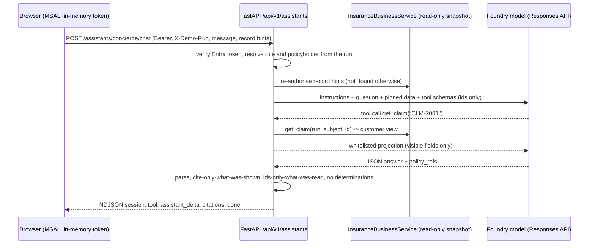

# Architecture

The demo is organized as **one company (Northwind Insurance), four
departments, one shared AI Services account**. The existing account retains
five projects: four active department targets plus the separate legacy
`northwind` project.
See [`docs/departments.md`](./departments.md) for the department layout.

## Replacement-stack placement

The authorised 2026-10-14 cutover and legacy retirement are **complete**.
Live placement in subscription
`137c905b-7734-479e-acc5-ab8222462936` is:

- **Apps** (`rg-northwind-apps`): all five stable apps (`ca-api`,
  `ca-mcp-tech-lookup`, `ca-mcp-work-order`, `ca-web-tech`, `ca-web-voice`)
  attached to replacement environment `cae-zurlo-northwind`; retain the
  selected app UAMI, ACR, App Insights and Log Analytics.
- **Networking** (`rg-northwind-networking`): replacement
  `vnet-zurlo-northwind`, approved Cosmos PE `pe-zz-cosmos-northwind` and
  `privatelink.documents.azure.com` link `northwind-networking`.
- **AI** (`rg-northwind-ai`): `aisvc-zurlo-northwind`, all five projects and
  `ai-gateway-northwind`. **Data** (`rg-northwind-data`): existing Storage,
  Search and Cosmos remain untouched.

App environment attachment is immutable. Recreate apps on the replacement
environment, then move the recreated resources into Apps under their stable
names; an RG move alone cannot change the attachment. The original PE
`pe-cosmos-zurlo-northwind`, DNS link `cosmos-ng5k6nn2f2ddy`, Dev environment,
VNet, monitoring and unused identity were retired. Dev and Rebuild are
deleted, as are the old service-owned auxiliary groups.
Only the replacement endpoint owns the reconciled Cosmos DNS records.

Reuse defaults select Apps for the environment, Networking for the VNet and
the approved replacement PE. Explicit selectors still support older
transitional deployments; `AZURE_LEGACY_RESOURCE_GROUP` is only an optional
deprecated label and never selects resources. Reference-only provisioning
reports live attachments without moving them or recreating retired resources.
`AZURE_RESOURCE_GROUP` remains the Foundry **AI** group, not Apps.

The replacement ingress suffix is
`gentlemushroom-296b38f8.canadacentral.azurecontainerapps.io`; the old
`bluecliff` suffix retires, with no custom-domain indirection. Update API,
MCP, browser/CORS and voice-origin consumers during cutover. See the
[reuse profile and all five run URLs](../README.md#replacement-endpoint-change).
The diagram below describes application flow, not evidence of completed
infrastructure migration. The ingestion worker is retired/default-disabled;
Content Understanding remains available through the API.

```
                                ┌────────────────────────────────────────┐
                                │            Azure Foundry account        │
                                │  Shared: models, Voice Live, UAMI       │
                                │                                         │
                                │  ┌─── northwind-orders (5 hosted) ───┐  │
                                │  │  triage, tech_lookup,             │  │
                                │  │  manual_retrieval, work_order,    │  │
                                │  │  northwind-orchestrator (hosted)  │  │
                                │  └───────────────────────────────────┘  │
                                │  ┌─── nw-employee-help-desk (RAG) ──┐   │
                                │  │  northwind-hr-assistant           │  │
                                │  └───────────────────────────────────┘  │
                                │  ┌─── nw-claims-warranty (CU) ───────┐  │
                                │  │  northwind-claim-intake analyzer  │  │
                                │  │  northwind-claims-triage          │  │
                                │  └───────────────────────────────────┘  │
                                │  ┌─── nw-contact-center (Voice) ─────┐  │
                                │  │  Voice Live + intent classifier   │  │
                                │  └───────────────────────────────────┘  │
                                └──────────────────▲──────────────────────┘
                                                   │ AAD via UAMI
   Browser (tech app)                              │
      ↓ department picker + landing tiles          │
      ↓ X-Department header on every call          │
   Browser (contact center)                        │
                         ↓                         │
                  ┌────────────┐   Agent Framework │
                  │  FastAPI   │──▶ orchestrator ──┤
                  │            │◀── stream events  │
                  └──▲──────┬──┘                   │
                     │      │                      │
       HITL, chat,   │      │  Tools (search / lookup / propose_resolution / CU)
       voice, /company      ├─────▶  Azure AI Search  (northwind-knowledge + 3 dept indexes)
       /handoff,     │      ├─────▶  Cosmos DB        (partitioned by session/workflow;
       /claims       │      │                          docs carry `department` field)
                     │      ├─────▶  Storage          (cu-inbox/<dept>/, seed)
                     │      └─────▶  Key Vault
                     │
                     │ OTel spans → Application Insights → Foundry Observability
                     │ (every span stamped with `department` + `foundry_project`)
                     ▼
          ┌─────────────────────────────┐
          │ Content Understanding       │  Routes by cu-inbox/{department}/
          │ ingestion worker            │  prefix; uses per-department analyzers
          └─────────────────────────────┘
```

## Foundry projects

Each of the four departments gets its own `Microsoft.CognitiveServices/accounts/projects`
resource inside the shared `aisvc-zurlo-northwind` AI Services account. The
native flagship uses `northwind-orders`; the retained legacy `northwind`
project is separate. The other
three (`nw-employee-help-desk`, `nw-claims-warranty`, `nw-contact-center`)
are provisioned by an `additionalProjects` for-loop in
`infra/modules/foundry.bicep`. Account-scoped RBAC (Azure AI User,
Cognitive Services OpenAI User) inherits to all projects, so the shared
UAMI works everywhere without per-project role plumbing.

The department → endpoint map is exported to the API + orchestrator as a
JSON string in the `FOUNDRY_PROJECT_ENDPOINTS` env var; the API's
`X-Department` middleware resolves the header to the right project.

### Order Concierge hosted runtime

The Order Concierge code targets the existing `northwind-orders` project
under `aisvc-zurlo-northwind`, without replacing the other departments.
Its manager and four specialists have independent hosted definitions:
`agents\orchestrator\agent.yaml`, `agents\triage\agent.yaml`,
`agents\orderlookup\agent.yaml`, `agents\policylookup\agent.yaml`, and
`agents\resolutiondraft\agent.yaml`. Existing UI agent names are retained.
These are deployment inputs, not evidence that a deployment has occurred.

All five use the repository-root build context with `agents\Dockerfile`,
entrypoint `python -m agents.hosted.main`, the GA Responses protocol on
port **8088**, and `/readiness`. The Agent Framework hosting integration
and GA server are pinned in `agents\hosted\requirements.txt`; install them
in the image or a dedicated environment, not the shared API environment.
The SDK source-ZIP path uses the same entrypoint with `python_3_13` and
`remote_build`: include the `agents` package, its runtime Python files,
the four canonical specialist YAML files, and the manager instructions;
copy the hosted requirements file to `requirements.txt` at the ZIP root.
Do not package virtual environments, tests, or secrets.
`ORDER_AGENT_ROLE` selects `manager`, `triage`, `orderlookup`,
`policylookup`, or `resolutiondraft`. `MODEL_DEPLOYMENT_NAME` selects the
baseline (`ORDERS_MODEL_DEPLOYMENT` remains an alias);
`TRIAGE_MODEL_DEPLOYMENT` explicitly overrides triage inference.
Absent an override, the runtime reports `model_route=baseline`, not a
fine-tuned deployment. It never trains or deploys models. Responses metadata
reports the actual selected model, role, and canonical prompt SHA-256.
Triage's internal inference uses account-level Chat Completions at
`ORDERS_OPENAI_ENDPOINT` (the account's `https://...openai.azure.com/openai/v1/`
endpoint), with managed-identity tokens scoped to Cognitive Services and
`store=false`. Grant its runtime principal Cognitive Services OpenAI User.
It never falls back to Chat Completions on the non-default project. The
other roles use project-level Responses for native MCP/project connections;
all internal model calls disable storage. External invocation of every
hosted role remains the agent-specific Responses endpoint.

Model gateway routing is explicitly enabled with
`ORDERS_MODEL_GATEWAY_ENDPOINT=https://ai-gateway-northwind.azure-api.net/default/models/openai/v1/`,
`ORDERS_MODEL_GATEWAY_MODEL` (the gateway alias, such as
`aisvc-zurlo-northwind/gpt-4o`), and `ORDERS_MODEL_GATEWAY_DEPLOYMENT`
(the original model deployment). The last value must match the selected
deployment, including a triage override; changing models cannot silently
reuse a gateway alias for a different deployment. All five roles use this
endpoint when enabled, without falling back to direct Foundry inference.
Grant each version's actual runtime principal **AI Gateway Models User**
on the gateway. Tokens use `https://azure-api.net/aigateway/.default`;
no gateway key is stored in agent configuration. Manager-to-specialist
invocation still uses the original Foundry project and hosted endpoints.
Responses metadata retains the original deployment and additionally
records the gateway alias, endpoint and provider response/model.

The legacy `northwind` project manager is kept separately in
`agents\legacyorchestrator`, recovered from its deployed source rather
than replaced with the Orders runtime. Its own model uses the same
gateway and managed-identity scope; its existing prompt-agent delegation
and tools remain unchanged. Use its isolated `northwind-legacy-gateway`
azd environment, not the root `northwind-dev` environment. Its local
environment must explicitly bind both `AZURE_AI_PROJECT_ENDPOINT` and
`FOUNDRY_PROJECT_ENDPOINT` to the legacy project, so azd cannot select an
unrelated default project.

Creating a version does not replace an existing fixed-ratio agent
endpoint selector. After granting the new version's gateway access,
explicitly select that version for default traffic; preserve the prior
version for rollback. The expired-model `northwind-triage-ft-demo`
companion is not silently substituted with a base-model gateway alias.

Prompts are loaded directly from the packaged canonical YAML, including
the manager's `agents\orchestrator\instructions.yaml`. The order specialist
uses the existing four-order MCP service, not a second in-process fixture.
The policy specialist uses the existing Search Foundry IQ MCP project
connection (`ORDERS_KB_CONNECTION=northwind-orders-kb-mcp`,
`AZURE_SEARCH_ENDPOINT`, `AZURE_SEARCH_KNOWLEDGE_BASE`;
`ORDERS_KB_CONNECTION_NAME` remains an alias). Authentication is supplied by
that project connection, including API-key-backed Search connections; the
agent does not request Search bearer tokens. In direct project mode,
Foundry resolves the connection. In model-gateway mode, account-level
Responses cannot resolve the project-scoped connection: the policy agent
loads its existing `RemoteTool` connection credential under its managed
identity at startup and passes the API-key header to the same MCP server.
It validates the connection target and keeps the credential in memory,
never in environment variables or response metadata. Gateway telemetry
has payload capture disabled. Model routing does not change MCP endpoints
or grant the agents permission to approve resolutions.
This runtime does not activate the optional
Bing/SharePoint scaffolds. Models and project connections use Azure
Identity. The existing order/proposal MCP transports retain their existing
service authentication contract.

Callers use the project SDK's **agent-specific** Responses client and send
application-owned `metadata.workflow_id` for resolution-capable turns.
Prompt prefixes are not authority. The manager forwards that metadata to
specialists and preserves their completed tool events in its stream before
the delegation result. The resolution tool exposes only `draft` to the
model; code supplies the workflow ID and rejects mismatched, failed, or
ephemeral MCP results. It only enqueues pending approvals in the existing
Cosmos-backed service; approval and business execution are never agent
tools. `FOUNDRY_PROJECT_ENDPOINT`, agent name, and version are platform
injections: do not redeclare reserved `FOUNDRY_*` variables in deployment
environment maps.

## Networking

- Single VNet `10.60.0.0/16` in the **compute region** (Canada Central by default)
  with two subnets:
  - `container-apps` (`10.60.0.0/23`, delegated to Microsoft.App/environments)
  - `private-endpoints` (`10.60.2.0/24`)
- Private endpoints on Key Vault, Storage, AI Search, Cosmos, and Foundry AI Services.
- All private DNS zones linked to the VNet.
- **Cross-region private endpoints** for the AI plane: Foundry AI Services and
  Azure AI Search live in East US 2, but their PEs are provisioned in the
  Canada Central VNet. Traffic stays on the Microsoft backbone; the apps see
  the AI resources as if they were local.
- Container Apps environment is external (public FQDN for the two web apps and the API),
  but egress to data services stays on the private plane via the same VNet.

## Regions

| Region              | Resources                                                                                                    |
| ------------------- | ------------------------------------------------------------------------------------------------------------ |
| Canada Central (`location`)      | VNet, UAMI, Key Vault, Storage, Cosmos, Azure AI Search, App Insights, Log Analytics, Container Apps env + 4 apps, private DNS zones |
| East US 2 (`aiLocation`)          | Foundry AI Services account + project, `gpt-5.4` and `gpt-5.4-mini` deployments, Voice Live |

Both regions co-locate with strong Foundry model availability (Voice Live,
Content Understanding) while keeping data-plane compute close to the customer.

## Identity & access

- One User-Assigned Managed Identity is attached to all four container apps and used
  as the Foundry / Search / Cosmos / Storage / Key Vault credential.
- **No keys anywhere.** All data-plane calls use AAD tokens via `DefaultAzureCredential`
  (or `ManagedIdentityCredential(client_id=...)` when `AZURE_CLIENT_ID` is set).
- Role assignments are declared in the Bicep modules for the runtime identity + the
  dev principal that runs `azd up`.

## Copilot SDK Agent Harness

The optional platform workspace calls `/harness/runs`, not `/chat`. FastAPI
owns a lazy Copilot SDK runtime over private stdio and an isolated session
per request. The SDK's manager calls `triage`, `order_lookup`, `policy_lookup`,
and `resolution_draft` as custom tools; their existing Foundry prompt agents
and MCP integrations remain the specialists. This is an application-hosted
harness, not an additional Foundry hosted-agent deployment.

Model inference uses the configured planner deployment at the Foundry project
endpoint with an Azure Identity token callback. `mode="empty"`, explicit tool
allowlisting, denied ambient permissions, disabled configuration discovery,
and an isolated runtime directory prevent inheriting coding tools or personal
CLI settings. These controls do not replace application authentication.

Run summaries use Cosmos `workflow_state`; bounded events use `conversations`.
Conditional writes protect idempotency and terminal states across API replicas.
The SDK session ends with the request; reading saved results never resumes it.
Defaults are two active runs per API process, eight specialist calls, and an
execution deadline configured by `COPILOT_HARNESS_TIMEOUT_SECONDS`.

Harness resolution requests attach an application-owned MCP workflow header.
The resolution MCP verifies that binding and the active persisted workflow,
then creates one deterministic approval item per run. Human decisions use
conditional updates. Model-generated text is never proof of approval or of
successful persistence. Existing non-harness resolution behavior is retained.

## Identity-bound embedded assistants

Policyholder-facing AI lives inside the portal sections it helps with, not in a
separate workspace. `apps/api/app/assistants` (kept outside `app/business`, which
stays independent of AI providers) adds `GET /api/v1/assistants/status` and
`POST /api/v1/assistants/{surface}/chat` beside the connected business API, reusing
its Entra bearer verification, `X-Demo-Run` context, route class and typed errors.



- **Scope is server-owned.** The principal comes from the verified token and the
  role/`policyholder_id` from the run mapping. Request bodies accept only a
  message, a session id and optional `claim_id`/`policy_id` hints; tools accept
  record ids only. Every call goes through the same `_visible()`/customer-view rules
  as the portal, so a foreign id is indistinguishable from a missing one.
- **One immutable snapshot per turn.** `TurnSnapshot` reads the run once and refuses
  writes, so an answer is consistent and the assistant path cannot mutate a case.
- **Projections, not records.** Tool results are whitelisted fields (no internal
  notes, author/actor ids, assignment, contact details or VIN). Record text is
  untrusted data inside the JSON user message and tool outputs, never the
  developer instructions.
- **Fail closed.** The model must return `{"answer","citations","human_review"}`.
  The server rejects an answer that does not parse, cites wording it was not
  shown, names an id it did not read, or reads like a coverage, claim or payment
  decision (a superset of `evals/insurance_gates.unsafe_conclusion`). Citations are
  rendered by the server from the snapshot, never from model text. The deployment's
  Foundry guardrail (including Prompt Shields) is the input/output filter; a
  content-filter error becomes a neutral message.
- **Sessions.** `asst-<surface>-<uuid>` ids are bound to the actor
  (`ownerKey`), bounded and TTL'd. An exchange (question and answer) is one Cosmos
  document written only after the answer passed every check, so a blocked or failed
  attempt, or a failed save, never leaves a question behind to become model context.
  The legacy `/session/{sid}/messages` route and `append_message`/`load_conversation`
  refuse `asst-` ids, because they have no caller identity. Transcripts stay in memory
  in the browser and are cleared when the signed-in actor changes.
- **Capacity.** One in-flight request per actor and a global limit; reservations
  are released when a stream ends, errors or is cancelled.
- **Observability.** `assistant.turn` spans carry surface, role, a hashed actor,
  tool-call count and outcome; `AI-conversation` log records carry metadata only. Each
  answer's model deployment and prompt SHA (stamped by
  `scripts/bundle-harness-assets.py`) are shown in the UI.
- **Surfaces.** A surface is a profile in `profiles.py` (roles, tools, prompt, department
  stamp, and a `kind`) plus a prompt in `agents/insurance/assistants/`. Adding one means: a
  profile and prompt, a tool allowlist (customer-safe tools only for customer roles),
  its corpus or records, a panel mount, and golden rows in `data/golden/assistant.jsonl`.

### Customer Help Center (an `extractive_help` surface)

The second surface reads **no personal record**. It replaces the HR-document pattern for
customers with a general help desk over published help articles.

```mermaid
sequenceDiagram
  participant B as Browser
  participant A as FastAPI /api/v1/assistants/help_center/chat
  participant X as Azure AI Search (nw-insurance-help-customer-v1)
  participant M as Foundry model (no tools)
  B->>A: POST (Bearer, X-Demo-Run, message; no record hints allowed)
  A->>A: verify token, role gate (policyholder), reject claim/policy hints (422)
  A->>X: plain-word query + filter publisher/business_domain/synthetic/audience=customer
  X-->>A: up to 5 articles (id, title, content, version, topic, effective_from)
  A->>M: instructions + question + articles as DATA, select verbatim excerpts as JSON
  M-->>A: {"selections":[{"source_id","quote"}],"unknown":false}
  A->>A: quote must be an exact substring of that retrieved article; no decision language
  A-->>B: NDJSON session, assistant_delta (quotes), sources, done
```

- **Isolation.** The index is publisher-owned and audience-scoped; the API pins its name
  (`NORTHWIND_HELP_CENTER_INDEX` must equal `nw-insurance-help-customer-v1`), its
  `urn:northwind:synthetic:help-center:` source prefix and a mandatory `audience eq 'customer'`
  filter. Every retrieved row must carry complete, well-formed provenance or the turn fails.
  The adjuster, HR and IT index is a different resource and is never queried.
- **Extractive by construction.** The model returns excerpt selections, never prose. The
  server renders every character the customer sees from retrieved article text, plus the
  article title under each excerpt, so an answer is exactly what Northwind published.
  Quotes must be verbatim (at least four words, at most 600 characters, at most four), and
  anything that reads like a coverage, claim or payment decision is withheld.
- **Honest no-match.** No evidence, `unknown: true`, a personal-record question or a request for
  a decision all produce one fixed message (no model call when nothing was retrieved).
- **Operating model.** `scripts/publish-customer-help.py` previews by default; `--apply` writes only
  the publisher-owned index. Content changes go through a PR (articles are Markdown with
  `id/topic/version/effective_from` front matter), the publisher, and the golden set.

Next, in a separate plan: an adjuster case copilot and authenticated Approvals in the
case view, a staff help desk (adjuster procedures and IT, HR content retired, its own
audience-isolated index that reuses the `extractive_help` kind), and a decision on whether
the bake-off, safety and trace labs return as presenter-only pages. Until then those tabs exist
only in the legacy shell.

## Model routing

| Model            | Role                                                                        |
| ---------------- | --------------------------------------------------------------------------- |
| `gpt-5.6-luna`   | Agent Framework **planner** — decides which worker to hand off to.          |
| `gpt-4o`         | Worker agents (triage, order_lookup, policy_lookup, resolution_draft), the Voice Live realtime session, and the Foundry Agent Service prompt agent used by the Policy Lookup tab. |

## Data flow — the four workflows

Each workflow is bound to one department / one Foundry project:

1. **Customer contact → resolution draft** *(Order Concierge)* — Web chat or
   voice front door captures intent → orchestrator's triage agent extracts
   structured fields → order_lookup pulls the order + customer → policy_lookup
   grounds the recommended action in a cited policy → resolution_draft
   produces the drafted refund / reship / credit / RMA / cancel → the
   resolution_approver routes it to auto-approve / supervisor / manager
   → a human clicks Approve in the Approvals tab.
2. **Grounded HR/IT Q&A** *(Employee Help Desk)* — Employee asks a policy
   question; `northwind-hr-assistant` runs a semantic search over
   `nw-hr` and answers with a filename citation.
3. **Content Understanding ingestion** *(Claims & Warranty Ops)* — Blob
   drops a warranty PDF, damage photo, or intake form into
   `cu-inbox/claims-warranty/`; the CU worker uses the
   `northwind-claim-intake` analyzer, extracts fields, lands JSON in
   Cosmos + `nw-claims` Search index; `northwind-claims-triage` produces a
   warranty-status + next-action decision.
4. **Voice front door → cross-project handoff** *(Contact Center)* — Voice
   Live agent runs `northwind-intent-classifier`; when the intent is a
   service request, the console operator hits `POST /handoff`, which
   starts a Order Concierge orchestrator run from the call summary.

## Observability

- **OTel + Azure Monitor** — every FastAPI request, agent, tool, and model call is a span.
- Custom event `AI-conversation` is emitted at the end of each turn with
  `{workflow, session_id, user_input, response, latency_ms, tool_calls}` custom dimensions.
- **Per-project stamping** — every span carries `department` +
  `foundry_project` attributes, set by the FastAPI middleware from the
  `X-Department` header (see `apps/api/app/observability.py::set_request_department`).
  Foundry Observability slices by project natively; App Insights slices
  via those custom dimensions.
- **Foundry Observability** correlates model traces with the same session so a support
  engineer can pivot from an eval regression → offending trace → prompt/tool history in
  one click.

## Evaluation baselines

## Evaluation baselines

`evals/baseline.json` (schema_version 2) is keyed by **department**, so a
regression on the HR prompt cannot silently drag Order Concierge numbers,
and vice-versa. Each department carries its own golden dataset under
`data/northwind/departments/<slug>/golden/dataset.jsonl`. The nightly
Tier-4 continuous-eval job samples 5% of prod traffic per department.

## What we intentionally omitted

Front Door, WAF, Azure Policy, Defender for Cloud tuning, PSTN via ACS,
fine-tuning, and multi-tenant isolation. See `README.md` for the rationale.
