# GenAIOps through GitHub — the full agent lifecycle

Traditional MLOps assumes model artifacts, batch training, and offline eval.
GenAIOps for agents is different: prompts, tools, retrieval configs, model
routes, and safety policies *all* ship together, evolve together, and
regress together. This repo runs the entire loop from a single GitHub repo.

## The loop

```mermaid
flowchart LR
    subgraph Dev
      A[Author prompt / tool / agent] --> B[Open PR]
    end
    subgraph GitHub[GitHub PR gate]
      B --> C1[Ruff + mypy + Bicep + web build]
      B --> C2[CodeQL + secret scan]
      B --> C3[Tier-1 smoke eval<br/>GitHub Models · no Azure creds]
      C3 -->|pass| D[Deploy ephemeral<br/>dev env via azd]
      D --> E[Tier-2 golden-set eval<br/>Foundry Evaluators]
      E --> F[Tier-3 AI Red Team<br/>informational on PR]
      F -->|no regression| G[Merge to main]
    end
    subgraph Staging
      G --> H[Deploy staging<br/>build once, digest pinned]
      H --> I[Full red team<br/>blocking]
      I --> J[Prompt registry publish<br/>.prompty → Foundry Prompt Store<br/>tagged with git SHA]
    end
    subgraph Prod[Prod - required reviewers]
      J --> K[Manual dispatch:<br/>promote digest → prod]
    end
    subgraph Observe
      K --> L[Foundry Observability<br/>OTel spans stamped with<br/>git SHA + prompt version]
      L --> M[Tier-4 continuous eval<br/>5% sample nightly]
      M --> N[Drift detector<br/>opens GitHub Issue at >2σ]
      N --> O[Copilot coding agent<br/>drafts fix PR from<br/>failing trace]
      O --> A
    end
```



## The four eval tiers

| Tier | When            | Where              | Cost              | Purpose                                    | File                                        |
| ---- | --------------- | ------------------ | ----------------- | ------------------------------------------ | ------------------------------------------- |
| 1    | Every PR        | GitHub Models      | Free              | 60-second smoke — catches obvious breakage | `.github/workflows/smoke-eval.yml`          |
| 2    | Every PR touching agents | Foundry     | ~$/PR             | Full 50-row golden set, blocks regressions | `.github/workflows/evals-on-pr.yml`         |
| 3    | Nightly + main  | Foundry Red Team   | ~$/night          | PyRIT jailbreak/harm/PII/tool-abuse suite  | `.github/workflows/red-team.yml`            |
| 4    | Nightly         | Foundry            | ~$/night          | 5% sample of prod traces, drift alerting   | `.github/workflows/continuous-eval.yml`     |

**Fail-fast principle:** cheap tiers run first so obvious breakage never burns
Azure quota. Only the tier that catches the failure runs to completion.

**Identity-bound assistants** add an offline contract check *alongside* the four
tiers (it does not replace or weaken any of them). `python evals/assistant_eval.py
--self-check` validates the golden set `data/golden/assistant.jsonl` (Claims
Concierge and customer Help Center rows) and proves the deterministic grader
catches another customer's records, decision language and non-verbatim Help Center
excerpts. CI runs it through `apps/api/tests/test_assistants_golden.py`; live runs
are an operator-approved step and are not wired into `evals/baseline.json`. See
[evals/README.md](../evals/README.md#identity-bound-assistants).

## Progressive delivery

| Env         | Trigger                          | GitHub Environment | Reviewers        | Region             |
| ----------- | -------------------------------- | ------------------ | ---------------- | ------------------ |
| `dev-pr-N`  | `pull_request` (opened/updated)  | `dev`              | none             | Canada Central     |
| `staging`   | Merge to `main`                  | `staging`          | none             | Canada Central     |
| `prod`      | Manual `workflow_dispatch`       | `prod`             | 1 required       | Canada Central     |

Prod never rebuilds. Staging bakes an image, PR-approves once, and prod pulls
the exact same digest. See `.github/workflows/deploy-progressive.yml`.

## Prompt-as-code

Every `.prompty` and `agent.yaml` under `agents/` is the source of truth.
On merge to `main`, `.github/workflows/prompt-registry.yml` uploads each
prompt to the Foundry **Prompt Store** tagged with the git SHA. That lets
observability spans in prod pivot back to the exact commit that shipped
the prompt (see `pipelines/observability/stamp_prompt_version.py`).

PR reviews get a **prompt diff** posted as a review comment so reviewers
don't have to eyeball hidden whitespace changes in YAML front-matter.

## Supply-chain posture

- **CodeQL** — Python, JS/TS, and Bicep are all scanned on every PR
  (`.github/workflows/codeql.yml`).
- **Dependabot** — three ecosystems: `pip` (api, evals, pipelines), `npm`
  (both webs), `docker` (all Dockerfiles). Config in `.github/dependabot.yml`.
- **Secret scanning with push protection** — enabled at repo level; blocks
  any commit containing a detected secret.
- **Bicep policy scan** — PSRule for Azure runs on every infra PR
  (`.github/workflows/bicep-policy.yml`).

## Auto-remediation

When the drift detector or red-team job files an issue, the **GitHub Copilot
coding agent** picks it up (config in `.github/copilot-setup-steps.yml`) and
opens a draft PR that:

1. Pulls the failing trace payload from App Insights as context.
2. Diffs the prompt against the last known-good version.
3. Proposes a prompt tweak or a new golden-set row that pins the failure.
4. Kicks off the Tier-1 → Tier-2 pipeline against its own draft.

Humans still review and merge — Copilot just eliminates the "who's on call
tonight" tax.

## Generating agent traces on demand

The flagship `northwind` Foundry project is connected to the deployment's
workspace-based Application Insights component. Agent traces flow through:

```text
northwind-orchestrator + prompt agents
  -> Application Insights (appi-zurlo-northwind)
  -> Log Analytics (log-zurlo-northwind)
```

Generate isolated end-to-end conversations without recording prompt or
response content in the local result artifact:

```powershell
.\scripts\run-agent-log-load.ps1 -Environment northwind-dev -Count 20
```

Each request calls the hosted orchestrator's Responses endpoint without a
`previous_response_id` or conversation, so it starts a fresh isolated chain
without depending on API conversation persistence. The script writes
`agent-log-load-results.json` with case IDs, response IDs, status, elapsed
time, and errors only.

Application Insights ingestion normally takes a few minutes. Query the linked
workspace with metadata-only KQL:

```kusto
let startTime = ago(30m);
union isfuzzy=true AppRequests, AppDependencies, AppTraces
| where TimeGenerated >= startTime
| extend properties = todynamic(Properties)
| extend responseId = tostring(coalesce(properties["gen_ai.response.id"], properties["response_id"])),
         agentName = tostring(coalesce(properties["gen_ai.agent.name"], properties["azure.ai.agentserver.agent_name"], properties["agent_name"])),
         toolName = tostring(coalesce(properties["gen_ai.tool.name"], properties["tool_name"]))
| where isnotempty(responseId) or isnotempty(agentName) or isnotempty(toolName)
| summarize rows=count(),
            responses=dcountif(responseId, isnotempty(responseId)),
            agents=make_set_if(agentName, isnotempty(agentName), 20),
            tools=make_set_if(toolName, isnotempty(toolName), 20)
```

Trace content capture stays disabled by default. Enable full prompt, response,
or tool payload capture only for a controlled debugging session because those
fields can contain customer data.

## Copilot SDK harness evidence

Harness events are stamped with `harness=copilot-sdk`, Order Concierge's
department/project, run/workflow IDs, and the canonical prompt hash. The UI
uses persisted actual events, never the legacy trace stub. Application-owned
spans and SDK usage events are not presented as a new hosted Foundry agent.
The `AI-conversation` log contains metadata only; continuous evaluation uses
the run ID to retrieve approved synthetic content from the saved API record.

The API packaging hook writes immutable source provenance, so `/build` can
verify which candidate is being evaluated. The progressive PR deployment runs
the harness golden set against that deployment with `--expected-build`, not
against unchanged staging. The prompt-registry workflow also retains the
canonical harness prompt as a GitHub artifact.

All four tiers remain: offline SDK/contract checks, live golden cases,
red-team HTTP target, and continuous sampling. Missing judge access, missing
baselines, disabled targets, and unscored attacks are not successful eval
evidence. Existing baseline values are not automatically changed. Live jobs
need private-network access to Foundry and the appropriate Azure roles; use a
connected runner rather than opening private resources to make CI pass.

## Reusable actions for other Foundry repos

Two composite actions live under `.github/actions/` so any other Foundry
project can consume them:

```yaml
- uses: ./.github/actions/foundry-eval
  with:
    dataset: data/golden/dataset.jsonl
    baseline: evals/baseline.json
- uses: ./.github/actions/foundry-redteam
  with:
    target_agent: northwind-orchestrator
    strategies: jailbreak,harm,pii-exfil,tool-abuse
```

## Where this diverges from typical LangChain-in-a-notebook demos

- **No offline notebooks in the golden path.** Every experiment goes through
  the same PR gate a bug fix does.
- **No hand-run evals.** If it's not in a workflow, it doesn't count.
- **No manual model swaps.** Model routing lives in Bicep +
  `settings.py` + a bake-off tab; you *see* the model change.
- **No unbounded prod drift.** Continuous eval + drift detector +
  auto-remediation means you find out before your customers do.
