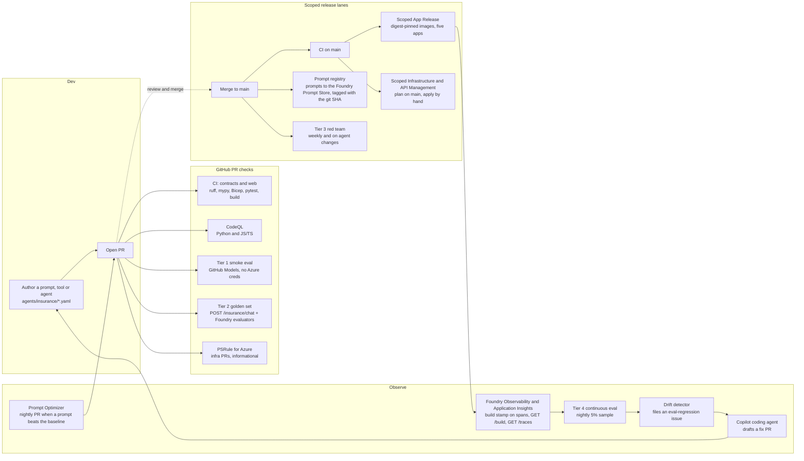

# GenAIOps through GitHub — the full agent lifecycle

Traditional MLOps assumes model artifacts, batch training, and offline eval.
GenAIOps for agents is different: prompts, tools, retrieval configs, model
routes, and safety policies *all* ship together, evolve together, and
regress together. This repo runs that loop from a single GitHub repo for the
Northwind Insurance claims concierge (five hosted agents, two MCP servers and a
human approval gate, all on synthetic data). Nothing in it trains a model.

> **Read this as "what the repository does today".** Every section describes
> what the workflows and scripts in this repo implement. Gates that depend on
> GitHub or Azure settings the repo cannot record, or that are not wired up yet,
> are listed in [What is and is not enforced today](#what-is-and-is-not-enforced-today).

## The loop



## The four eval tiers

| Tier | When | Against | Cost | Purpose | Files |
| ---- | ---- | ------- | ---- | ------- | ----- |
| 1 | Pull requests that touch `agents/`, `apps/api/`, `apps/mcp-claim-review/`, `evals/` or `data/golden/` | GitHub Models (`openai/gpt-4o-mini` by default) with the workflow `GITHUB_TOKEN` | No Azure credentials or quota | 14 judge-free cases that catch obvious prompt breakage: triage JSON and identifier discipline, cited wording, claim-action drafts, refusals, prompt injection | `.github/workflows/smoke-eval.yml`, `evals/smoke_eval.py` |
| 2 | The same pull requests | The deployed insurance API at `STAGING_API_URI`, scored with Foundry evaluators | Foundry judge and safety-evaluator calls | The 50-row golden set (`data/golden/dataset.jsonl`) posted to `POST /insurance/chat` | `.github/workflows/evals-on-pr.yml`, `evals/run_evals.py` |
| 3 | Weekly (Mondays 09:00 UTC), pushes to `main` that touch agents, rubrics, the red-team runner, the harness or the claim-review MCP, and manual runs | Foundry AI Red Team (PyRIT) against `northwind-insurance-orchestrator`, and the Copilot SDK harness through the API | Foundry red-team service | Jailbreak, harm, PII-exfiltration and tool-abuse attacks (25 per strategy, minimum pass rate 0.85) | `.github/workflows/red-team.yml`, `pipelines/red-team/run_redteam.py` |
| 4 | Nightly (07:00 UTC); the drift detector runs when it finishes | Copilot SDK harness runs recorded as `AI-conversation` events in Application Insights | Log Analytics query | About 5% of the last 24 hours re-scored with the harness contract, then a rolling z-score per metric | `.github/workflows/continuous-eval.yml`, `.github/workflows/drift-detector.yml`, `evals/continuous_eval.py`, `evals/drift_detector.py` |

**Cost order, not fail-fast.** The tiers are ordered by cost, but they are
independent workflows triggered by the same events: nothing makes Tier 2 wait
for Tier 1. Run `python evals/smoke_eval.py` first (or read the Tier-1 comment)
before you spend Foundry quota on a re-run. Row formats, evaluators and the
rubric workflow are in [`evals/README.md`](../evals/README.md); this page only
covers how the tiers fit into the delivery loop.

### What each tier does and how it fails

- **Tier 1.** `python evals/smoke_eval.py --output smoke-results.json` builds
  every case from `data/northwind/insurance-fixtures.json` and sends one agent
  prompt from `agents/insurance/*.yaml` to GitHub Models; lookup and wording
  results are pasted into the message because that endpoint has no tools. Cases
  are graded without a judge: strict JSON, exact identifiers and citations, a
  human-review marker on refusals, and no binding statement such as "claim
  approved" or "payment sent". One failed case fails the job. The workflow
  comments the per-case table on the PR and uploads `smoke-eval-results`;
  `--self-check` verifies the token and every prompt file.
- **Tier 2.** `python evals/run_evals.py --dataset data/golden/dataset.jsonl
  --output evals/results.json --baseline evals/baseline.json` streams each row
  to `POST /insurance/chat` and scores it with `Coherence`, `TaskAdherence`,
  `HateUnfairness` and `Violence` (Foundry built-ins, only when the project
  endpoint and a compatible judge deployment are configured), the deterministic
  `ClaimActionCompleteness`, and the LLM-as-judge `triage` and `safety` rubrics
  (`evals/evaluators/rubrics/*.prompty`). `claim_action_draft` rows are graded on
  the draft that was actually saved: the runner reads `GET /hitl?workflow_id=...`
  and needs exactly one pending `insurance_claim_action` item, so prose or an
  unrelated draft cannot pass. Exit code `0` means every gate passed, `1` a
  failed row, an evaluator error or a regression larger than 0.05, and `2`
  incomplete evidence (see [Baselines](#baselines-and-the-regression-gate)). The
  workflow comments the aggregates on the PR and uploads `eval-results`.
- **Tier 3.** The composite action `.github/actions/foundry-redteam` runs
  `python pipelines/red-team/run_redteam.py --agent <name> --strategies
  jailbreak,harm,pii-exfil,tool-abuse --attacks 25 --min-pass 0.85` for two
  targets in two jobs: the hosted `northwind-insurance-orchestrator`, and
  `copilot-sdk`, which attacks `POST /harness/runs` through
  `evals/harness_eval.py::redteam_target` (it rejects tool-context injection
  instead of silently dropping it). A pass rate below `--min-pass` exits
  non-zero; the harness target is strict and exits `2` when an attack was not
  scored. The report is the artifact `redteam-<agent>`.
- **Tier 4.** `python evals/continuous_eval.py` reads `AI-conversation` events
  from the last 24 hours (`APPINSIGHTS_RESOURCE_ID`), keeps about 5% with a
  fixed random seed, re-reads each harness run from `GET /harness/runs/{id}`
  (`API_URI`) and grades the persisted run with the harness contract; a claim
  action that a person already decided is accepted. The job fails when a sampled
  run breaks the contract and writes the artifact `continuous-eval-results`.
  `evals/drift_detector.py` compares the latest artifact with the previous seven
  days (at least three successful runs), flags a drop of 2σ or more in a `*_score`
  metric, a 2σ move in a `*_pass` or safety metric, and files an issue titled
  `[eval-regression] <metric> drifted <z>σ on continuous eval` with the labels
  `eval-regression`, `drift` and `copilot-fix` (the template
  `.github/ISSUE_TEMPLATE/eval-regression.yml` is the manual equivalent).

### Baselines and the regression gate

`evals/baseline.json` (schema version 2) is keyed by department slug
(`claims-concierge`, `adjuster-support`, `claims-documents`, `contact-center`) so
a regression in one department cannot hide in another. **Every department entry
is intentionally empty today.** No reviewer-approved measured run of
`data/golden/dataset.jsonl` (orchestrator) or `data/golden/harness.jsonl`
(`copilot-sdk`) exists yet, and the file's own `_comment` names what has to
happen first: the Foundry SDK evaluators (`azure-ai-evaluation` 1.1.0) still send
`max_tokens`, which gpt-5.x deployments reject, so `FOUNDRY_JUDGE_DEPLOYMENT`
must name a compatible judge before aggregates can be measured. In practice:

- `evals/run_evals.py` reports `regression_status=unavailable` and exits `2`. A missing
  judge, an empty baseline, a disabled target or an unscored attack is never a
  pass, so the Tier-2 PR job reports incomplete evidence instead of going green.
- The optimizer compares a candidate with a baseline score of `0.0`, so its lift is
  only meaningful once a baseline exists.
- Numbers change only through a pull request that a reviewer approves: if a
  regression is legitimate, update `evals/baseline.json` in the same PR; the
  Copilot coding agent must not touch it without explicit approval
  ([`.github/copilot-instructions.md`](../.github/copilot-instructions.md)).
  Never disable or weaken an evaluator to make a run pass.
- Do not quote scores in a demo or a document until that PR exists.

### Gateway routing and the tiers

When the API app and the agents are routed through the AI Gateway (see
[`ai-gateway.md`](./ai-gateway.md)), Tier-2 `POST /insurance/chat` traffic goes through
it automatically, and the harness runs that Tier 4 re-scores were served through it. The
evaluator judge calls, Foundry safety evaluators, Red Team runs, the optimizer
and the GitHub Models smoke tier are out of scope and still call their services
directly. A gateway failure (401/403/404/429) is an evaluation failure, never a
skipped evaluator. Once direct access to the API is locked down
(`NORTHWIND_GATEWAY_AUTH_REQUIRED`), point `STAGING_API_URI` at
`<gateway>/insurance` ([API Management](./api-management.md)).

## Release path

There is no per-PR environment and no staging-to-production promotion in this
repository. Pull requests are scored by Tiers 1 and 2; after a merge, three
**scoped lanes** change the live insurance stack (the `ca-insurance-*` apps, one storage
network boundary and the API Management definition). Each runs only in
`ZacharyZurloMSFT/foundry-frontier`, only for current `main` after a successful
`CI` run, and with federated OIDC (no client secrets). The one-time setup is in
the README, *Scoped GitHub Actions delivery*.

| Lane | Workflow | Runs | GitHub environment | Changes |
| ---- | -------- | ---- | ------------------ | ------- |
| Apps | `.github/workflows/deploy-apps.yml` (Scoped App Release) | After `CI` succeeds on `main` (only the services whose files changed since the last successful automatic release) or by manual dispatch (`service`, `expected_sha`); needs `NORTHWIND_DEPLOY_ENABLED` | `northwind-apps` | The image of an existing Container App |
| Infrastructure | `.github/workflows/deploy-infra.yml` | `CI` on `main` triggers a plan; apply is manual with the reviewed SHA and a successful same-source plan run; needs `NORTHWIND_INFRA_ENABLED` | `northwind-infra-plan`, `northwind-infra-apply` | `infra/live/storage-networking.bicep` only |
| API Management | `.github/workflows/deploy-apim.yml` | The same plan and apply gating; needs `NORTHWIND_APIM_ENABLED` | `northwind-apim-plan`, `northwind-apim-apply` | The allow-listed objects of `infra/live/apim-apis.bicep` (the `insurance` stack of `apim-northwind`) |

An app release builds each image **once** on the runner and releases that exact
digest, never a tag:

- `python scripts/release-app.py plan` picks the services (`api`,
  `mcp-policy-lookup`, `mcp-claim-review`, `web-portal`, `web-voice`); a change
  under `.github/workflows/`, `scripts/`, `agents/copilot-harness/` or to
  `azure.yaml` selects all five.
- Each selected service is packaged (the API with `python data/seed/generate.py
  --domain insurance`, `scripts/bundle-insurance-assets.py` and
  `scripts/bundle-harness-assets.py`; the MCP servers with
  `scripts/bundle-insurance-assets.py`; the web apps with `npm run build`), built
  with `docker buildx build --push` and tagged `<service>:<sha>-<run>-<attempt>`.
- `python scripts/release-app.py release` swaps the digest into the existing single-container
  app and preserves every setting, secret reference and capability flag. Only the
  API also receives `GIT_SHA`, `BUILD_ENV=github-actions`, `DEPLOYED_AT` and
  `GITHUB_REPOSITORY`, which feed `GET /build`. It refuses to proceed if the
  app's revision or configuration changed after it was inspected, waits for the
  new revision to be healthy with 100% traffic, smoke-checks `/health` (API),
  `/healthz` (MCP servers) or `/` (web apps) and writes a secret-free rollback
  record (artifact `app-rollback-<run>-<attempt>`, kept 14 days). There is no
  automatic rollback.
- Not covered by any lane: hosted agents, prompt agents, Search content and
  identity registrations. Those are explicit, dry-run-first scripts (README,
  *Deploy*).

## Prompt-as-code

Prompts are files, and the files are the source of truth:
`agents/insurance/*.yaml` (the five hosted roles),
`agents/copilot-harness/instructions.prompty` (the harness),
`data/northwind/departments/*/prompts/*.yaml` (prompt agents and adjuster
support) and `evals/evaluators/rubrics/*.prompty` (judge rubrics). Change them
through a PR, the optimizer's included; do not fork them into code.

On a push to `main` that touches `agents/insurance/`, `agents/copilot-harness/`
or `evals/evaluators/rubrics/`, `.github/workflows/prompt-registry.yml` runs
`scripts/publish-prompts.py`, which uploads the five agent prompts, the harness
prompt and the two rubrics to the Foundry **Prompt Store** tagged with the git
SHA, and keeps the harness prompt as the artifact `copilot-harness-prompt-<sha>`.
The upload is best effort (see the table below). Three stamps tie a running
system back to the prompt files:

- hosted agents report their deployment, role and the SHA-256 of the canonical
  prompt file (`prompt_sha256`) in the Responses metadata;
- `scripts/bundle-harness-assets.py` writes `git_sha`, the repository and the
  SHA-256 of the harness and adjuster-support prompts
  (`prompt_sha.copilot-harness`, `prompt_sha.adjuster-support`) into the API
  image; `GET /build` returns them;
- `apps/api/app/observability.py` stamps every span created through `get_tracer`
  with that build, the department, the Foundry project and the model route, and
  the trace panel lists the prompt hashes under **Prompt versions**.

## Supply-chain posture

- **CodeQL** — Python and JavaScript/TypeScript (`security-and-quality` queries) on
  pull requests to `main`, pushes to `main` and weekly
  (`.github/workflows/codeql.yml`). Bicep is not analysed by CodeQL.
- **Bicep policy scan** — PSRule for Azure on pull requests that touch `infra/`
  (`.github/workflows/bicep-policy.yml`). The step is `continue-on-error` and
  uploads SARIF, so its findings are informational.
- **Dependabot** — weekly: `pip` (`apps/api`, `evals`, `pipelines/red-team`,
  `pipelines/optimizer`, `agents/hosted`), `npm` (`apps/web-portal`,
  `apps/web-voice`), `docker` (`apps/api` and the two MCP servers) and
  `github-actions`. Config in `.github/dependabot.yml`.
- **Contract tests** — `.github/workflows/ci.yml` compiles the Bicep, checks that the committed
  route table and OpenAPI spec match the served API (`scripts/tests/test_export_openapi.py`),
  and runs `scripts/tests/test_no_legacy_vocabulary.py`, which keeps the repository insurance-only.
- **Secret scanning with push protection** is a GitHub repository setting; no file
  in this repo records whether it is on.

## Auto-remediation

When the drift detector files an `eval-regression` issue it carries the label
`copilot-fix`. [`.github/copilot-instructions.md`](../.github/copilot-instructions.md)
tells the GitHub Copilot coding agent how to work such an issue:

1. Read the trace payload attached to the issue.
2. Compare the current prompt with the SHA stamped in the trace.
3. Prefer a prompt fix over a code fix; if code has to change, add a golden-set
   row that would catch the same failure next time.
4. Never touch `evals/baseline.json` without explicit reviewer approval.

Humans still review and merge; Tiers 1 and 2 run on the agent's draft PR like on
any other PR whose paths match. Enabling the agent, assigning it and the sandbox
setup file are GitHub-side concerns (see the table below).

## Observability and traces

- **Spans and build stamp.** OpenTelemetry from the API and the MCP servers goes to
  Application Insights; the spans the API creates through `get_tracer` carry the stamps
  described under *Prompt-as-code*.
  `GET /traces/{sid}` queries the Log Analytics workspace (`APPINSIGHTS_WORKSPACE_ID`
  or `LOG_ANALYTICS_WORKSPACE_ID`) for one session and returns the span tree,
  per-agent latency, the token and cost figures the spans report and a hand-off
  sequence diagram, or an explicit `unavailable`; it never substitutes a stub.
  The totals are not an Azure billing total. The portal renders it as the
  **Trace** panel under the Claims Concierge chat. Details:
  [`architecture.md`](./architecture.md#observability).
- **Foundry side.** Foundry exports hosted-agent traces to the Application Insights
  component connected to the flagship project
  (`infra/modules/foundry-observability.bicep`); whether an existing deployment has
  that connection is an operator fact this repository cannot verify.

### Generating agent traces on demand

```text
northwind-insurance-orchestrator + specialists
  -> Application Insights (connected to the flagship Foundry project)
  -> Log Analytics workspace
```

Generate isolated end-to-end conversations without recording prompt or response
content in the local result artifact:

```powershell
.\scripts\run-agent-log-load.ps1 -Environment <azd-env> -AgentEndpoint <orchestrator-responses-endpoint> -Count 20
```

The script cycles through 20 synthetic insurance cases (claim status for
`CLM-2001` and `CLM-2002`, wording lookups, evidence-request, policyholder-update
and escalation drafts, mismatched and unknown identifiers, an injected
instruction, a refusal and two end-to-end runs). Each request calls the hosted
orchestrator's Responses endpoint without a `previous_response_id` or
conversation, so it starts a fresh chain that does not depend on API
conversation persistence. It writes `agent-log-load-results.json` with case IDs,
response IDs, status, elapsed time and errors only. Cases that ask for a draft
leave **pending drafts in the Approvals queue**: reject them, then delete the
reviewed drafts, before a demo. Without `-AgentEndpoint` the script reads
`AGENT_ORCHESTRATOR_RESPONSES_ENDPOINT` from `azd env get-values`; nothing in this
repository sets that value, so pass the endpoint explicitly.

Application Insights ingestion normally takes a few minutes. Query the linked
workspace with metadata-only KQL:

```kusto
let startTime = ago(30m);
union isfuzzy=true AppRequests, AppDependencies, AppTraces
| where TimeGenerated >= startTime
| extend properties = todynamic(Properties)
| extend responseId = tostring(coalesce(properties["gen_ai.response.id"], properties["response_id"])),
         agentName = tostring(coalesce(properties["gen_ai.agent.name"], properties["azure.ai.agentserver.agent_name"], properties["agent_name"])),
         toolName = tostring(coalesce(properties["gen_ai.tool.name"], properties["tool_name"]))
| where isnotempty(responseId) or isnotempty(agentName) or isnotempty(toolName)
| summarize rows=count(),
            responses=dcountif(responseId, isnotempty(responseId)),
            agents=make_set_if(agentName, isnotempty(agentName), 20),
            tools=make_set_if(toolName, isnotempty(toolName), 20)
```

The repository's own telemetry is metadata only: the harness `AI-conversation`
event carries IDs, the department, the project and the prompt hash, never prompt
or answer text. If you switch on prompt, response or tool-payload capture in
Foundry for a debugging session, treat those fields as potentially containing
customer data and switch it off again afterwards.

## Copilot SDK harness evidence

The harness (`/harness/*`, API only; the portal has no tab for it) stores run
summaries in `workflow_state` and bounded event history in `conversations`, both
with a seven-day TTL ([`architecture.md`](./architecture.md#copilot-sdk-agent-harness)).
Every run appends one `AI-conversation` log (`harness=copilot-sdk`,
`department=claims-concierge`, the Foundry project, the run ID as `session_id`,
`workflow=harness`, the execution status and the canonical prompt hash) and a
`harness.run` span stamped with the same build and prompt hash. Application-owned
spans and SDK usage events are not presented as a new hosted Foundry agent.
Continuous evaluation uses the run ID to retrieve the approved synthetic content
from the saved API record.

The API packaging step writes immutable source provenance, so `GET /build` can
verify which candidate is being evaluated: `python evals/run_evals.py ... --expected-build <git
sha>` writes `evaluation_status: candidate_build_mismatch` and exits `2` when the
deployed API reports another SHA.

All four tiers apply to the harness, but only some are wired into workflows:

| Tier | Harness coverage | In a workflow? |
| ---- | ---------------- | -------------- |
| 1 | Offline SDK and contract checks: `python -m pytest apps/api/tests evals/tests/test_harness_eval.py`; after `python -m copilot download-runtime`, set `TEST_COPILOT_RUNTIME=1` for the real-SDK contract | `apps/api/tests` run in `.github/workflows/ci.yml`; `evals/tests` do not |
| 2 | `python evals/run_evals.py --target copilot-sdk --dataset data/golden/harness.jsonl --output evals/harness-results.json --baseline evals/baseline.json` (17 rows; add `--expected-build <git sha>`) | No: run it by hand against an enabled, deployed candidate |
| 3 | The `harness-redteam` job of `.github/workflows/red-team.yml` | Yes |
| 4 | The harness branch of `evals/continuous_eval.py` | Yes |

Missing judge access, a missing baseline, a disabled target and an unscored
attack are not successful eval evidence, and existing baseline values are never
changed automatically. The live checks call the API over its public ingress, so
the runner needs no private-network access; Cosmos DB stays private, which is why
Cosmos-backed routes only work against a deployed API
([`local-dev.md`](./local-dev.md)).

## Reusable actions for other Foundry repos

Two composite actions live under `.github/actions/` so another Foundry project can
consume them. `foundry-redteam` is used by `.github/workflows/red-team.yml`;
`foundry-eval` is not called by any workflow here
(`.github/workflows/evals-on-pr.yml` runs `evals/run_evals.py` directly)
and, unlike `foundry-redteam`, does not log in to Azure itself:

```yaml
- uses: azure/login@v3
  with:
    client-id: ${{ secrets.AZURE_CLIENT_ID }}
    tenant-id: ${{ secrets.AZURE_TENANT_ID }}
    subscription-id: ${{ secrets.AZURE_SUBSCRIPTION_ID }}
- uses: ./.github/actions/foundry-eval
  with:
    dataset: data/golden/dataset.jsonl
    baseline: evals/baseline.json
    api_uri: ${{ secrets.STAGING_API_URI }}
    foundry_endpoint: ${{ secrets.FOUNDRY_ENDPOINT }}
    foundry_project_endpoint: ${{ secrets.FOUNDRY_PROJECT_ENDPOINT }}
- uses: ./.github/actions/foundry-redteam
  with:
    target_agent: northwind-insurance-orchestrator
    strategies: jailbreak,harm,pii-exfil,tool-abuse
    azure_client_id: ${{ secrets.AZURE_CLIENT_ID }}
    azure_tenant_id: ${{ secrets.AZURE_TENANT_ID }}
    azure_subscription_id: ${{ secrets.AZURE_SUBSCRIPTION_ID }}
    foundry_project_endpoint: ${{ secrets.FOUNDRY_PROJECT_ENDPOINT }}
```

The workflows that call Azure read these repository secrets (configured in
GitHub, not by anything in this repo): `AZURE_CLIENT_ID`, `AZURE_TENANT_ID`,
`AZURE_SUBSCRIPTION_ID`, `STAGING_API_URI`, `FOUNDRY_ENDPOINT`,
`FOUNDRY_PROJECT_ENDPOINT` and `APPINSIGHTS_RESOURCE_ID`. The red team,
optimizer and prompt registry also run in a `staging` environment. Tier 1 needs
only the workflow's own `GITHUB_TOKEN`.

## What is and is not enforced today

| Area | Today | Not enforced, or caveat |
| ---- | ----- | ----------------------- |
| Required checks | The workflows above run. | Which of them must pass before a merge is a branch-protection setting, and environment reviewers (`northwind-apps`, `staging`) and secrets are GitHub settings; the repo records none of them. [`api-management.md`](./api-management.md) notes that no `STAGING_API_URI` secret existed on 2026-10-22, so confirm it is set, and points at the insurance API, before you rely on Tiers 2 to 4. |
| Tier 2 target | Scores the API at `STAGING_API_URI`. | No workflow deploys the PR's code there and none passes `--expected-build`, so a run proves nothing about a PR's own change unless that API was updated first. |
| Harness and department sets | `data/golden/harness.jsonl` (17 rows) has a documented command. | No workflow runs it. The department sets (adjuster support 14, claim documents 10, contact center 12 rows) are authored regression rows that no workflow runs either ([`departments.md`](./departments.md)). |
| Tier 3 | The hosted target fails below `--min-pass`; the harness target is strict. | For the hosted target `pipelines/red-team/run_redteam.py` writes a stub report and exits `0` when the SDK or the target fails. No step files an issue, although the composite action's description says it does. |
| Tier 4 | Re-scores harness runs. | The harness is the only emitter of `AI-conversation` events. `evals/drift_detector.py` reads an `aggregates` object from each artifact, but `evals/continuous_eval.py` writes a list of rows, so no drift issue can be derived from it yet. The workflow's "Publish to observability dashboard" step only prints a message. |
| Baseline | Every script reads it. | Nothing writes it, although its `_comment` says the nightly Tier-4 job regenerates it. |
| Optimizer | Nightly for `triage` and `claim_action_draft`; opens a PR only when a variant beats the baseline by `OPTIMIZER_MIN_LIFT` (default 0.05). | The matrix is fixed (the `agent` dispatch input is unused), and it exits cleanly with `improved=false` when the Prompt Optimizer SDK cannot be imported. |
| Prompt Store | `scripts/publish-prompts.py` runs on merge. | Best effort: it prints a dry run when the SDK surface or endpoint is missing and skips files when the client has no `upload_prompt` or `create_prompt`; check the log for `published` lines. Department prompts are not published. |
| Copilot coding agent | `eval-regression` issues carry `copilot-fix`. | GitHub reads setup steps from `.github/workflows/copilot-setup-steps.yml`, while this repo keeps the file at `.github/copilot-setup-steps.yml`. |
| `foundry-eval` action | Defined for reuse. | Its `regressed` output reads a key that `evals/run_evals.py` never writes (it writes `regressions` and `regression_status`), so it is always `false`; rely on the step's exit code. |
| CI scope | `.github/workflows/ci.yml` runs contracts, Bicep compilation, the web builds and tests. | It does not run `agents/tests`, `evals/tests` or `python evals/smoke_eval.py --self-check`, and ruff and mypy cover only the business-API contracts; run the full list in `.github/copilot-instructions.md` before a PR. |

## Where this diverges from typical LangChain-in-a-notebook demos

- **No notebooks in the golden path.** Prompts, tools, golden rows, rubrics and
  workflows are versioned files that go through the same PR a bug fix does.
- **Evals are code.** The evaluators, rubrics and golden rows live next to the
  agents they score, so a prompt change and its regression test ship together.
- **Model routing is configuration you can see.** Deployments are Bicep parameters
  (`infra/main.bicep`), adjuster support offers a model picker, and with the AI
  Gateway on, `GET /gateway/status`, the `gateway.route` span attribute and the
  trace panel's "AI Gateway" badge show which route served a turn.
- **Incomplete evidence is not a pass.** In the eval runner and the harness paths
  an unavailable judge, an empty baseline, a disabled target or an unscored
  attack is reported as incomplete.
- **Agents draft, people decide.** Every claim action is a draft in a human-review
  queue; no tier, workflow or tool can approve, deny or pay a claim.
