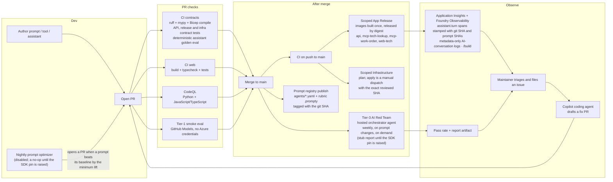

# GenAIOps through GitHub — the full agent lifecycle

Traditional MLOps assumes model artifacts, batch training, and offline eval.
GenAIOps for agents is different: prompts, tools, retrieval configs, model
routes, and safety policies *all* ship together, evolve together, and
regress together. This repo runs the entire loop from a single GitHub repo.

> **What is enabled today.** Only `CI`, `deploy-apps.yml` and `deploy-infra.yml`
> are meant to be enabled right now. The smoke-eval, red-team, prompt-registry
> and optimizer workflows below are kept in the repo but stay disabled until they
> are configured and budgeted (see the [README](../README.md)). The legacy
> department shell and its unauthenticated endpoints were deleted, so the product
> is the Northwind Insurance portal plus `/api/v1/*` (with `/health` and `/build`),
> and every gate below is one that still has something to exercise.

## The loop



## The eval tiers that remain

Two of the four original tiers were retired together with the legacy endpoints
they exercised (see below). Nothing here is described as running unless a
workflow or test in this repo runs it.

| Tier | When                                           | Where               | Cost          | Purpose                                             | File                                         |
| ---- | ---------------------------------------------- | ------------------- | ------------- | --------------------------------------------------- | -------------------------------------------- |
| 1    | PRs touching agents, API, evals or golden data | GitHub Models       | Free          | 5-case smoke — catches blank or malformed output    | `.github/workflows/smoke-eval.yml`           |
| —    | Every PR and push to `main`                    | Offline, no Azure   | Free          | Deterministic assistant golden eval for the product | `.github/workflows/ci.yml` (`contracts` job) |
| 3    | Pushes to `main`, weekly, manual               | Foundry AI Red Team | Foundry usage | PyRIT jailbreak/harm/PII/tool-abuse attacks         | `.github/workflows/red-team.yml`             |

- **Tier 1** runs on pull requests that touch `agents/`, `apps/api/`, `evals/`,
  `data/golden/` or `apps/mcp-work-order/`. `evals/smoke_eval.py` sends five
  hand-picked cases, built from the `agents/*.yaml` instructions, to GitHub Models
  with the workflow's `GITHUB_TOKEN` and fails unless every case returns the
  expected shape. No Azure credentials are involved.
- **The assistant golden eval** is deterministic. `apps/api/tests/test_assistants_golden.py`,
  run by the `contracts` job in `ci.yml`, drives the real assistant routes with a
  scripted model and search and grades them with `evals/assistant_eval.py` against
  `data/golden/assistant.jsonl`. It replaces Tier 2 as the PR check for the product.
- **Tier 3** attacks the hosted `northwind-orchestrator` through the
  `foundry-redteam` composite action and `pipelines/red-team/run_redteam.py`, on
  pushes to `main` that touch `agents/`, `evals/evaluators/rubrics/`,
  `pipelines/red-team/` or `apps/mcp-work-order/`, weekly (Mondays 09:00 UTC) and on
  manual dispatch. A completed scan fails the run below `min_pass_rate` (default
  0.85). If the red-team SDK is unavailable or the scan raises, the runner writes a
  stub report and exits 0, and as pinned today it takes that path:
  `pipelines/red-team/requirements.txt` installs `azure-ai-evaluation==1.1.0`, which
  ships no `red_team` module. A green run without a real report is not evidence, so
  raise the pin before relying on this tier.

**Retired with the legacy endpoints** (do not bring them back without a transport
that exists):

- **Tier 2 — Foundry golden-set eval** (`evals/run_evals.py`, `evals-on-pr.yml` and
  the `foundry-eval` composite action). It invoked the deleted `/chat` endpoint and
  read session-bound drafts through `/hitl`; its Copilot SDK harness target used
  `/harness/runs`. The assistant golden eval above replaces it as the product's PR
  check.
- **Tier 4 — continuous eval and drift detector** (`continuous_eval.py`,
  `drift_detector.py`, `continuous-eval.yml`, `drift-detector.yml`). It sampled
  `AI-conversation` events that carried `user_input` and `response` text, which only
  the deleted legacy chat path logged. The assistants log metadata only (see
  [Assistant telemetry](#assistant-telemetry-and-build-provenance)), so there is
  nothing to sample.
- **Copilot SDK harness evals** — `data/golden/harness.jsonl`, `evals/harness_eval.py`,
  the red team's `copilot-sdk` HTTP target and the `harness-redteam` job — went with
  the harness itself.

The API-independent pieces stay: the evaluators and rubrics, the golden datasets and
`evals/baseline.json` (still read by the nightly prompt optimizer). See
[evals/README.md](../evals/README.md).

**Fail-fast principle:** everything that runs on a pull request needs no Azure
credentials and no paid inference (CI, CodeQL, the Tier-1 smoke eval, the assistant
golden eval). Paid Foundry work — the red team and the optimizer — runs after
merge, on a schedule or on demand.

**Live grading of the assistants** is an operator step. `python evals/assistant_eval.py
--self-check` validates the golden set `data/golden/assistant.jsonl` (Claims
Concierge and customer Help Center rows) and proves the deterministic grader
catches another customer's records, decision language and non-verbatim Help Center
excerpts; the same grader can grade a recorded or live run. Live runs send real
model requests, need an approved budget and are not wired into `evals/baseline.json`.
See [evals/README.md](../evals/README.md#identity-bound-assistants).

## Delivery

Releases go through CI, then two scoped workflows. There is no per-PR environment
and no staging-to-prod promotion any more: `.github/workflows/deploy-progressive.yml`
is a retired stub that fails if it is dispatched, so no workflow runs `azd up`
or `azd down` against the migrated deployment.

| Lane           | Workflow                                   | Trigger                                                     | GitHub Environment                              | Scope                                                  |
| -------------- | ------------------------------------------ | ----------------------------------------------------------- | ----------------------------------------------- | ------------------------------------------------------ |
| CI             | `ci.yml`                                   | Pull requests, pushes to `main`, manual                     | none                                            | No Azure login, no paid inference                      |
| App release    | `deploy-apps.yml` (Scoped App Release)     | Successful CI on the current `main`, or a manual dispatch   | `northwind-apps`                                | `api`, `mcp-tech-lookup`, `mcp-work-order`, `web-tech` |
| Infrastructure | `deploy-infra.yml` (Scoped Infrastructure) | Successful CI on `main` (plan only), or a manual plan/apply | `northwind-infra-plan`, `northwind-infra-apply` | `infra/live/storage-networking.bicep` only             |

App release and infrastructure are each gated by a repository variable
(`NORTHWIND_DEPLOY_ENABLED`, `NORTHWIND_INFRA_ENABLED`), so they do nothing until
an operator turns them on. A release verifies that the commit is the current `main`
with a successful CI run, builds each selected app's image once on the runner,
pushes it to ACR and releases it **by digest**, keeping the app's existing
configuration. Each release uploads a secret-free rollback record (previous image
and revision) as an artifact for 14 days. Infrastructure apply additionally needs
the exact reviewed commit SHA and the ID of a successful plan run for that same
commit. The README's scoped-delivery section covers the OIDC setup and the
required variables.

## Prompt-as-code

Prompts are source-controlled: `agents/*.yaml` (the prompt agents),
`agents/insurance/assistants/*.yaml` (the embedded Claims Concierge and Help
Center) and the judge rubrics in `evals/evaluators/rubrics/*.prompty`.

- **Foundry Prompt Store.** On a push to `main` that touches `agents/**` or
  `evals/evaluators/rubrics/**`, `.github/workflows/prompt-registry.yml` runs
  `scripts/publish-prompts.py`, which uploads the top-level `agents/*.yaml` files
  and the rubric `.prompty` files tagged with the git SHA. The upload is best
  effort: when the Prompt Store SDK surface or the project endpoint is missing,
  the script prints what it would have published and exits 0.
- **Assistant prompts ship inside the API image.** `scripts/bundle-assistant-assets.py`
  copies `agents/insurance/assistants/*.yaml` into the image and writes `build.json`
  with the commit SHA and a SHA-256 per prompt (`prompt_sha.assistant-<name>`), so a
  change under `agents/insurance/assistants/` selects the `api` for the next scoped
  app release. The running API reports the same values at `GET /build`, its own
  spans carry them (see [Assistant telemetry](#assistant-telemetry-and-build-provenance)),
  and the portal shows each answer's prompt version under "How this answer was
  produced".
- **Optimizer PRs.** `.github/workflows/optimizer.yml` runs nightly (06:00 UTC) and
  on demand for `triage` and `work_order_draft`. `pipelines/optimizer/run_prompt_optimizer.py`
  scores candidate prompts against `data/golden/dataset.jsonl`; when the best one beats
  its baseline by `OPTIMIZER_MIN_LIFT` (default 0.05) it rewrites the `instructions:`
  block of `agents/<agent>.yaml` and the workflow opens a PR labelled `optimizer` and
  `needs-review`. It exits cleanly with no PR when the Prompt Optimizer SDK is not
  installed, and as pinned today (`azure-ai-evaluation==1.1.0` and
  `azure-ai-projects==1.0.0` in `pipelines/optimizer/requirements.txt`) none of the
  modules it imports exists. The script reads `<agent>_rubric_score` from
  `evals/baseline.json`, which holds no numbers yet, so lift is measured against 0.0
  until a reviewer establishes a real baseline: treat an optimizer PR as a suggestion
  to review, not evidence of improvement.

## Supply-chain posture

- **CodeQL** — Python and JavaScript/TypeScript (`security-and-quality` queries)
  on pull requests to `main`, pushes to `main` and weekly
  (`.github/workflows/codeql.yml`).
- **Dependabot** — four ecosystems, weekly: `pip` (`apps/api`, `evals`,
  `agents/orchestrator`, and the `content-understanding`, `red-team` and
  `optimizer` pipelines), `npm` (`apps/web-tech`), `docker` (the API and the two
  MCP server images) and `github-actions`. Config in `.github/dependabot.yml`.
- **Secret scanning with push protection** — a repository setting that no file in
  this repo configures; confirm it is enabled under Settings → Code security
  before relying on it.
- **Bicep policy scan** — PSRule for Azure runs on pull requests that touch
  `infra/` and uploads SARIF to code scanning. The scan step is
  `continue-on-error`, so it informs rather than blocks
  (`.github/workflows/bicep-policy.yml`).

## Remediation loop

Issue filing is manual today. The drift detector that used to open issues was
retired with Tier 4, and nothing in the red-team path files one: the
`foundry-redteam` action's description says it files an issue on failure, but its
steps only run the scan and upload the `redteam-<agent>` report artifact, and
`run_redteam.py` only exits non-zero below the pass-rate threshold. So the loop is:

1. A failed red-team run, or a bad turn found in Application Insights, is triaged
   by a maintainer, who files an issue that links the report artifact or the trace.
2. The issue is assigned to the **GitHub Copilot coding agent**, which follows
   `.github/copilot-instructions.md`: read the report or trace payload, compare the
   current prompt with the SHA stamped in the trace (`GET /build` reports the SHAs
   the running API shipped), prefer a prompt fix, and — if a code fix is needed —
   add a golden-set row that would catch the same failure next time.
3. Its draft PR goes through the same PR checks as any other change, and
   `evals/baseline.json` stays untouched unless a reviewer approves new numbers.

Humans still review and merge.

## Generating agent traces on demand

The flagship `northwind` Foundry project is connected to the deployment's
workspace-based Application Insights component. Agent traces flow through:

```text
northwind-orchestrator + prompt agents
  -> Application Insights (appi-zurlo-northwind)
  -> Log Analytics (log-zurlo-northwind)
```

Generate isolated end-to-end conversations without recording prompt or
response content in the local result artifact:

```powershell
.\scripts\run-agent-log-load.ps1 -Environment northwind-dev -Count 20
```

Each request calls the hosted orchestrator's Responses endpoint without a
`previous_response_id` or conversation, so it starts a fresh isolated chain
without depending on API conversation persistence. The script writes
`agent-log-load-results.json` with run metadata only — environment, agent
endpoint, timestamps, case and response IDs, status, elapsed time, errors and
counts — never prompt or response text.

Application Insights ingestion normally takes a few minutes. Query the linked
workspace with metadata-only KQL:

```kusto
let startTime = ago(30m);
union isfuzzy=true AppRequests, AppDependencies, AppTraces
| where TimeGenerated >= startTime
| extend properties = todynamic(Properties)
| extend responseId = tostring(coalesce(properties["gen_ai.response.id"], properties["response_id"])),
         agentName = tostring(coalesce(properties["gen_ai.agent.name"], properties["azure.ai.agentserver.agent_name"], properties["agent_name"])),
         toolName = tostring(coalesce(properties["gen_ai.tool.name"], properties["tool_name"]))
| where isnotempty(responseId) or isnotempty(agentName) or isnotempty(toolName)
| summarize rows=count(),
            responses=dcountif(responseId, isnotempty(responseId)),
            agents=make_set_if(agentName, isnotempty(agentName), 20),
            tools=make_set_if(toolName, isnotempty(toolName), 20)
```

Nothing in this repo enables trace content capture. Enable full prompt, response,
or tool payload capture only for a controlled debugging session because those
fields can contain customer data.

## Assistant telemetry and build provenance

The embedded assistants (Claims Concierge and the customer Help Center) emit
metadata only (`apps/api/app/assistants/runtime.py`). Each turn produces one
`assistant.turn` span and one `AI-conversation` log line. The log line carries the
assistant surface, the department stamp, a one-way `session_ref`, `execution_status`
and `tool_calls`; the span carries the same kind of metadata (surface, role, outcome,
tool-call count). Neither carries the question, the answer or a session id, so nobody
who can read telemetry can name a conversation. That is why there is no conversation
content to sample or re-score, and why Tier 4 was retired rather than ported.

The API's own spans, `assistant.turn` included, are also stamped with the build.
`apps/api/app/observability.py` adds the git SHA, build environment, deploy time and
repository, plus the per-prompt SHAs from the `build.json` that
`scripts/bundle-assistant-assets.py` packaged into the image. `GET /build` returns the
same values, so a trace can be pivoted to the commit that shipped its prompts.

**Evidence rule:** treat a missing judge configuration, an empty baseline, a
disabled target or an unscored attack as no evidence — not as a pass. Baseline
numbers only ever come from a reviewer-approved measured run.

## Reusable action for other Foundry repos

One composite action lives under `.github/actions/`; the `foundry-eval` action was
retired with Tier 2.

```yaml
- uses: ./.github/actions/foundry-redteam
  with:
    target_agent: northwind-orchestrator
    strategies: jailbreak,harm,pii-exfil,tool-abuse
    azure_client_id: ${{ secrets.AZURE_CLIENT_ID }}
    azure_tenant_id: ${{ secrets.AZURE_TENANT_ID }}
    azure_subscription_id: ${{ secrets.AZURE_SUBSCRIPTION_ID }}
    foundry_project_endpoint: ${{ secrets.FOUNDRY_PROJECT_ENDPOINT }}
```

The action runs `pipelines/red-team/run_redteam.py` from the caller's workspace, so
another Foundry repo needs a copy of `pipelines/red-team/` (the script and its
`requirements.txt`) before it can use it. It also takes `attacks_per_strategy`
(default 25) and `min_pass_rate` (default 0.85), and uploads the report as the
`redteam-<target_agent>` artifact.

## Where this diverges from typical LangChain-in-a-notebook demos

- **No offline notebooks in the golden path.** Every experiment goes through
  the same PR checks a bug fix does.
- **No unlabelled evals.** Offline contract checks run in CI; live grading (the
  assistant golden eval against a real run, the orders-learning evaluations) is an
  explicit, budget-approved operator step that records what it ran. If it isn't in
  a workflow or a recorded run, it doesn't count.
- **No hidden model swaps.** Model routing lives in Bicep and `settings.py`, and
  each assistant answer shows the model deployment and prompt version that
  produced it.
- **No anonymous builds.** `GET /build` and the API's spans carry the git SHA and the
  assistant prompt SHAs, so a bad turn traces back to the commit that shipped its
  prompt.
